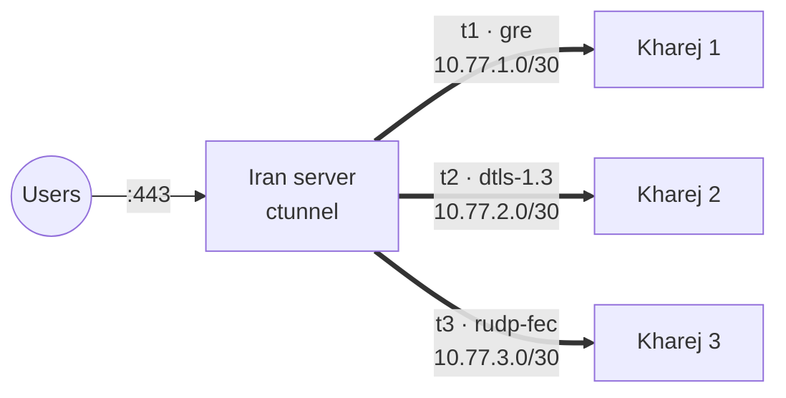

<p align="center">
  
</p>

<p align="center">
  <a href="https://github.com/CIAUB/C-Tunnel/releases/latest"></a>
  <a href="https://github.com/CIAUB/C-Tunnel/actions/workflows/ci.yml"></a>
  
  
  <a href="https://t.me/CiAUB_CH"></a>
</p>

<p align="center">
  <b>English</b> · <a href="README_FA.md">فارسی</a> · <a href="README_RU.md">Русский</a>
</p>

<p align="center">
  <a href="https://nowpayments.io/embeds/donation-widget?api_key=8373139c-0aec-4e38-b34c-88dd005cfc1c" target="_blank" rel="noreferrer noopener">
    
  </a>
</p>

<p align="center">
  Kernel tunnels and encrypted UDP transports between an Iran server and any number of kharej servers,<br>
  with port forwarding, one-line setup links, a terminal menu and a web panel.
</p>

<p align="center">
  
</p>

---

## Contents

- [How it works](#how-it-works)
- [Features](#features)
- [Requirements](#requirements)
- [Installation](#installation)
- [Quick start](#quick-start)
- [Choosing a method](#choosing-a-method)
- [All methods](#all-methods)
- [Web panel](#web-panel)
- [Command line](#command-line)
- [Files and services](#files-and-services)
- [Troubleshooting](#troubleshooting)
- [Building from source](#building-from-source)
- [License](#license)
- [Community](#community)

## How it works



1. On the Iran server you create a tunnel and get a one-line `ctunnel://` link.
2. You paste the link on the kharej server. Addresses, ports, keys and MTU on both sides now match.
3. Users connect to a port on the Iran server, and C-Tunnel forwards the traffic through the tunnel to the kharej server.

Every tunnel gets its own `10.77.N.0/30` subnet, network interface and UDP port, so you can add as many kharej servers as you need without conflicts.

## Features

| | |
|---|---|
| **28 methods** | Kernel L3 and L2 tunnels plus eight encrypted UDP transports |
| **One Iran, many kharej** | Subnets, ports and tunnel IDs are allocated automatically, and conflicts are refused |
| **Port forwarding** | `443`, or `2053=8443` to forward to a different port. Rules are tagged per tunnel and removed cleanly. |
| **Encryption** | AES-256-GCM with a separate key per direction, a 2000-packet anti-replay window and random padding |
| **Protocol look-alike** | Each UDP-Crypt method wraps packets in the header of the protocol it is named after |
| **Loss recovery** | `rudp-fec` adds one XOR parity packet per two data packets and rebuilds a lost packet without retransmission |
| **MikroTik** | Ready-to-paste RouterOS 7 commands for `gre`, `ipip`, `6to4`, `eoip`, `vxlan` and `wireguard` |
| **Web panel** | Dark responsive UI, HTTP by default, private base path, custom domain/TLS, live traffic, tunnel management and measured deployment |
| **Connection test** | Sends real GRE, IPIP, SIT, ESP, WireGuard, VXLAN, QUIC, DTLS… packets between the two servers, shows which methods pass or are blocked, measures speed and recommends the best one |
| **Persistent** | Every tunnel is a systemd unit, so it comes back after a reboot and is rebuilt cleanly on restart |

## Requirements

- Linux with systemd: Ubuntu 20.04+, Debian 11+ or similar
- `amd64` or `arm64`
- Root access
- A public IP on each server, plus the tunnel protocol or UDP port allowed by the provider

`install.sh` installs `iproute2`, `iptables` and `curl` if they are missing. WireGuard tunnels also need `wireguard-tools`.

## Installation

One command, on **both** servers:

```bash
sudo bash -c "$(curl -sL https://raw.githubusercontent.com/CIAUB/C-Tunnel/main/install.sh)"
```

The installer always installs the latest [release](https://github.com/CIAUB/C-Tunnel/releases/latest).
It downloads the binaries for the server's architecture, the kernel helper and the systemd units,
checks each file against the release's `SHA256SUMS`, and installs only if every hash matches.
A corrupt or modified download stops the install and nothing is changed.

```bash
sudo ctunnel
```

To update, choose **Update** in the menu or run the install command again. Running tunnels are kept.
To install a specific version, add `CTUNNEL_VERSION=v0.1.0` after `sudo`.

## Quick start

**1. Iran server**, once per kharej server:

```text
sudo ctunnel  →  1) Setup Iran
  Method              gre        (dtls-1.3 if GRE is filtered)
  Remote server IP    203.0.113.10
  Forward ports       443
```

The menu prints a setup link:

```text
ctunnel://eyJuYW1lIjoidDEiLCJyb2xlIjoia2hhcmVqIiwibWV0aG9kIjoiZ3JlIi...
```

**2. Kharej server:**

```text
sudo ctunnel  →  2) Setup Kharej  →  paste the link
```

or in one command:

```bash
sudo ctunnel apply-link 'ctunnel://...'
```

**3. Check it:**

```bash
sudo ctunnel status
```

```text
 NAME      METHOD       ROLE   REMOTE           TUNNEL IP      PORT   STATE    RX / TX
 t1        gre          iran   203.0.113.10     10.77.1.1      0      up       1.2 GiB / 310.4 MiB
 t2        dtls-1.3     iran   203.0.113.11     10.77.2.1      24002  up       842.7 MiB / 95.1 MiB
```

To add another kharej server, repeat step 1 with its IP. It gets `10.77.2.0/30`, the next free port and its own forwarded ports.

## Choosing a method

| Situation | Recommended |
|---|---|
| GRE / IPIP not filtered | `gre`, `6to4`, `ipip`: kernel speed, lowest CPU |
| Raw IP protocols filtered | `dtls-1.3`, `quic-v1`, `wireguard`, or `gre` with a FOU port |
| Lossy or unstable route | `rudp-fec` |
| Encryption at kernel speed | `xfrm-ipsec`, `wireguard` |
| MikroTik on the other side | `gre`, `ipip`, `eoip`, `vxlan`, `wireguard` |

Not sure? Run **0) Connection Test** on the Iran server first (it prints a `ctunnel-test://` link), then on the kharej server paste the link. A live table shows each method being tested. You get every method marked `ok`, `unstable` or `blocked`, the speed of every working method, the path MTU, the TCP speed and a recommended method with its MTU:

```text
RESULT  FAMILY     METHOD        STATUS    ECHOES  PROGRESS

🟢      L3-Direct  6to4          OK        10/10   ▰▰▰▰▰▰▰▰ 100%
🟢      UDP-Crypt  dtls-1.3      OK        10/10   ▰▰▰▰▰▰▰▰ 100%
🟡      UDP-Crypt  quic-v1       UNSTABLE  7/10    ▰▰▰▰▰▰▱▱  70%
🔴      L3-Direct  gre           BLOCKED   0/10    ▱▱▱▱▱▱▱▱   0%

Works steadily:

   METHOD        FAMILY     LATENCY          DOWNLOAD     UPLOAD       TOTAL
🟢 6to4          L3-Direct  42.1 ms ±0.8     1.12 Gbps    418.6 Mbps   1.54 Gbps
🟢 dtls-1.3      UDP-Crypt  42.3 ms ±0.9     1.05 Gbps    402.3 Mbps   1.45 Gbps

BEST SETTINGS
Method           6to4           42.1 ms ±0.8, 0% loss
Download         1.12 Gbps      6to4 packets at full rate for 1 s
Upload           418.6 Mbps     6to4 packets at full rate for 1 s
Path MTU         1500           full-size packets pass
Tunnel MTU       1440           path MTU minus 6to4 overhead
TCP download     1.18 Gbps      4 TCP streams, bytes confirmed by the receiver
TCP upload       431.0 Mbps     4 TCP streams, bytes confirmed by the receiver
```

During the test the Iran server needs UDP 7712, TCP 7711 and IP protocols 4, 41, 47, 50, 97 and 115 open.

### Reverse mode

In REVERSE mode the kharej server dials in and the iran server only listens, so iran never opens a connection to a foreign IP.

| Layer | How it travels | Best for |
|---|---|---|
| UDP-Crypt (`rev+dtls-1.3`, `rev+quic-v1`…) | kharej sends UDP to iran, same packets as DIRECT | lossy or high-latency links |
| WireGuard (`rev+wireguard`) | kharej is the WireGuard client | MikroTik and standard clients |
| Kernel L3/L2 (`frp+gre`, `frp+vxlan`…) | inside 8 parallel TCP streams that look like TLS records | clean links where only TCP gets through |

Every inner connection stays on one TCP stream, so it is never reordered, and each stream has its own queue. In our test this roughly doubled the speed of the TCP carrier compared with 0.1.5 (about 390 → 690 Mbit/s on an 800 Mbit/s link). The Connection Test measures every reverse option too: a `rev+` row for each UDP method and independent `frp+METHOD` rows with fresh TCP streams, method-specific payloads, verified echoes and separate speeds for every supported FRP-style option. These are carrier/encapsulation shape tests, not kernel tunnel integration tests. Best Settings names the fastest reverse option.

## All methods

<details>
<summary><b>L3 kernel</b>: 13 methods</summary>

| Method | Description |
|---|---|
| `gre` | GRE (IP protocol 47), optional FOU and parallel lanes |
| `ipip` | IPv4-in-IPv4 (protocol 4), optional FOU |
| `6to4` | SIT carrier with IPIP6 inside |
| `6to4-gre` | SIT carrier with IP6GRE inside |
| `sit` | IPv6-in-IPv4; carries IPv6 only |
| `ip6gre` | GRE over an IPv6 underlay |
| `ipip6` | IPv4 over an IPv6 underlay |
| `ip6ip6` | IPv6 over IPv6; carries IPv6 only |
| `wireguard` | Kernel WireGuard; keys are derived from the setup link |
| `xfrm-ipsec` | GRE encrypted with kernel IPsec ESP (AES-GCM-256) |
| `fou-gre` | GRE inside UDP |
| `gue-ipip` | IPIP inside GUE/UDP |
| `ecmp-lanes` | 2 to 8 parallel keyed GRE tunnels with ECMP |

</details>

<details>
<summary><b>L2</b>: 7 methods</summary>

| Method | Description |
|---|---|
| `eoip` | MikroTik EoIP over raw GRE, compatible with RouterOS |
| `gretap` | Ethernet over GRE |
| `ip6gretap` | Ethernet over IPv6 GRE |
| `vxlan` | Ethernet over UDP (4789) |
| `geneve` | Ethernet over UDP (6081) |
| `l2tpv3` | Static L2TPv3 pseudowire over IP or UDP |
| `etherip` | EtherIP, RFC 3378 (protocol 97) |

</details>

<details>
<summary><b>UDP-Crypt</b>: 8 methods, AES-256-GCM</summary>

| Method | Packets look like |
|---|---|
| `dtls-1.3` | DTLS application data records |
| `quic-v1` | QUIC short-header packets |
| `srtp-direct` | RTP / SRTP media |
| `wg-stealth` | Random per-key header, with a junk burst at start |
| `rudp-fec` | Grouped datagrams with 2+1 XOR parity |
| `dnscrypt-udp` | DNS responses |
| `ntp-direct` | NTPv4 server packets |
| `openvpn-dco` | OpenVPN `P_DATA_V2` |

</details>

## Web panel

Open `sudo ctunnel` → **4) Web Panel** → **Start** and use the exact URL printed by the menu. Initial startup uses HTTP with a persisted random path:

```text
http://<server-ip>:8443/panel-<random-id>/
```

Log in with the code shown in the same menu. Five wrong codes block that IP for five minutes. The terminal menu can change the port or rotate the code; rotation logs out existing sessions.

In **Settings → Panel settings**, customize the base path and domain. Set the paths to a valid `fullchain.pem` and matching `privkey.pem`, or upload the pair over HTTPS/loopback. A valid pair enables HTTPS automatically after a graceful listener reload. Domain DNS must already point to the server, and the panel port must be reachable. A changed address or transport requires logging in again.

**Link test** accepts the peer's `ctunnel-test://` link, measures methods separately, and offers **Deploy Best Tunnel** for a successful measured result. Deployment creates this endpoint and returns a setup link to apply on the peer. Carrier-shape tests do not replace real kernel tunnel checks.

The screenshots use synthetic demonstration data and are generated from the actual UI with Chromium. See [mobile](docs/panel-mobile.png), [settings](docs/panel-settings.png), and [0.2.1 changes and upgrade notes](CHANGELOG.md).


## Command line

| Command | Description |
|---|---|
| `ctunnel` | Interactive menu |
| `ctunnel status` | Tunnels with state and traffic |
| `ctunnel up\|restart\|down NAME` | Control one tunnel |
| `ctunnel link NAME` | Setup link and MikroTik commands for the other side |
| `ctunnel apply-link 'ctunnel://…'` | Create and start a tunnel from a link |
| `ctunnel conntest-server` | Iran side of the connection test, prints a link |
| `ctunnel conntest 'ctunnel-test://…'` | Kharej side: which methods pass, speed, recommendation |
| `ctunnel linktest HOST` | Latency, loss and throughput to HOST, e.g. a tunnel IP |
| `ctunnel speedtest-server` | Responder for `linktest` (TCP 7711) |
| `ctunnel optimize` | BBR + fq, 64 MB socket buffers, IP forwarding |
| `ctunnel restart-all` | Restart every tunnel (Manage → Auto Refresh runs this from cron) |
| `ctunnel proxy-serve` | The built-in SOCKS5/HTTP proxy (Manage → Built-in Proxy sets it up) |
| `ctunnel panel` | Run the web panel in the foreground |
| `ctunnel catalog` | List all methods |
| `ctunnel version` | Show the version |

## Files and services

| Path | Purpose |
|---|---|
| `/etc/ctunnel/state.json` | Tunnels, panel port and login code |
| `/etc/ctunnel/panel.json` | Persisted panel base path, domain and certificate paths |
| `/etc/ctunnel/tunnels/NAME.env` | Settings of one tunnel |
| `/usr/local/lib/ctunnel/ctunnel-kernel` | Builds interfaces, port forwards and IPsec |
| `ctunnel@NAME.service` | Kernel tunnels |
| `ctunnel-engine@NAME.service` | UDP-Crypt, EoIP and EtherIP |
| `ctunnel-panel.service` | Web panel |

Logs:

```bash
journalctl -u ctunnel@t1 -u ctunnel-engine@t1 -n 50
```

## Troubleshooting

| Symptom | Cause and fix |
|---|---|
| State `failed` | Read the log above. Usually a missing kernel module (`modprobe ip_gre`) or a protocol blocked by the provider. |
| State `up`, no traffic | The other side is not configured, or a firewall drops the tunnel. Open the UDP port for UDP-Crypt and WireGuard, or protocol 47 for GRE. |
| UDP-Crypt drops packets after a restart | Both servers need roughly correct time (NTP), because sequence numbers start from the clock. |
| Forwarded port does not answer | The service on the kharej server must listen on `0.0.0.0` or on the tunnel IP. |
| `sit` / `ip6ip6` cannot forward ports | These carry IPv6 only. Use `6to4` instead. |

## Building from source

```bash
git clone https://github.com/CIAUB/C-Tunnel.git
cd C-Tunnel
go test ./...
sudo bash install.sh                  # build and install from this checkout
bash scripts/build-release.sh 0.1.0   # release assets and SHA256SUMS in dist/
```

**Publishing a release:** set the version in `pkg/version/version.go`, commit, then push a tag
(`git tag v0.1.1 && git push origin v0.1.1`). GitHub Actions runs the tests, builds all assets with
`SHA256SUMS` and publishes the release; the install command picks it up immediately.
[docs/ARCHITECTURE.md](docs/ARCHITECTURE.md) explains how the pieces fit together.

> The UDP-Crypt methods make packets look like DTLS, QUIC, RTP and the others to simple filters. They are not full implementations of those protocols.

## License

C-Tunnel is free software under [AGPL-3.0](LICENSE). See [NOTICE](NOTICE) for the attribution and trademark terms.

The Manage menu (tunnels, status, health check, exit health, metrics, auto refresh, built-in proxy, file locations) is taken from BackPack:
**Based on BackPack by Amin Mohammadi (AminMGMT)** — https://github.com/AminMGMT/BackPack

## Community

- News, releases and support: Telegram channel [@CiAUB_CH](https://t.me/CiAUB_CH)
- Bugs and feature requests: [GitHub Issues](https://github.com/CIAUB/C-Tunnel/issues)

<p align="center">
  
</p>
