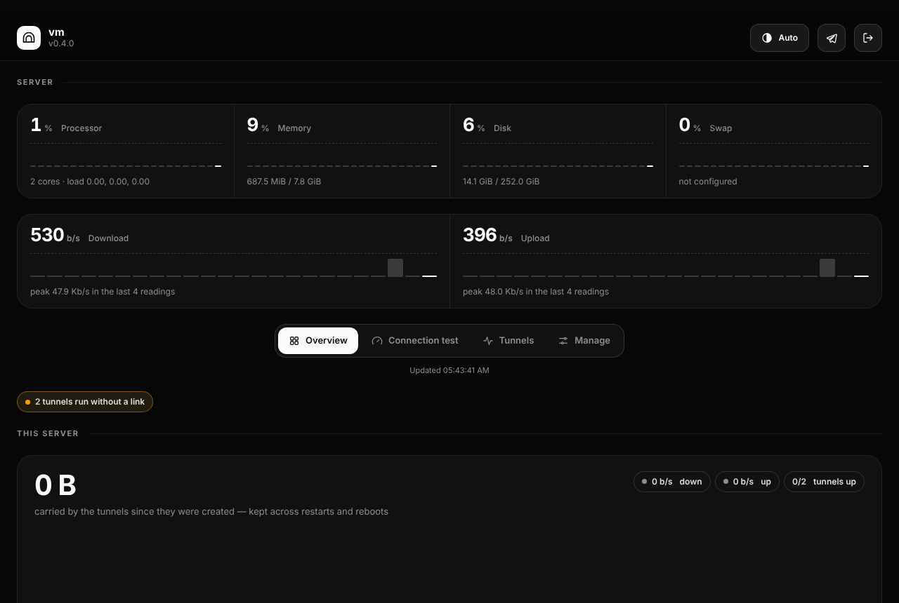
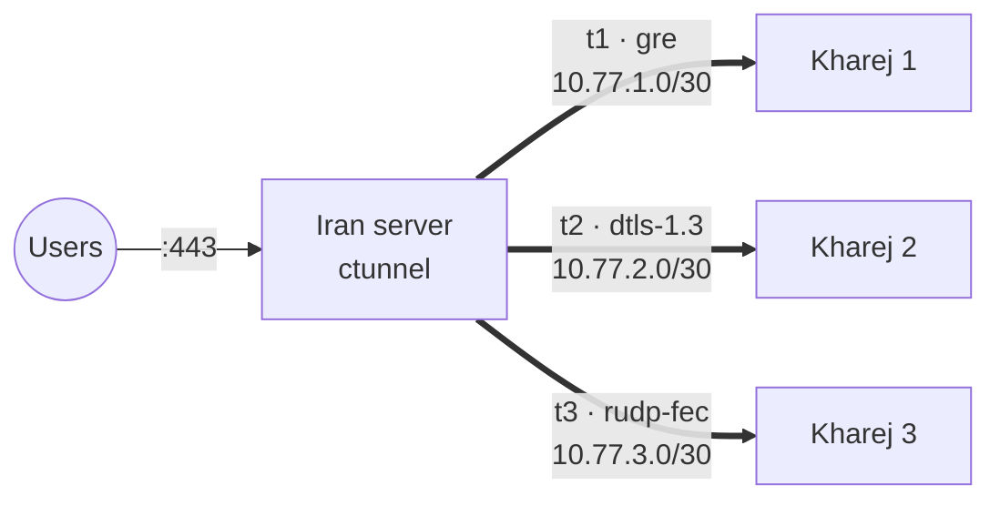

<p align="center">
  
</p>

<p align="center">
  <a href="https://github.com/CIAUB/C-Tunnel/releases/latest"></a>
  <a href="https://github.com/CIAUB/C-Tunnel/actions/workflows/ci.yml"></a>
  
  
  <a href="https://t.me/CiAUB_CH"></a>
</p>

<p align="center">
  <b>English</b> · <a href="README_FA.md">فارسی</a> · <a href="README_RU.md">Русский</a>
</p>

<p align="center">
  <a href="https://nowpayments.io/embeds/donation-widget?api_key=8373139c-0aec-4e38-b34c-88dd005cfc1c" target="_blank" rel="noreferrer noopener">
    
  </a>
</p>

<p align="center">
  Kernel tunnels and encrypted UDP transports between an Iran server and any number of kharej servers,<br>
  with port forwarding, one-line setup links, a terminal menu and a web panel.
</p>

<p align="center">
  
</p>

---

## Contents

- [How it works](#how-it-works)
- [Features](#features)
- [Requirements](#requirements)
- [Installation](#installation)
- [Quick start](#quick-start)
- [Choosing a method](#choosing-a-method)
- [All methods](#all-methods)
- [Web panel](#web-panel)
- [Command line](#command-line)
- [Files and services](#files-and-services)
- [Troubleshooting](#troubleshooting)
- [Building from source](#building-from-source)
- [License](#license)
- [Community](#community)

## How it works



1. On the Iran server you create a tunnel and get a one-line `ctunnel://` link.
2. You paste the link on the kharej server. Addresses, ports, keys and MTU on both sides now match.
3. Users connect to a port on the Iran server, and C-Tunnel forwards the traffic through the tunnel to the kharej server.

Every tunnel gets its own `10.77.N.0/30` subnet, network interface and UDP port, so you can add as many kharej servers as you need without conflicts.

## Features

| | |
|---|---|
| **43 methods** | Kernel L3 and L2 tunnels, eleven encrypted UDP transports, two Stealth carriers and nine layer-4 reverse transports |
| **One Iran, many kharej** | Subnets, ports and tunnel IDs are allocated automatically, and conflicts are refused |
| **Port forwarding** | `443`, or `2053=8443` to forward to a different port. Rules are tagged per tunnel and removed cleanly. |
| **Encryption** | AES-256-GCM with a separate key per direction, a 2000-packet anti-replay window and random padding |
| **Protocol look-alike** | Each UDP-Crypt method wraps packets in the header of the protocol it is named after |
| **Loss recovery** | `rudp-fec` adds one XOR parity packet per two data packets and rebuilds a lost packet without retransmission |
| **MikroTik** | Ready-to-paste RouterOS 7 commands for `gre`, `ipip`, `6to4`, `eoip`, `vxlan` and `wireguard` |
| **Web panel** | Dark responsive UI, HTTP by default, private base path, custom domain/TLS, live traffic, tunnel management and measured deployment |
| **Connection test** | Sends real GRE, IPIP, SIT, ESP, WireGuard, VXLAN, QUIC, DTLS… packets between the two servers and runs a real tunnel for each layer-4 method, shows which methods pass or are blocked, measures speed and recommends the best one |
| **Telegram alerts** | The Kharej servers report a tunnel down or back up, a failover switch, a restart or update, and a daily traffic report; each alert can be turned on or off in the panel or with the bot's buttons |
| **One-click update** | Manage → Update now installs the latest release from the panel and shows the log |
| **Persistent** | Every tunnel is a systemd unit, so it comes back after a reboot and is rebuilt cleanly on restart |

## Requirements

- Linux with systemd: Ubuntu 20.04+, Debian 11+ or similar
- `amd64`, `arm64` or `armv7` (32-bit ARM)
- Root access
- A public IP on each server, plus the tunnel protocol or UDP port allowed by the provider

`install.sh` installs `iproute2`, `iptables` and `curl` if they are missing. WireGuard tunnels also need `wireguard-tools`.

## Installation

One command, on **both** servers:

```bash
sudo bash -c "$(curl -sL https://raw.githubusercontent.com/CIAUB/C-Tunnel/main/install.sh)"
```

The installer always installs the latest [release](https://github.com/CIAUB/C-Tunnel/releases/latest).
It downloads the binaries for the server's architecture, the kernel helper and the systemd units,
checks each file against the release's `SHA256SUMS`, and installs only if every hash matches.
A corrupt or modified download stops the install and nothing is changed.

```bash
sudo ctunnel
```

To update, choose **Update** in the menu or run the install command again. Running tunnels are kept.
Without a version, the installer selects the latest stable GitHub release and excludes drafts and pre-releases. To install a specific version:

```bash
sudo bash -c "$(curl -sL https://raw.githubusercontent.com/CIAUB/C-Tunnel/main/install.sh)" v0.2.1
```

`bash install.sh v0.2.1` and `CTUNNEL_VERSION=v0.2.1` are also supported. An explicit version argument takes precedence over the environment variable.

## Quick start

**1. Iran server**, once per kharej server:

```text
sudo ctunnel  →  1) Setup Iran
  Method              gre        (dtls-1.3 if GRE is filtered)
  Remote server IP    203.0.113.10
  Forward ports       443
```

The menu prints a setup link:

```text
ctunnel://eyJuYW1lIjoidDEiLCJyb2xlIjoia2hhcmVqIiwibWV0aG9kIjoiZ3JlIi...
```

**2. Kharej server:**

```text
sudo ctunnel  →  2) Setup Kharej  →  paste the link
```

or in one command:

```bash
sudo ctunnel apply-link 'ctunnel://...'
```

**3. Check it:**

```bash
sudo ctunnel status
```

```text
 NAME      METHOD       ROLE   REMOTE           TUNNEL IP      PORT   STATE    RX / TX
 t1        gre          iran   203.0.113.10     10.77.1.1      0      up       1.2 GiB / 310.4 MiB
 t2        dtls-1.3     iran   203.0.113.11     10.77.2.1      24002  up       842.7 MiB / 95.1 MiB
```

To add another kharej server, repeat step 1 with its IP. It gets `10.77.2.0/30`, the next free port and its own forwarded ports.

## Choosing a method

| Situation | Recommended |
|---|---|
| GRE / IPIP not filtered | `gre`, `6to4`, `ipip`: kernel speed, lowest CPU |
| Raw IP protocols filtered | `dtls-1.3`, `quic-v1`, `wireguard`, or `gre` with a FOU port |
| Lossy or unstable route | `rudp-fec`, or `udpmux` for port forwarding |
| GRE / IPIP filtered, plain UDP passes, no encryption needed | `bareudp` |
| Video calls pass while other UDP is shaped | `stun-turn` |
| IPsec VPN traffic passes | `esp-udp` |
| UDP 2152 (mobile core) left alone | `gtp-u` |
| UDP blocked, TCP open | `faketcp` |
| Only ping gets through | `icmp` |
| Encryption at kernel speed | `xfrm-ipsec`, `wireguard` |
| MikroTik on the other side | `gre`, `ipip`, `eoip`, `vxlan`, `wireguard` |

Not sure? Run **0) Connection Test** on the Iran server first (it prints a `ctunnel-test://` link), then on the kharej server paste the link. A live table shows each method being tested. You get every method marked `ok`, `unstable` or `blocked`, the speed of every working method, the path MTU, the TCP speed and a recommended method with its MTU:

```text
RESULT  FAMILY     METHOD        STATUS    ECHOES  PROGRESS

🟢      L3-Direct  6to4          OK        10/10   ▰▰▰▰▰▰▰▰ 100%
🟢      UDP-Crypt  dtls-1.3      OK        10/10   ▰▰▰▰▰▰▰▰ 100%
🟡      UDP-Crypt  quic-v1       UNSTABLE  7/10    ▰▰▰▰▰▰▱▱  70%
🔴      L3-Direct  gre           BLOCKED   0/10    ▱▱▱▱▱▱▱▱   0%

Works steadily:

   METHOD        FAMILY     LATENCY          DOWNLOAD     UPLOAD       TOTAL
🟢 6to4          L3-Direct  42.1 ms ±0.8     1.12 Gbps    418.6 Mbps   1.54 Gbps
🟢 dtls-1.3      UDP-Crypt  42.3 ms ±0.9     1.05 Gbps    402.3 Mbps   1.45 Gbps

BEST SETTINGS
Method           6to4           42.1 ms ±0.8, 0% loss
Download         1.12 Gbps      6to4 packets at full rate for 1 s
Upload           418.6 Mbps     6to4 packets at full rate for 1 s
Path MTU         1500           full-size packets pass
Tunnel MTU       1440           path MTU minus 6to4 overhead
TCP download     1.18 Gbps      4 TCP streams, bytes confirmed by the receiver
TCP upload       431.0 Mbps     4 TCP streams, bytes confirmed by the receiver
```

During the test the Iran server needs UDP 7712, TCP 7711 and IP protocols 4, 41, 47, 50, 97 and 115 open.

### Reverse mode

In REVERSE mode the kharej server dials in and the iran server only listens, so iran never opens a connection to a foreign IP.

| Layer | How it travels | Best for |
|---|---|---|
| UDP-Crypt (`rev+dtls-1.3`, `rev+quic-v1`…) | kharej sends UDP to iran, same packets as DIRECT | lossy or high-latency links |
| WireGuard (`rev+wireguard`) | kharej is the WireGuard client | MikroTik and standard clients |
| Kernel L3/L2 (`frp+gre`, `frp+vxlan`…) | inside 8 parallel TCP streams that look like TLS records | clean links where only TCP gets through |
| Layer 4 (`tcp`, `tcpmux`, `pck`, `ws`, `wsmux`, `wss`, `wssmux`, `udp`, `udpmux`) | port forwarding as in BackPack: each user connection or UDP flow has its own stream, no tunnel IP | TCP services (VLESS, Trojan…) without TCP-in-TCP, links that pass only WebSocket or TLS, and lossy links (`udp`, `udpmux`) |

Every inner connection stays on one TCP stream, so it is never reordered, and each stream has its own queue. In our test this roughly doubled the speed of the TCP carrier compared with 0.1.5 (about 390 → 690 Mbit/s on an 800 Mbit/s link). The Connection Test measures every reverse option too: a `rev+` row for each UDP method and independent `frp+METHOD` rows with fresh TCP streams, method-specific payloads, verified echoes and separate speeds for every supported FRP-style option. These are carrier/encapsulation shape tests, not kernel tunnel integration tests. Best Settings names the fastest reverse option.

### Stealth methods

Two layer-3 tunnels encrypted like UDP-Crypt (AES-256-GCM, a key per direction, random padding) whose packets do not travel as UDP. They work in DIRECT mode (Iran sends first) and in REVERSE mode (Kharej sends first).

| Method | Between the servers | Use when |
|---|---|---|
| `faketcp` | TLS records inside TCP segments built by hand and read through a packet socket (the `pck` carrier from BackPack). Middleboxes see one TCP connection with consistent sequence numbers; nothing is retransmitted inside it, so there is no TCP-in-TCP and the tunnel runs at UDP speed | UDP is blocked or shaped and TCP is not |
| `icmp` | ICMP echo: requests one way, replies the other, with an identifier from the secret. The answering server's kernel would reply to each request itself; an iptables rule drops those replies and keeps the tunnel's own | only ping gets through |

`faketcp` and `icmp` need root and iptables, as `pck` does. `icmp` has no port. The connection test pings the Iran server with tunnel-sized echo requests for `icmp`, and gives `faketcp` the result of the `pck` carrier it rides on.

### New look-alikes and BareUDP

`stun-turn`, `gtp-u` and `esp-udp` are UDP-Crypt methods: the same encryption and padding, with the header of TURN ChannelData (WebRTC call relays), GTP-U G-PDU (the mobile core's user plane) or ESP in UDP (IPsec VPNs behind NAT). The first tunnel of each takes the real protocol's port, 3478, 2152 or 4500, when it is free; later ones take a port from the usual range. As with the other UDP-Crypt methods, only the header looks like the protocol; a filter that follows the whole exchange can tell them apart.

`bareudp` is a kernel tunnel that puts IPv4 packets straight into UDP, with no header and no encryption, for links where GRE and IPIP are filtered and plain UDP passes. It needs Linux 5.7 or later with the `bareudp` module and takes port 6635 when it is free. A bareudp device takes UDP from any address, so an iptables rule lets only the other server reach its port.

### Layer-4 reverse tunnels

The Reverse-L4 methods follow BackPack's reverse engine. The Iran server listens on the tunnel port and on every forwarded port, TCP and UDP. The Kharej server dials out to the tunnel port and sends each user connection to the target port on its own 127.0.0.1. There is no tunnel interface or tunnel IP, so the tunnel benchmark does not apply to them. Failover does, to another layer-4 method: a tunnel is up while the Kharej server holds a connection to the Iran server. The connection test starts a real tunnel of each method on the Iran server's layer-4 test port (TCP and UDP 7714 from the terminal menu, or the next free port if it is taken; the menu prints the ports to open) and measures through it.

| Method | Between the servers |
|---|---|
| `tcp` | one TCP connection per user connection, from a pool of 16 the Kharej server keeps open |
| `tcpmux` | smux streams over 4 TCP connections |
| `pck` | smux streams over KCP inside TCP segments built by hand through a packet socket (no kernel TCP state on either side); AES-encrypted |
| `ws` | as `tcp`, each connection a WebSocket |
| `wsmux` | as `tcpmux`, over WebSockets |
| `wss` | as `ws`, inside TLS |
| `wssmux` | as `wsmux`, inside TLS |
| `udp` | one KCP session over UDP per user connection, from a pool of 16; AES-encrypted. KCP resends lost packets itself, so a lossy link costs less than with TCP |
| `udpmux` | smux streams over 2 KCP sessions over UDP; AES-encrypted |

Both servers prove they know the tunnel secret when each connection opens. Past that, `tcp` and `ws` carry the users' bytes unchanged, as in BackPack; use `wss`, `wssmux`, `pck`, `udp` or `udpmux` when the link between the servers must be encrypted. `udp` and `udpmux` need the tunnel port open for UDP on the Iran server. The WebSocket methods take an optional Host / SNI. On the Kharej server a tunnel can be added from the setup link or by hand with the Iran server's IP, the method, the tunnel port and the secret.

Between two network namespaces on 2 CPUs (iperf3, one TCP flow through a forwarded port): `tcp` about 12.7 Gbps, `ws` 10.8, `tcpmux` 7.6, `wsmux` 6.9, `wss` 6.6, `wssmux` 4.4 and `pck` 0.8 Gbps.

Over a simulated long path (500 Mbit/s, 100 ms round trip, 0.3% loss each way; iperf3, one flow): `tcp`, `ws` and `wss` about 425 Mbit/s, `tcpmux` 373, `wsmux` 397, `wssmux` 359, `pck` 185, `udp` 188 and `udpmux` 188 (about 300 with four flows). Since KCP sends its acks once per 10 ms tick, `udp`, `udpmux` and `pck` run 1.6 to 2.5 times faster between namespaces, about 25% faster at 50 ms and 10-20% faster at 150 ms. The layer-3 methods on the same path, upload: `faketcp` 370, `icmp` 377, `stun-turn` 323, `gtp-u` 311 and `esp-udp` 307 Mbit/s, against 317 for `quic-v1`.

## All methods

<details>
<summary><b>L3 kernel</b>: 14 methods</summary>

| Method | Description |
|---|---|
| `gre` | GRE (IP protocol 47), optional FOU and parallel lanes |
| `ipip` | IPv4-in-IPv4 (protocol 4), optional FOU |
| `6to4` | SIT carrier with IPIP6 inside |
| `6to4-gre` | SIT carrier with IP6GRE inside |
| `sit` | IPv6-in-IPv4; carries IPv6 only |
| `ip6gre` | GRE over an IPv6 underlay |
| `ipip6` | IPv4 over an IPv6 underlay |
| `ip6ip6` | IPv6 over IPv6; carries IPv6 only |
| `wireguard` | Kernel WireGuard; keys are derived from the setup link |
| `xfrm-ipsec` | GRE encrypted with kernel IPsec ESP (AES-GCM-256) |
| `fou-gre` | GRE inside UDP |
| `gue-ipip` | IPIP inside GUE/UDP |
| `ecmp-lanes` | 2 to 8 parallel keyed GRE tunnels with ECMP |
| `bareudp` | IPv4 straight inside UDP (6635), no header; Linux 5.7+ |

</details>

<details>
<summary><b>L2</b>: 7 methods</summary>

| Method | Description |
|---|---|
| `eoip` | MikroTik EoIP over raw GRE, compatible with RouterOS |
| `gretap` | Ethernet over GRE |
| `ip6gretap` | Ethernet over IPv6 GRE |
| `vxlan` | Ethernet over UDP (4789) |
| `geneve` | Ethernet over UDP (6081) |
| `l2tpv3` | Static L2TPv3 pseudowire over IP or UDP |
| `etherip` | EtherIP, RFC 3378 (protocol 97) |

</details>

<details>
<summary><b>UDP-Crypt</b>: 11 methods, AES-256-GCM</summary>

| Method | Packets look like |
|---|---|
| `dtls-1.3` | DTLS application data records |
| `quic-v1` | QUIC short-header packets |
| `srtp-direct` | RTP / SRTP media |
| `wg-stealth` | Random per-key header, with a junk burst at start |
| `rudp-fec` | Grouped datagrams with 2+1 XOR parity |
| `dnscrypt-udp` | DNS responses |
| `ntp-direct` | NTPv4 server packets |
| `openvpn-dco` | OpenVPN `P_DATA_V2` |
| `stun-turn` | TURN ChannelData, as WebRTC call relays send (3478) |
| `gtp-u` | GTP-U G-PDU, the mobile core's user plane (2152) |
| `esp-udp` | IPsec ESP in UDP, as NAT-T sends it (4500) |

</details>

<details>
<summary><b>Stealth</b>: 2 methods, AES-256-GCM</summary>

| Method | Packets travel as |
|---|---|
| `faketcp` | TLS records in hand-built TCP segments (no TCP state, no retransmission) |
| `icmp` | ICMP echo requests and replies |

</details>

<details>
<summary><b>Reverse-L4</b>: 9 methods, port forwarding</summary>

| Method | Description |
|---|---|
| `tcp` | TCP, a pooled connection per user connection |
| `tcpmux` | TCP + MUX |
| `pck` | TCP + PCK: KCP in hand-built TCP segments, raw socket |
| `ws` | WebSocket |
| `wsmux` | WebSocket + MUX |
| `wss` | WebSocket in TLS |
| `wssmux` | WebSocket in TLS + MUX |
| `udp` | UDP: a KCP session per user connection, AES |
| `udpmux` | UDP + MUX: streams over a few KCP sessions, AES |

</details>

## Web panel

Open `sudo ctunnel` → **4) Web Panel** → **Start** and use the exact URL printed by the menu. Initial startup uses HTTP with a persisted random path:

```text
http://<server-ip>:6969/panel-<random-id>/
```

Log in with the code shown in the same menu. Five wrong codes block that IP for five minutes. The terminal menu can change the port or rotate the code; rotation logs out existing sessions.

The panel has four sections in the dock — **Overview**, **Connection test**, **Tunnels** and **Manage** — and every screen has its own address (`#/tunnels`, `#/t/<name>/logs`, `#/health`…), so a screen can be bookmarked or reloaded.

- **Tunnels**: each card shows its state, live rate and history, and has Start/Stop, Restart, Live log, Setup link, Edit and Delete.
- **Live log**: the tunnel's journal, coloured by level, filterable, following new lines.
- **Manage**: health check (the same checks as the CLI, with a fix for each problem), tunnel benchmark, auto restart, built-in proxy, Telegram alerts, kernel tuning, restart all, backup download and restore, panel settings, update check and Update now.
- **Update now**: runs the installer for the latest release in a systemd unit of its own (`ctunnel-update`), so the update finishes even though it restarts the panel; the dialog follows `/var/log/ctunnel-update.log` until it reports the result.
- **Tunnel benchmark**: download, upload, ping, jitter and loss of every running tunnel, measured through the tunnel one at a time, with the fastest marked. The other server answers through `ctunnel-agent` (C-Tunnel 1.0 or newer).
- **Auto restart**: restart every tunnel every 1-48 hours, shown on a 24-hour dial with a countdown. It is the same schedule as **Manage → Auto Refresh** in the terminal menu.
- **Built-in proxy**: turn the SOCKS5 or HTTP proxy on, with or without a login, and see the forward to make on the Iran server.
- **Appearance**: Auto, Dark or Light, in Mono or one of six colours (Ocean, Emerald, Violet, Amber, Rose, Red), kept in the browser.
- **Backup**: one JSON file with every tunnel's settings and secret token. Restore adds the tunnels a server does not have and starts them. Keep the file private.

### Failover

A tunnel can have a **backup method** (tunnel form, or a setup link from a server that has one). `ctunnel-agent` on both servers pings the other end through the tunnel. When it gets no answer for 45 seconds, both servers switch to the method the clock picks for that two-minute window, so they meet on the same method without contacting each other. At the top of every hour a tunnel on its backup tries its primary again, and goes back within a minute if the primary still does not answer. Both servers need roughly correct time (NTP). Editing a tunnel puts it back on its primary method; a stopped tunnel is never switched. The card and the health check show which method runs. A layer-4 tunnel takes a layer-4 backup, and counts as down when the Kharej server holds no connection to the Iran server.

### Telegram alerts

Only the Kharej servers send, since Telegram is filtered in Iran. In **Manage → Telegram alerts** give a bot token from @BotFather and the chat ID (send `/start` to the bot to learn it), then **Send test**. Alerts: tunnel down for 45 seconds and back up, failover switch, restart or update (with the reason), and a daily report of each tunnel's state and traffic at a chosen time. `ctunnel-agent` sends them and answers the bot, only in the configured chat: `/status`, `/report` and `/settings`, whose buttons turn each alert on or off as the panel does. Settings are in `/etc/ctunnel/telegram.json`; the token is never shown again in the panel. Several Kharej servers can send alerts through one bot, but Telegram lets only one of them read the bot's messages, so give each server its own bot if each should answer the buttons.

### Built-in proxy through a tunnel

The proxy listens on 127.0.0.1 and on the tunnel IP of every tunnel on the server, never on its public address. On the Iran server forward the proxy's port through the tunnel, the same number on both ends for SOCKS5 UDP: for a proxy on port 10800 use `10800` or `10800=10800`. In `A=B` the first port is Iran's and the second is the Kharej server's.

Traffic totals on the cards and in the CLI count from when the tunnel was created and survive restarts and reboots. New tunnels are named `ir-<port>` on Iran and `kh-<port>` on Kharej unless you give a name.

To try the panel on a desktop without touching its network, run `go run ./cmd/ctunnel-local` (Windows, macOS or Linux) and open `http://127.0.0.1:6969/ctunnel-local/` with login code `ctunnel-test`. Its tunnels are simulated.

In **Manage → Panel settings**, customize the base path and domain. Set the paths to a valid `fullchain.pem` and matching `privkey.pem`, or upload the pair over HTTPS/loopback. A valid pair enables HTTPS automatically after a graceful listener reload. Domain DNS must already point to the server, and the panel port must be reachable. A changed address or transport requires logging in again.

**Connection test** accepts the peer's `ctunnel-test://` link, measures methods separately, and offers **Deploy Best Tunnel** for a successful measured result. Deployment creates this endpoint and returns a setup link to apply on the peer. Carrier-shape tests do not replace real kernel tunnel checks.

The screenshots use synthetic demonstration data and are generated from the actual UI with Chromium. See [mobile](docs/panel-mobile.png), [settings](docs/panel-settings.png), and [changes and upgrade notes](CHANGELOG.md).


## Command line

| Command | Description |
|---|---|
| `ctunnel` | Interactive menu |
| `ctunnel status` | Tunnels with state and traffic |
| `ctunnel up\|restart\|down NAME` | Control one tunnel |
| `ctunnel link NAME` | Setup link and MikroTik commands for the other side |
| `ctunnel apply-link 'ctunnel://…'` | Create and start a tunnel from a link |
| `ctunnel conntest-server` | Iran side of the connection test, prints a link |
| `ctunnel conntest 'ctunnel-test://…'` | Kharej side: which methods pass, speed, recommendation |
| `ctunnel linktest HOST` | Latency, loss and throughput to HOST, e.g. a tunnel IP |
| `ctunnel speedtest-server` | Responder for `linktest` (TCP 7711) |
| `ctunnel optimize` | BBR + fq, 64 MB socket buffers, IP forwarding |
| `ctunnel restart-all` | Restart every tunnel (Manage → Auto Refresh runs this from cron) |
| `ctunnel proxy-serve` | The built-in SOCKS5/HTTP proxy (Manage → Built-in Proxy sets it up) |
| `ctunnel agent` | Failover and the tunnel benchmark responder (`ctunnel-agent.service` runs it) |
| `ctunnel panel` | Run the web panel in the foreground |
| `ctunnel catalog` | List all methods |
| `ctunnel version` | Show the version |

## Files and services

| Path | Purpose |
|---|---|
| `/etc/ctunnel/state.json` | Tunnels, panel port and login code |
| `/etc/ctunnel/panel.json` | Persisted panel base path, domain and certificate paths |
| `/etc/ctunnel/tunnels/NAME.env` | Settings of one tunnel |
| `/usr/local/lib/ctunnel/ctunnel-kernel` | Builds interfaces, port forwards and IPsec |
| `ctunnel@NAME.service` | Kernel tunnels |
| `ctunnel-engine@NAME.service` | UDP-Crypt, EoIP and EtherIP |
| `ctunnel-panel.service` | Web panel |
| `ctunnel-agent.service` | Failover and the tunnel benchmark responder (TCP 7719 on the tunnel IPs) |
| `/etc/ctunnel/failover/NAME` | Present while the tunnel runs on its backup method |
| `/etc/ctunnel/telegram.json` | Telegram alert settings (bot token, chat ID, alerts) |
| `/var/log/ctunnel-update.log` | Log of the last update started from the panel |

Logs:

```bash
journalctl -u ctunnel@t1 -u ctunnel-engine@t1 -n 50
```

## Troubleshooting

| Symptom | Cause and fix |
|---|---|
| State `failed` | Read the log above. Usually a missing kernel module (`modprobe ip_gre`) or a protocol blocked by the provider. |
| State `up`, no traffic | The other side is not configured, or a firewall drops the tunnel. Open the UDP port for UDP-Crypt and WireGuard, or protocol 47 for GRE. |
| UDP-Crypt drops packets after a restart | Both servers need roughly correct time (NTP), because sequence numbers start from the clock. |
| Forwarded port does not answer | The service on the kharej server must listen on `0.0.0.0` or on the tunnel IP. |
| `sit` / `ip6ip6` cannot forward ports | These carry IPv6 only. Use `6to4` instead. |

## Building from source

```bash
git clone https://github.com/CIAUB/C-Tunnel.git
cd C-Tunnel
go test ./...
sudo bash install.sh                  # build and install from this checkout
bash scripts/build-release.sh 0.1.0   # release assets and SHA256SUMS in dist/
```

**Publishing a release:** set the version in `pkg/version/version.go`, commit, then push a tag
(`git tag v0.1.1 && git push origin v0.1.1`). GitHub Actions runs the tests, builds all assets with
`SHA256SUMS` and publishes the release; the install command picks it up immediately.
[docs/ARCHITECTURE.md](docs/ARCHITECTURE.md) explains how the pieces fit together.

> The UDP-Crypt methods make packets look like DTLS, QUIC, RTP and the others to simple filters. They are not full implementations of those protocols.

## License

C-Tunnel is free software under [AGPL-3.0](LICENSE). See [NOTICE](NOTICE) for the attribution and trademark terms.

The Manage menu (tunnels, status, health check, exit health, metrics, auto refresh, built-in proxy, file locations) is taken from BackPack:
**Based on BackPack by Amin Mohammadi (AminMGMT)** — https://github.com/AminMGMT/BackPack

## Community

- News, releases and support: Telegram channel [@CiAUB_CH](https://t.me/CiAUB_CH)
- Bugs and feature requests: [GitHub Issues](https://github.com/CIAUB/C-Tunnel/issues)

<p align="center">
  
</p>
