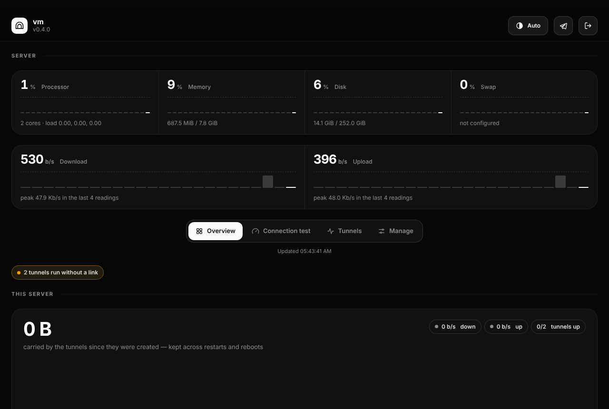
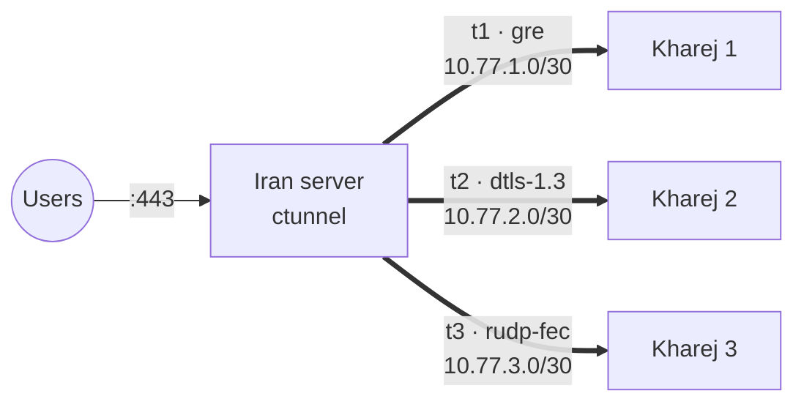

<p align="center">
  
</p>

<p align="center">
  <a href="https://github.com/CIAUB/C-Tunnel/releases/latest"></a>
  <a href="https://github.com/CIAUB/C-Tunnel/actions/workflows/ci.yml"></a>
  
  
  <a href="https://t.me/CiAUB_CH"></a>
</p>

<p align="center">
  <a href="README.md">English</a> · <b>فارسی</b> · <a href="README_RU.md">Русский</a>
</p>

<p align="center">
  <a href="#نصب">⚡ نصب آنلاین</a> · <a href="#نصب-آفلاین">📦 نصب آفلاین (بدون دسترسی به گیت‌هاب)</a> · <a href="https://github.com/CIAUB/C-Tunnel/releases/latest/download/ctunnel-offline-amd64.zip">⬇️ دانلود مستقیم ZIP آفلاین (~۸.۵ مگابایت)</a>
</p>

<p align="center">
  <a href="https://nowpayments.io/embeds/donation-widget?api_key=8373139c-0aec-4e38-b34c-88dd005cfc1c" target="_blank" rel="noreferrer noopener">
    
  </a>
</p>

<div dir="rtl">

<p align="center">
  تانل‌های کرنلی و ترنسپورت‌های UDP رمزنگاری‌شده بین یک سرور ایران و هر تعداد سرور خارج،<br>
  همراه با فوروارد پورت، لینک راه‌اندازی یک‌خطی، منوی ترمینال و پنل وب.
</p>

<p align="center">
  
</p>

---

## فهرست

- [تازه‌های نسخه ۲.۱.۰](#تازههای-نسخه-۲۱۰)
- [چطور کار می‌کند](#چطور-کار-میکند)
- [امکانات](#امکانات)
- [پیش‌نیازها](#پیشنیازها)
- [نصب](#نصب)
- [نصب آفلاین (بدون دسترسی به گیت‌هاب)](#نصب-آفلاین)
- [شروع سریع](#شروع-سریع)
- [انتخاب روش](#انتخاب-روش)
- [همه‌ی روش‌ها](#همهی-روشها)
- [پنل وب](#پنل-وب)
- [دستورها](#دستورها)
- [فایل‌ها و سرویس‌ها](#فایلها-و-سرویسها)
- [عیب‌یابی](#عیبیابی)
- [ساخت از سورس](#ساخت-از-سورس)
- [لایسنس](#لایسنس)
- [ارتباط](#ارتباط)

## تازه‌های نسخه ۲.۱.۰

یادداشت‌های کامل همه‌ی نسخه‌ها در [CHANGELOG.md](CHANGELOG.md) است.

- **پروفایل‌های کارایی تطبیقی و سه‌سطحی (`AUTO` / `ECO` / `TURBO` / `HYPER`) روی همه‌ی تانل‌ها:**
  - جای ورودی‌های جداگانه‌ی `turbo+` را یک پروفایل واحد گرفته که هنگام ساخت تانل (CLI و پنل وب) انتخاب می‌شود و هر وقت بخواهید با `ctunnel set-profile <name> <auto|eco|turbo|hyper>`، ویرایش در CLI یا ویرایش در پنل وب عوض می‌شود.
  - **`AUTO` (تطبیقی، اول فهرست):** در زمان بیکاری (`< 5 Mbps`) روی `ECO` می‌ماند و زیر بار، هر دو سرور ایران و خارج را خودکار به `TURBO` (`>= 15 Mbps`) یا `HYPER` (`>= 120 Mbps` روی سرورهای ۴ هسته‌ای یا بیشتر با ۳.۵ گیگابایت رم یا بیشتر) می‌برد. سطح فعلی (`AUTO → ECO/TURBO/HYPER`) به‌صورت زنده در CLI، پنل وب و ربات تلگرام دیده می‌شود.
  - مقیاس‌دهی واقعی در زمان اجرا برای استخر کانکشن‌های L4 (`8/16/32`)، بافرهای `smux` (`16M/64M/128M`)، پنجره‌های KCP (`2048/4096/8192`)، استریم‌های BBR در `revCarrier` (`4/8/16`)، بافر سوکت UDP (`4M/16M/32M`)، `txqueuelen` کرنل (`4000/10000/20000`) و `SO_BUSY_POLL=50` لینوکس روی `HYPER`.
  - تانل‌های نسخه‌های قبلی خودکار روی `ECO` قرار می‌گیرند (تانل‌های قدیمی Direct با `Carrier: true` روی `TURBO`).
- **۲ ترنسپورت Stealth جدید لایه ۳ (`stealth-tcp`، `stealth-ws`):**
  - `stealth-tcp`: تانل TUN لایه ۳ چنداستریمی با AES-256-GCM که به شکل رکوردهای application-data در TLS 1.3 فریم می‌شود، با پین کردن جریان‌ها بر اساس 5-tuple و pacing از نوع BBR.
  - `stealth-ws`: تانل TUN لایه ۳ چنداستریمی با AES-256-GCM روی WebSocket با مسیر مخفی SHA-256 (مقایسه‌ی constant-time و پاسخ `404` به پروب‌های غیرمجاز) و `Host` / SNI سفارشی اختیاری.
- **۵ پروتکل اختصاصی گیمینگ و بهینه‌سازی موتور:**
  - `dtls-1.3` با نام **`game-dtls`** به خانواده‌ی `FamilyGaming` منتقل شد؛ با مهاجرت بی‌دردسر state و لینک، سازگاری روی سیم، QoS کامل گیمینگ (`DSCP EF`، `SO_PRIORITY=6`، `IP_PMTUDISC_DO`) و نوشتن بدون تخصیص حافظه با `WriteToUDPAddrPort`.
  - بهینه‌سازی `game-udp`، `game-fec` (رفع پین شدن worker گروه‌های XOR-FEC)، `game-dup` و `game-kcp` (`IP_PMTUDISC_DO` و `SO_BUSY_POLL=50` روی `HYPER`).
- **فهرست گزیده‌ی پروتکل‌های فعال و محدود شدن `frp+`:**
  - `frp+` در حالت reverse/carrier فقط برای روش‌های اصلی IPv4 لایه ۳ مانده است (`xgre`، `xgre-ip`، `6to4`، `ipip`، `gre`).
  - همه‌ی ترنسپورت‌های اصلی لایه ۴ (`tcp`، `tcpmux`، `pck`، `ws`، `wsmux`، `wss`، `wssmux`، `udp`، `udpmux`) فعال مانده‌اند.
  - ۲۳ پروتکل قدیمیِ ضعیف یا تکراری از ساخت تانل جدید و تست اتصال حذف شدند، ولی تانل‌های موجود ۱۰۰٪ قابل مدیریت، ویرایش و اجرا هستند. (برای ساخت پروتکل‌های قدیمی، نسخه‌ی `v2.0.1` را با دستور نصب نسخه‌دار پایین نصب کنید.)
- **نصب یک‌خطی از گیت‌هاب و اتصال خودکار (`--apply-link`):**
  - CLI (`showLink`، `ctunnel link <name>`) و پنل وب (`#dlg-link`) حالا یک دستور آماده‌ی کپی به شکل `sudo bash -c "$(curl -sL ...)" -- --apply-link 'ctunnel://...'` می‌سازند که C-Tunnel را از گیت‌هاب نصب می‌کند و سرور مقابل را خودکار وصل می‌کند و یک کارت وضعیت رنگی نشان می‌دهد.
- **پوشش ۱۰۰٪ ایموجی‌های سفارشی پریمیوم تلگرام (`pkg/notify`):**
  - پشتیبانی کامل از چند پک و نام‌های مترادف برای هر ۵۰ کلید آیکون رابط کاربری؛ هر صفحه‌ی ربات، هشدار، گزارش ترافیک، کپشن بکاپ و دکمه‌ی inline وقتی پریمیوم فعال باشد از `<tg-emoji>` / `icon_custom_emoji_id` متحرک استفاده می‌کند و برای اکانت‌های غیرپریمیوم خودکار به ایموجی یونیکد تمیز برمی‌گردد.

<details>
<summary><b>مهم‌ترین تغییرات v2.0.0 / v2.0.1</b> (پایداری TCP، ربات تلگرام نسخه ۲، سهمیه، بکاپ و بازیابی، TOTP 2FA)</summary>

- **v2.0.1:** رفع سیاه‌چاله‌ی کانکشن‌های TCP در استخر (`TCP_USER_TIMEOUT=20s`، حذف سوکت‌های مرده با `TCP_INFO`)، گرسنگی استخر keepalive، طوفان کانکشن TCP در Reverse/Direct، fallback بک‌اند IPv6/LocalIP روی سرور خارج و لینک‌های راه‌اندازی NAT یک‌به‌یک.
- **v2.0.0:** Go 1.26.10 (صفر CVE قابل‌دسترس)، ۹ ترنسپورت لایه ۴ Direct/Reverse با `splice` کرنل بدون کپی، ربات تلگرام نسخه ۲ با رله از داخل تانل ایران (`pkg/tgrelay`)، جدول‌های Native در Bot API 10.1+، مولتی‌ادمین، ورود بدون رمز به پنل وب (`#tgToken` و Mini App روی HTTPS)، سهمیه‌ی حجم (GB) و محدودیت سرعت (Mbps) برای هر تانل، `ctunnel-backup/2` با ترافیک ماندگار، تغییر درجای IP سرور مقابل، TOTP 2FA، لیست IP/CIDR مجاز و تست اتصال نسخه ۲.

</details>

## چطور کار می‌کند



۱. روی سرور ایران تانل می‌سازید و یک لینک یک‌خطی `ctunnel://` می‌گیرید.

۲. لینک را روی سرور خارج می‌چسبانید. آدرس، پورت، کلید و MTU دو طرف با هم یکی می‌شود.

۳. کاربرها به یک پورت روی سرور ایران وصل می‌شوند و C-Tunnel ترافیک را از داخل تانل به سرور خارج می‌رساند.

هر تانل subnet خودش (`10.77.N.0/30`)، اینترفیس خودش و پورت UDP خودش را می‌گیرد؛ پس هر چند سرور خارج که بخواهید را بدون تداخل اضافه می‌کنید.

## امکانات

| | |
|---|---|
| **۲۸ روش فعال (+۲۳ روش قدیمی قابل مدیریت)** | تانل‌های گزیده‌ی کرنلی L3/L2، UDP-Crypt رمزنگاری‌شده، **۴ حامل Stealth** (`faketcp`، `icmp`، `stealth-tcp`، `stealth-ws`)، **۹ ترنسپورت لایه ۴ Direct/Reverse** و **۵ پروتکل اختصاصی گیمینگ** (`game-udp`، `game-fec`، `game-dup`، `game-kcp`، `game-dtls`) |
| **پروفایل‌های کارایی سه‌سطحی** | `ECO` (کمترین مصرف منابع)، `TURBO` (سرعت بالا) و `HYPER` (سرعت خیلی بالا + `SO_BUSY_POLL`) روی هر تانل، قابل تغییر زنده از CLI و پنل وب |
| **یک ایران، چند خارج** | subnet، پورت و شناسه‌ی تانل خودکار تخصیص داده می‌شوند، تداخل رد می‌شود و IP سرور مقابل بدون حذف و بازسازی تانل درجا عوض می‌شود |
| **فوروارد پورت** | `443`، یا `2053=8443` برای فرستادن به پورت دیگر. قانون‌های هر تانل جدا برچسب می‌خورند و تمیز پاک می‌شوند. |
| **سهمیه‌ی حجم و محدودیت سرعت** | سقف حجم اختیاری (GB) برای هر تانل (توقف خودکار + هشدار تلگرام با گزینه‌های بازیابی Override / Reset / Add GB) و سقف پهنای باند (Mbps) |
| **بکاپ و بکاپ خودکار** | بکاپ کامل JSON (`ctunnel-backup/2`) که ترافیک تجمعی هر تانل و کل سرور را در بازیابی و انتقال حفظ می‌کند، به‌همراه بکاپ خودکار زمان‌بندی‌شده به تلگرام |
| **رمزنگاری** | AES-256-GCM با کلید جدا برای هر جهت، پنجره‌ی ضد replay به اندازه‌ی ۲۰۰۰ بسته و padding تصادفی |
| **شبیه‌سازی پروتکل** | هر روش UDP-Crypt بسته‌ها را با هدر پروتکل هم‌نامش می‌فرستد |
| **بازیابی packet loss** | `rudp-fec` و `game-fec` بسته‌های گم‌شده را با parity از نوع XOR و بدون ارسال مجدد (0-RTT) بازسازی می‌کنند |
| **میکروتیک** | دستورهای آماده‌ی RouterOS 7 برای `gre`، `ipip`، `6to4`، `eoip`، `vxlan` و `wireguard` |
| **پنل وب** | رابط تیره و روشن واکنش‌گرا، HTTP پیش‌فرض، مسیر خصوصی، دامنه و TLS سفارشی، TOTP 2FA و لیست IP مجاز، تله‌متری زنده با SSE، فضای اسپانسر چندفرمته و ورود یک‌کلیک بدون رمز از تلگرام |
| **تست اتصال** | بسته‌های واقعی GRE، IPIP، SIT، ESP، WireGuard، VXLAN، QUIC، DTLS و… را بین دو سرور می‌فرستد و برای هر روش لایه ۴ یک تانل واقعی بالا می‌آورد، نشان می‌دهد کدام روش‌ها رد می‌شوند یا بسته‌اند، سرعت را اندازه می‌گیرد و بهترین روش را پیشنهاد می‌دهد |
| **ربات تلگرام نسخه ۲** | روی سرورهای خارج و ایران (از طریق رله‌ی داخل تانل) کار می‌کند؛ جدول‌های Native در Bot API 10.1+، دکمه‌های رنگی معنادار، جدول زنده‌ی سلامت شبکه در `/start`، مولتی‌ادمین، ایموجی‌های متحرک پریمیوم با fallback خودکار، افزودن حجم تعاملی، بکاپ و بازیابی، و ورود مستقیم به پنل وب با HTTP یک‌کلیک یا Mini App روی HTTPS |
| **آپدیت با یک کلیک** | Manage → Update now آخرین نسخه را از داخل پنل نصب می‌کند و لاگش را نشان می‌دهد |
| **ماندگار** | هر تانل یک سرویس systemd است؛ بعد از ریبوت برمی‌گردد و با ری‌استارت از نو و تمیز ساخته می‌شود |

## پیش‌نیازها

- لینوکس با systemd: Ubuntu 20.04 به بالا، Debian 11 به بالا یا مشابه
- معماری `amd64`، `arm64` یا `armv7` (ARM ۳۲ بیتی)
- دسترسی root
- IP عمومی روی هر سرور، و باز بودن پروتکل یا پورت UDP تانل در دیتاسنتر

اگر `iproute2`، `iptables` و `curl` نصب نباشند، `install.sh` خودش نصبشان می‌کند. برای WireGuard بسته‌ی `wireguard-tools` هم لازم است.

## نصب

یک دستور، روی **هر دو** سرور:

```bash
sudo bash -c "$(curl -sL https://raw.githubusercontent.com/CIAUB/C-Tunnel/main/install.sh)"
```

نصب‌کننده همیشه آخرین [Release](https://github.com/CIAUB/C-Tunnel/releases/latest) را نصب می‌کند.
باینری‌های مخصوص معماری سرور، اسکریپت کرنل و سرویس‌های systemd را دانلود می‌کند، هر فایل را با
`SHA256SUMS` همان Release مقایسه می‌کند و فقط اگر همه یکی باشند نصب می‌کند. اگر فایلی خراب یا
دستکاری‌شده باشد، نصب متوقف می‌شود و هیچ چیزی تغییر نمی‌کند.

```bash
sudo ctunnel
```

برای آپدیت، گزینه‌ی **Update** در منو را بزنید یا دستور نصب را دوباره اجرا کنید. تانل‌های فعلی حفظ می‌شوند.
بدون شماره‌ی نسخه، آخرین ریلیز پایدار گیت‌هاب نصب می‌شود و نسخه‌های draft و pre-release انتخاب نمی‌شوند. برای نصب یک نسخه‌ی مشخص (مثلاً `v2.0.1` اگر می‌خواهید پروتکل‌های قدیمیِ حذف‌شده را بسازید):

```bash
sudo bash -c "$(curl -sL https://raw.githubusercontent.com/CIAUB/C-Tunnel/main/install.sh)" v2.0.1
```

برای نصب C-Tunnel روی سرور مقابل (خارج) **و** وصل کردن فوری تانل از روی لینک راه‌اندازی با یک دستور:

```bash
sudo bash -c "$(curl -sL https://raw.githubusercontent.com/CIAUB/C-Tunnel/main/install.sh)" -- --apply-link 'ctunnel://...'
```

اجرای `bash install.sh v2.0.1` و متغیر `CTUNNEL_VERSION=v2.0.1` هم پشتیبانی می‌شوند. آرگومان نسخه بر متغیر محیطی اولویت دارد.

## نصب آفلاین

اگر سرور شما به گیت‌هاب دسترسی ندارد (یا اینترنت بین‌الملل / `apt` محدود است)، می‌توانید C-Tunnel را **کاملاً آفلاین** روی **همه‌ی سرورهای لینوکس** (Ubuntu، Debian، CentOS، AlmaLinux، Rocky، Fedora و Arch حتی با SELinux فعال) نصب یا آپدیت کنید.

**۱. دانلود بسته آفلاین** روی سیستم شخصی، گوشی یا هر سروری که به گیت‌هاب دسترسی دارد:

- **پیشنهادی — سرورهای معمول `amd64` / Intel / AMD (فقط ~۸.۵ مگابایت):** [دانلود مستقیم `ctunnel-offline-amd64.zip`](https://github.com/CIAUB/C-Tunnel/releases/latest/download/ctunnel-offline-amd64.zip)
- **سایر معماری‌ها و فرمت‌ها:** [`arm64` (~۷.۵ مگابایت)](https://github.com/CIAUB/C-Tunnel/releases/latest/download/ctunnel-offline-arm64.zip) · [`armv7` (~۷.۹ مگابایت)](https://github.com/CIAUB/C-Tunnel/releases/latest/download/ctunnel-offline-armv7.zip) · [`amd64.tar.gz` (~۸.۴ مگابایت، بدون نیاز به `unzip`/`python3`)](https://github.com/CIAUB/C-Tunnel/releases/latest/download/ctunnel-offline-amd64.tar.gz) · [نسخه جامع همه‌معماری `.zip` (~۲۴ مگابایت)](https://github.com/CIAUB/C-Tunnel/releases/latest/download/ctunnel-offline.zip)

**۲. انتقال فایل به سرور** (با `scp`، Termius، WinSCP، MobaXterm یا هر ابزار SFTP):

```bash
scp ctunnel-offline-amd64.zip root@SERVER_IP:/root/
```

**۳. اجرای یک دستور روی سرور** (در همان پوشه‌ای که فایل را آپلود کردید):

```bash
rm -rf /tmp/ctunnel-offline && (unzip -qo ctunnel-offline-amd64.zip -d /tmp 2>/dev/null || python3 -m zipfile -e ctunnel-offline-amd64.zip /tmp) && sudo bash /tmp/ctunnel-offline/install.sh && rm -rf /tmp/ctunnel-offline
```

<details>
<summary><b>روش‌های دیگر نصب آفلاین</b> (<code>.tar.gz</code>، اتصال خودکار با <code>--apply-link</code>، پوشه استخراج‌شده، روت بدون <code>sudo</code>)</summary>

- **نصب با `ctunnel-offline-amd64.tar.gz`** (فقط با `tar` داخلی لینوکس؛ حتی بدون `unzip` و `python3`):
  ```bash
  rm -rf /tmp/ctunnel-offline && tar -xzf ctunnel-offline-amd64.tar.gz -C /tmp && sudo bash /tmp/ctunnel-offline/install.sh && rm -rf /tmp/ctunnel-offline
  ```
- **نصب آفلاین + اتصال فوری تانل با لینک (`--apply-link`):**
  ```bash
  rm -rf /tmp/ctunnel-offline && (unzip -qo ctunnel-offline-amd64.zip -d /tmp 2>/dev/null || python3 -m zipfile -e ctunnel-offline-amd64.zip /tmp) && sudo bash /tmp/ctunnel-offline/install.sh --apply-link 'ctunnel://...' && rm -rf /tmp/ctunnel-offline
  ```
- **اگر فایل را قبلاً دستی اکسترکت کرده‌اید** (یا مستقیم با کاربر `root` بدون `sudo` هستید):
  ```bash
  bash ctunnel-offline/install.sh
  ```
- **اجرا مستقیم با فلگ `--offline`** (پشتیبانی از هر `.zip`، `.tar.gz` یا مسیر پوشه):
  ```bash
  sudo bash install.sh --offline /root/ctunnel-offline-amd64.zip
  ```

</details>

> **بدون هیچ درخواست اینترنتی + اعتبارسنجی کامل:** اسکریپت `install.sh` به‌طور خودکار حالت آفلاین را تشخیص می‌دهد، تمام فایل‌ها را با `SHA256SUMS` بررسی می‌کند، در سرورهای دارای SELinux برچسب‌های امنیتی را تنظیم می‌کند، هیچ درخواستی به GitHub یا `apt-get` نمی‌فرستد و در آپدیت آفلاین تمام تانل‌ها و تنظیمات فعلی را حفظ می‌کند.

## شروع سریع

**۱. سرور ایران** (برای هر سرور خارج یک بار):

```text
sudo ctunnel  →  1) Setup Iran
  Method              gre        (dtls-1.3 if GRE is filtered)
  Remote server IP    203.0.113.10
  Forward ports       443
```

منو یک لینک راه‌اندازی چاپ می‌کند:

```text
ctunnel://eyJuYW1lIjoidDEiLCJyb2xlIjoia2hhcmVqIiwibWV0aG9kIjoiZ3JlIi...
```

**۲. سرور خارج:**

```text
sudo ctunnel  →  2) Setup Kharej  →  paste the link
```

یا با یک دستور:

```bash
sudo ctunnel apply-link 'ctunnel://...'
```

**۳. بررسی:**

```bash
sudo ctunnel status
```

```text
 NAME      METHOD       ROLE   REMOTE           TUNNEL IP      PORT   STATE    RX / TX
 t1        gre          iran   203.0.113.10     10.77.1.1      0      up       1.2 GiB / 310.4 MiB
 t2        dtls-1.3     iran   203.0.113.11     10.77.2.1      24002  up       842.7 MiB / 95.1 MiB
```

برای سرور خارج بعدی، مرحله‌ی ۱ را با IP آن تکرار کنید. تانل جدید `10.77.2.0/30`، پورت آزاد بعدی و پورت‌های فوروارد خودش را می‌گیرد.

## انتخاب روش

| وضعیت | پیشنهاد |
|---|---|
| GRE و IPIP فیلتر نیستند | `gre`، `6to4`، `ipip`: سرعت کرنل، کمترین مصرف CPU |
| پروتکل‌های خام IP فیلترند | `dtls-1.3`، `quic-v1`، `wireguard`، یا `gre` با پورت FOU |
| مسیر packet loss دارد یا ناپایدار است | `rudp-fec`، یا `udpmux` برای فوروارد پورت |
| GRE و IPIP فیلترند، UDP ساده رد می‌شود و رمزنگاری لازم نیست | `bareudp` |
| تماس تصویری رد می‌شود ولی بقیه‌ی UDP محدود است | `stun-turn` |
| ترافیک VPN از نوع IPsec رد می‌شود | `esp-udp` |
| پورت UDP 2152 (هسته‌ی شبکه‌ی موبایل) کاری ندارد | `gtp-u` |
| UDP بسته است ولی TCP باز است | `faketcp` |
| فقط ping رد می‌شود | `icmp` |
| رمزنگاری با سرعت کرنل | `xfrm-ipsec`، `wireguard` |
| طرف مقابل میکروتیک است | `gre`، `ipip`، `eoip`، `vxlan`، `wireguard` |

مطمئن نیستید؟ اول روی سرور ایران **0) Connection Test** را بزنید (یک لینک `ctunnel-test://` می‌دهد)، بعد روی سرور خارج لینک را بچسبانید. یک جدول زنده نشان می‌دهد کدام روش در حال تست است. کنار هر روش `ok`، `unstable` یا `blocked` نوشته می‌شود، سرعت هر روشِ سالم، MTU مسیر و سرعت TCP اندازه گرفته می‌شود و بهترین روش با MTU مناسبش پیشنهاد می‌شود:

```text
RESULT  FAMILY     METHOD        STATUS    ECHOES  PROGRESS

🟢      L3-Direct  6to4          OK        10/10   ▰▰▰▰▰▰▰▰ 100%
🟢      UDP-Crypt  dtls-1.3      OK        10/10   ▰▰▰▰▰▰▰▰ 100%
🟡      UDP-Crypt  quic-v1       UNSTABLE  7/10    ▰▰▰▰▰▰▱▱  70%
🔴      L3-Direct  gre           BLOCKED   0/10    ▱▱▱▱▱▱▱▱   0%

Works steadily:

   METHOD        FAMILY     LATENCY          DOWNLOAD     UPLOAD       TOTAL
🟢 6to4          L3-Direct  42.1 ms ±0.8     1.12 Gbps    418.6 Mbps   1.54 Gbps
🟢 dtls-1.3      UDP-Crypt  42.3 ms ±0.9     1.05 Gbps    402.3 Mbps   1.45 Gbps

BEST SETTINGS
Method           6to4           42.1 ms ±0.8, 0% loss
Download         1.12 Gbps      6to4 packets at full rate for 1 s
Upload           418.6 Mbps     6to4 packets at full rate for 1 s
Path MTU         1500           full-size packets pass
Tunnel MTU       1440           path MTU minus 6to4 overhead
TCP download     1.18 Gbps      4 TCP streams, bytes confirmed by the receiver
TCP upload       431.0 Mbps     4 TCP streams, bytes confirmed by the receiver
```

در زمان تست، روی سرور ایران پورت UDP 7712، پورت TCP 7711 و پروتکل‌های IP شماره‌ی 4، 41، 47، 50، 97 و 115 باید باز باشند.

### حالت ریورس

در حالت REVERSE سرور خارج به ایران وصل می‌شود و سرور ایران فقط گوش می‌دهد؛ یعنی ایران هیچ‌وقت به IP خارجی کانکشن نمی‌زند.

| لایه | مسیر | مناسب برای |
|---|---|---|
| UDP-Crypt (`rev+dtls-1.3`، `rev+quic-v1`…) | خارج UDP به ایران می‌فرستد، همان بسته‌های DIRECT | لینک‌های پرلاس یا پینگ بالا |
| WireGuard (`rev+wireguard`) | خارج کلاینت وایرگارد است | میکروتیک و کلاینت‌های معمولی |
| کرنل L3/L2 (`frp+gre`، `frp+vxlan`…) | داخل ۸ استریم TCP موازی شبیه رکورد TLS | لینک تمیز که فقط TCP رد می‌شود |
| لایه ۴ (`tcp`، `tcpmux`، `pck`، `ws`، `wsmux`، `wss`، `wssmux`، `udp`، `udpmux`) | فوروارد پورت لایه ۴: هر کانکشن کاربر یا جریان UDP استریم خودش را دارد، بدون IP تانل | سرویس‌های TCP (VLESS، Trojan…) بدون TCP-in-TCP، لینک‌هایی که فقط WebSocket یا TLS رد می‌کنند، و لینک‌های پرلاس (`udp`، `udpmux`) |
| گیمینگ اختصاصی (`game-udp`، `game-fec`، `game-dup`، `game-kcp`) | UDP فوق‌سبک با DSCP EF، بازیابی 0-RTT XOR-FEC، ارسال دوگانه‌ی بسته‌های کوچک یا KCP لایه ۴ با تیک ۵ms | بازی آنلاین رقابتی (کمترین پینگ در برابر مقاومت در مقابل پکت‌لاس، در هر دو حالت Direct و Reverse) |

هر کانکشن داخلی روی یک استریم TCP می‌ماند تا جابه‌جا نرسد و هر استریم صف خودش را دارد. در تست ما سرعت حامل TCP نسبت به 0.1.5 حدوداً دو برابر شد (از حدود ۳۹۰ به ۶۹۰ مگابیت روی لینک ۸۰۰ مگابیتی). تست اتصال همه‌ی گزینه‌های ریورس را هم می‌سنجد: برای هر روش UDP یک ردیف `rev+`، و برای هر گزینه‌ی پشتیبانی‌شده به سبک FRP یک ردیف مستقل `frp+METHOD` با استریم‌های TCP تازه، payload مخصوص همان روش، echo تأییدشده و سرعت جدا. این‌ها تست شکل حامل و کپسوله‌سازی هستند، نه تست یکپارچگی تانل کرنل. Best Settings سریع‌ترین گزینه‌ی ریورس را نام می‌برد.

### روش‌های Stealth

چهار تانل لایه ۳ با رمزنگاری AES-256-GCM (کلید جدا برای هر جهت، padding تصادفی) که بسته‌هایشان به شکل UDP ساده نمی‌روند. در حالت DIRECT (اول ایران وصل می‌شود) و REVERSE (اول خارج وصل می‌شود) کار می‌کنند.

| روش | بین دو سرور | کی استفاده شود |
|---|---|---|
| `faketcp` | رکوردهای TLS داخل سگمنت‌های TCP دست‌ساز که با packet socket خوانده می‌شوند (حامل `pck`). برای میان‌افزارها یک کانکشن TCP با sequenceهای سازگار است، ولی داخلش هیچ retransmit نیست؛ پس TCP-in-TCP نداریم و تانل با سرعت UDP کار می‌کند | UDP بسته یا محدود است و TCP نه |
| `icmp` | ICMP echo: درخواست در یک جهت، پاسخ در جهت دیگر، با شناسه‌ای که از secret ساخته می‌شود. کرنل سرورِ پاسخ‌دهنده خودش هم به هر درخواست جواب می‌دهد؛ یک قانون iptables آن جواب‌ها را دور می‌ریزد و جواب‌های تانل را نگه می‌دارد | فقط ping رد می‌شود |
| `stealth-tcp` | حامل TCP چنداستریمی با AES-256-GCM که به شکل رکوردهای application-data در TLS 1.3 (`0x17 0x03 0x03`) فریم می‌شود، با پین کردن جریان بر اساس 5-tuple و pacing از نوع BBR | TCP رد می‌شود و یک تانل TUN لایه ۳ رمزشده و چنداستریمی تمیز می‌خواهید |
| `stealth-ws` | حامل WebSocket چنداستریمی با AES-256-GCM و مسیر URL مخفی SHA-256 (پاسخ `404` به پروب‌های غیرمجاز) و `Host` / SNI سفارشی اختیاری | ترافیک HTTP/WebSocket بهتر از همه از DPI رد می‌شود |

`faketcp` و `icmp` مثل `pck` به root و iptables نیاز دارند. `icmp` پورت ندارد. تست اتصال برای `icmp` سرور ایران را با echo requestهای هم‌اندازه‌ی بسته‌های تانل ping می‌کند و برای `faketcp` نتیجه‌ی حامل `pck` را نشان می‌دهد، چون روی همان سوار است.

### روش‌های شبیه‌سازی جدید و BareUDP

`stun-turn`، `gtp-u` و `esp-udp` روش‌های UDP-Crypt هستند: همان رمزنگاری و padding، با هدر TURN ChannelData (رله‌ی تماس‌های WebRTC)، GTP-U G-PDU (ترافیک کاربر در هسته‌ی شبکه‌ی موبایل) یا ESP داخل UDP (VPNهای IPsec پشت NAT). اولین تانل هر کدام، اگر پورت واقعی پروتکل (3478، 2152 یا 4500) آزاد باشد، همان را می‌گیرد؛ تانل‌های بعدی از بازه‌ی معمول پورت می‌گیرند. مثل بقیه‌ی UDP-Crypt فقط هدر شبیه پروتکل است؛ فیلتری که کل رد و بدل را دنبال کند می‌تواند تشخیصشان دهد.

`bareudp` تانل کرنلی است که بسته‌های IPv4 را مستقیم و بدون هدر و رمزنگاری داخل UDP می‌گذارد؛ برای لینک‌هایی که GRE و IPIP فیلترند و UDP ساده رد می‌شود. به Linux 5.7 یا بالاتر با ماژول `bareudp` نیاز دارد و اگر پورت 6635 آزاد باشد همان را می‌گیرد. دستگاه bareudp از هر آدرسی UDP قبول می‌کند، برای همین یک قانون iptables فقط به سرور مقابل اجازه‌ی رسیدن به پورتش را می‌دهد.

### تانل‌های لایه ۴ ریورس

موتور Reverse-L4 روی سرور ایران روی پورت تانل و روی همه‌ی پورت‌های فورواردشده (TCP و UDP) گوش می‌دهد. سرور خارج به پورت تانل وصل می‌شود و هر کانکشن کاربر را به پورت مقصد روی `127.0.0.1` خودش می‌رساند. اینترفیس و IP تانل ندارند، برای همین بنچمارک تانل برایشان کاربرد ندارد. failover دارند، به یک روش لایه ۴ دیگر: تانل تا وقتی بالاست که سرور خارج یک کانکشن به سرور ایران داشته باشد. تست اتصال برای هر روش یک تانل واقعی روی پورت تست لایه ۴ سرور ایران بالا می‌آورد (از منوی ترمینال TCP و UDP 7714، یا اگر اشغال باشد اولین پورت آزاد بعدی؛ منو پورت‌هایی را که باید باز شوند چاپ می‌کند) و سرعت را از داخل آن می‌سنجد.

| روش | بین دو سرور |
|---|---|
| `tcp` | یک کانکشن TCP برای هر کانکشن کاربر، از استخری ۱۶تایی که سرور خارج باز نگه می‌دارد |
| `tcpmux` | استریم‌های smux روی ۴ کانکشن TCP |
| `pck` | استریم‌های smux روی KCP داخل سگمنت‌های TCP دست‌ساز با packet socket (هیچ‌کدام از دو طرف state کرنلی TCP ندارند)؛ رمزشده با AES |
| `ws` | مثل `tcp`، هر کانکشن یک WebSocket |
| `wsmux` | مثل `tcpmux`، روی WebSocket |
| `wss` | مثل `ws`، داخل TLS |
| `wssmux` | مثل `wsmux`، داخل TLS |
| `udp` | یک session از KCP روی UDP برای هر کانکشن کاربر، از استخری ۱۶تایی؛ رمزشده با AES. KCP بسته‌ی گم‌شده را خودش دوباره می‌فرستد، پس لینک پرلاس کمتر از TCP هزینه دارد |
| `udpmux` | استریم‌های smux روی ۲ session از KCP روی UDP؛ رمزشده با AES |

هر دو سرور موقع باز شدن هر کانکشن ثابت می‌کنند secret تانل را دارند. بعد از آن `tcp` و `ws` بایت‌های کاربر را همان‌طور که هست می‌برند؛ اگر لینک بین دو سرور باید رمز شود از `wss`، `wssmux`، `pck`، `udp` یا `udpmux` استفاده کنید. `udp` و `udpmux` روی سرور ایران پورت تانل را برای UDP باز لازم دارند. روش‌های WebSocket یک Host / SNI اختیاری می‌گیرند. روی سرور خارج تانل را می‌شود با لینک راه‌اندازی یا دستی ساخت: IP سرور ایران، روش، پورت تانل و secret.

بین دو network namespace روی ۲ هسته‌ی CPU (iperf3، یک جریان TCP از داخل یک پورت فورواردشده): `tcp` حدود 12.7 Gbps، `ws` 10.8، `tcpmux` 7.6، `wsmux` 6.9، `wss` 6.6، `wssmux` 4.4 و `pck` 0.8 Gbps.

روی یک مسیر طولانی شبیه‌سازی‌شده (500 Mbit/s، رفت‌وبرگشت 100 ms، loss 0.3٪ در هر جهت؛ iperf3، یک جریان): `tcp`، `ws` و `wss` حدود 425 Mbit/s، `tcpmux` 373، `wsmux` 397، `wssmux` 359، `pck` 185، `udp` 188 و `udpmux` 188 (حدود 300 با چهار جریان). چون KCP ackهایش را هر ۱۰ میلی‌ثانیه یک‌جا می‌فرستد، `udp`، `udpmux` و `pck` بین دو namespace ۱.۶ تا ۲.۵ برابر، در ۵۰ms حدود ۲۵٪ و در ۱۵۰ms حدود ۱۰ تا ۲۰٪ سریع‌ترند. روش‌های لایه ۳ روی همین مسیر، آپلود: `faketcp` 370، `icmp` 377، `stun-turn` 323، `gtp-u` 311 و `esp-udp` 307 Mbit/s، در برابر 317 برای `quic-v1`.

## همه‌ی روش‌ها

<details>
<summary><b>L3 کرنلی</b>: ۱۶ روش</summary>

| روش | توضیح |
|---|---|
| `gre` | GRE (پروتکل 47)، با FOU و lane موازی اختیاری |
| `ipip` | IPv4 داخل IPv4 (پروتکل 4)، با FOU اختیاری |
| `6to4` | حامل SIT با IPIP6 داخلش |
| `6to4-gre` | حامل SIT با IP6GRE داخلش |
| `sit` | IPv6 داخل IPv4؛ فقط IPv6 حمل می‌کند |
| `ip6gre` | GRE روی بستر IPv6 |
| `ipip6` | IPv4 روی بستر IPv6 |
| `ip6ip6` | IPv6 روی IPv6؛ فقط IPv6 حمل می‌کند |
| `wireguard` | WireGuard کرنلی؛ کلیدها از لینک راه‌اندازی ساخته می‌شوند |
| `xfrm-ipsec` | GRE رمزشده با IPsec ESP کرنل (AES-GCM-256) |
| `fou-gre` | GRE داخل UDP |
| `gue-ipip` | IPIP داخل GUE/UDP |
| `ecmp-lanes` | ۲ تا ۸ تانل GRE موازی با کلید و ECMP |
| `bareudp` | IPv4 مستقیم داخل UDP (6635)، بدون هدر؛ Linux 5.7 به بالا |
| `xgre` | GRE چندمسیره‌ی پیشرفته با کلید (`ignore-df`، آماده‌ی FOU، میکروتیک) |
| `xgre-ip` | IPIP داخل حامل چندمسیره‌ی `xGRE` با کلید |

</details>

<details>
<summary><b>L2</b>: ۷ روش</summary>

| روش | توضیح |
|---|---|
| `eoip` | EoIP میکروتیک روی GRE خام، سازگار با RouterOS |
| `gretap` | اترنت روی GRE |
| `ip6gretap` | اترنت روی GRE با IPv6 |
| `vxlan` | اترنت روی UDP (4789) |
| `geneve` | اترنت روی UDP (6081) |
| `l2tpv3` | pseudowire ثابت L2TPv3 روی IP یا UDP |
| `etherip` | EtherIP طبق RFC 3378 (پروتکل 97) |

</details>

<details>
<summary><b>UDP-Crypt</b>: ۱۱ روش با AES-256-GCM</summary>

| روش | بسته‌ها شبیه به |
|---|---|
| `dtls-1.3` | رکوردهای application data در DTLS |
| `quic-v1` | بسته‌های short-header پروتکل QUIC |
| `srtp-direct` | مدیای RTP / SRTP |
| `wg-stealth` | هدر تصادفی وابسته به کلید، با چند بسته‌ی بی‌معنی در شروع |
| `rudp-fec` | دیتاگرام‌های گروهی با parity از نوع XOR (۲+۱) |
| `dnscrypt-udp` | پاسخ‌های DNS |
| `ntp-direct` | بسته‌های سرور NTPv4 |
| `openvpn-dco` | بسته‌های `P_DATA_V2` در OpenVPN |
| `stun-turn` | TURN ChannelData، مثل رله‌ی تماس‌های WebRTC (3478) |
| `gtp-u` | GTP-U G-PDU، ترافیک کاربر در هسته‌ی موبایل (2152) |
| `esp-udp` | ESP داخل UDP، همان‌طور که NAT-T می‌فرستد (4500) |

</details>

<details>
<summary><b>Stealth</b>: ۴ روش با AES-256-GCM</summary>

| روش | بسته‌ها به شکل |
|---|---|
| `faketcp` | رکوردهای TLS در سگمنت‌های TCP دست‌ساز (بدون state و retransmit) |
| `icmp` | درخواست و پاسخ ICMP echo |
| `stealth-tcp` | TCP رمزشده‌ی چنداستریمی به شکل TLS 1.3 روی TUN |
| `stealth-ws` | WebSocket رمزشده‌ی چنداستریمی با مسیر مخفی و Host/SNI اختیاری |

</details>

<details>
<summary><b>لایه ۴ (Direct و Reverse)</b>: ۹ روش، فوروارد پورت</summary>

| روش | توضیح |
|---|---|
| `tcp` | TCP، یک کانکشن از استخر برای هر کانکشن کاربر (`splice` کرنل) |
| `tcpmux` | TCP + MUX (استریم‌های `smux` v2 روی کانکشن‌های TCP موازی) |
| `pck` | TCP + PCK: KCP در سگمنت‌های TCP دست‌ساز، raw socket، AES |
| `ws` | WebSocket |
| `wsmux` | WebSocket + MUX |
| `wss` | WebSocket داخل TLS |
| `wssmux` | WebSocket داخل TLS + MUX |
| `udp` | UDP: یک session از KCP برای هر کانکشن کاربر، AES |
| `udpmux` | UDP + MUX: استریم‌ها روی sessionهای موازی KCP، AES |

</details>

<details>
<summary><b>گیمینگ اختصاصی (Direct و Reverse)</b>: ۵ روش</summary>

| روش | مناسب برای |
|---|---|
| `game-udp` | کمترین پینگ و جیتر ممکن (`DSCP EF`، `SO_PRIORITY 6`، بدون head-of-line blocking) |
| `game-fec` | بازیابی 0-RTT بسته‌های گم‌شده با XOR-FEC بدون تأخیر ارسال مجدد |
| `game-dup` | ارسال دوگانه‌ی بسته‌های کوچک و حساس به تأخیر بازی (`&lt;= 320 B`) |
| `game-kcp` | فوروارد پورت لایه ۴ با KCP تنظیم‌شده‌ی nodelay و تیک `5 ms` برای مسیرهای ناپایدار |
| `game-dtls` | UDP ضد DPI به شکل DTLS 1.3 با AES-256-GCM و QoS گیمینگ (تانل‌های `dtls-1.3` خودکار به آن منتقل می‌شوند) |

</details>

## پنل وب

از منوی `sudo ctunnel` → **4) Web Panel** → **Start**، دقیقاً همان آدرسی را باز کنید که منو چاپ می‌کند. راه‌اندازی اولیه با HTTP و یک مسیر تصادفیِ ذخیره‌شده انجام می‌شود:

```text
http://<server-ip>:6969/panel-<random-id>/
```

با کدی که همان منو نشان می‌دهد وارد شوید. بعد از پنج کد اشتباه، آن IP پنج دقیقه مسدود می‌شود. از منوی ترمینال می‌شود پورت را عوض کرد یا کد را چرخاند؛ چرخاندن کد، نشست‌های فعلی را خارج می‌کند.

پنل چهار بخش در نوار پایین دارد (**Overview**، **Connection test**، **Tunnels** و **Manage**) و هر صفحه آدرس خودش را دارد (`#/tunnels`، `#/t/<name>/logs`، `#/health`…)، پس می‌شود هر صفحه را بوکمارک یا رفرش کرد.

- **Tunnels**: هر کارت وضعیت، سرعت لحظه‌ای و تاریخچه را نشان می‌دهد و دکمه‌های Start/Stop، Restart، Live log، Setup link، Edit و Delete دارد.
- **Live log**: ژورنال تانل، رنگی بر اساس سطح، قابل فیلتر، که خط‌های جدید را دنبال می‌کند.
- **Manage**: هلث‌چک (همان بررسی‌های CLI، با راه‌حل برای هر مشکل)، بنچمارک تانل، ری‌استارت خودکار، پروکسی داخلی، هشدار تلگرام، تنظیم کرنل، ری‌استارت همه، دانلود و بازیابی بکاپ، تنظیمات پنل، بررسی آپدیت و Update now.
- **Update now**: نصب‌کننده‌ی آخرین نسخه را در یک سرویس systemd جدا (`ctunnel-update`) اجرا می‌کند، پس آپدیت با وجود ری‌استارت شدن پنل تمام می‌شود؛ پنجره `/var/log/ctunnel-update.log` را تا اعلام نتیجه دنبال می‌کند.
- **بنچمارک تانل**: دانلود، آپلود، پینگ، جیتر و loss هر تانل در حال اجرا، که یکی‌یکی از داخل تانل اندازه گرفته می‌شود و سریع‌ترین علامت می‌خورد. سرور مقابل از طریق `ctunnel-agent` جواب می‌دهد (C-Tunnel 1.0 یا جدیدتر).
- **ری‌استارت خودکار**: همه‌ی تانل‌ها را هر ۱ تا ۴۸ ساعت ری‌استارت می‌کند و روی یک صفحه‌ی ۲۴ ساعته با شمارش معکوس نشان می‌دهد. همان زمان‌بندی **Manage → Auto Refresh** در منوی ترمینال است.
- **پروکسی داخلی**: پروکسی SOCKS5 یا HTTP را با یا بدون نام کاربری روشن کنید و فورواردی را که باید روی سرور ایران بسازید ببینید.
- **ظاهر**: Auto، Dark یا Light، به رنگ Mono یا یکی از شش رنگ (Ocean، Emerald، Violet، Amber، Rose، Red)، که در مرورگر ذخیره می‌شود.
- **بکاپ**: یک فایل JSON با تنظیمات و توکن مخفی همه‌ی تانل‌ها. بازیابی، تانل‌هایی را که سرور ندارد اضافه و روشن می‌کند. فایل را خصوصی نگه دارید.

### Failover

یک تانل می‌تواند **روش پشتیبان** داشته باشد (از فرم تانل، یا لینک راه‌اندازی سروری که روش پشتیبان دارد). `ctunnel-agent` روی هر دو سرور طرف مقابل را از داخل تانل ping می‌کند. اگر ۴۵ ثانیه جوابی نیاید، هر دو سرور به روشی می‌روند که ساعت برای آن بازه‌ی دو دقیقه‌ای انتخاب می‌کند؛ پس بدون تماس با هم روی یک روش به هم می‌رسند. سر هر ساعت، تانلی که روی روش پشتیبان است دوباره روش اصلی را امتحان می‌کند و اگر روش اصلی هنوز جواب ندهد، ظرف یک دقیقه برمی‌گردد. ساعت هر دو سرور باید تقریباً درست باشد (NTP). ویرایش تانل آن را به روش اصلی برمی‌گرداند و تانلِ خاموش هیچ‌وقت سوییچ نمی‌شود. کارت و هلث‌چک نشان می‌دهند کدام روش در حال اجراست. تانل لایه ۴ فقط روش پشتیبان لایه ۴ می‌گیرد و وقتی سرور خارج هیچ کانکشنی به سرور ایران نداشته باشد قطع حساب می‌شود.

### هشدار تلگرام

فقط سرورهای خارج پیام می‌فرستند، چون تلگرام در ایران فیلتر است. در **Manage → Telegram alerts** توکن بات (از @BotFather) و Chat ID را وارد کنید (با فرستادن `/start` به بات، Chat ID را می‌گوید) و **Send test** را بزنید. هشدارها: قطع شدن تانل بعد از ۴۵ ثانیه و وصل شدن دوباره، سوییچ failover، ری‌استارت یا آپدیت (با دلیلش) و گزارش روزانه‌ی وضعیت و ترافیک هر تانل در ساعت دلخواه. `ctunnel-agent` پیام‌ها را می‌فرستد و فقط در همان چت به بات جواب می‌دهد: `/status`، `/report` و `/settings` که دکمه‌هایش مثل پنل هر هشدار را روشن و خاموش می‌کنند. تنظیمات در `/etc/ctunnel/telegram.json` است و پنل توکن را دیگر نشان نمی‌دهد. چند سرور خارج می‌توانند با یک بات هشدار بفرستند، ولی تلگرام فقط به یکی اجازه‌ی خواندن پیام‌های بات را می‌دهد؛ اگر می‌خواهید دکمه‌ها روی هر سرور کار کند، برای هر کدام بات جدا بسازید.

### پروکسی داخلی از طریق تانل

پروکسی روی 127.0.0.1 و روی IP تانل همه‌ی تانل‌های سرور گوش می‌دهد، هیچ‌وقت روی آدرس عمومی. روی سرور ایران پورت پروکسی را از داخل تانل فوروارد کنید؛ برای UDP در SOCKS5 شماره‌ی پورت دو طرف باید یکی باشد: برای پروکسی روی پورت 10800 از `10800` یا `10800=10800` استفاده کنید. در `A=B` پورت اول مال ایران و دومی مال سرور خارج است.

مجموع ترافیک روی کارت‌ها و در CLI از زمان ساخت تانل شمرده می‌شود و بعد از ری‌استارت و ریبوت باقی می‌ماند. تانل‌های جدید اگر اسم ندهید روی ایران `ir-<port>` و روی خارج `kh-<port>` نام می‌گیرند.

برای امتحان پنل روی کامپیوتر بدون دست زدن به شبکه‌اش، `go run ./cmd/ctunnel-local` را اجرا کنید (ویندوز، macOS یا لینوکس) و `http://127.0.0.1:6969/ctunnel-local/` را با کد ورود `ctunnel-test` باز کنید. تانل‌هایش شبیه‌سازی‌شده‌اند.

در **Manage → Panel settings** می‌توانید مسیر پنل و دامنه را تغییر دهید. مسیر یک `fullchain.pem` معتبر و `privkey.pem` منطبق را وارد کنید، یا این دو فایل را روی HTTPS یا لوپ‌بک آپلود کنید. یک جفت معتبر بعد از بارگذاری دوباره‌ی آرام listener، خودکار HTTPS را فعال می‌کند. DNS دامنه باید از قبل به سرور اشاره کند و پورت پنل در دسترس باشد. بعد از تغییر آدرس یا پروتکل باید دوباره وارد شوید.

**Connection test** لینک `ctunnel-test://` سرور مقابل را می‌گیرد، روش‌ها را جداگانه می‌سنجد و برای نتیجه‌ی موفق اندازه‌گیری‌شده **Deploy Best Tunnel** را پیشنهاد می‌دهد. Deploy این سمت را می‌سازد و یک لینک راه‌اندازی برای اعمال روی سرور مقابل برمی‌گرداند. تست شکل حامل جای بررسی واقعی تانل کرنل را نمی‌گیرد.

عکس‌ها با داده‌های نمایشی ساختگی و از رابط واقعی در Chromium گرفته شده‌اند. [موبایل](docs/panel-mobile.png)، [تنظیمات](docs/panel-settings.png) و [تغییرات و نکات ارتقا](CHANGELOG.md) را ببینید.


## دستورها

| دستور | کار |
|---|---|
| `ctunnel` | منوی تعاملی |
| `ctunnel status` | لیست تانل‌ها با وضعیت و ترافیک |
| `ctunnel up\|restart\|down NAME` | کنترل یک تانل |
| `ctunnel set-peer NAME NEW_IP` | تغییر درجای IP سرور مقابل (`-all OLD NEW` همه‌ی تانل‌های منطبق را عوض می‌کند) |
| `ctunnel set-profile NAME eco\|turbo\|hyper` | تغییر پروفایل کارایی و ری‌استارت |
| `ctunnel link NAME` | لینک راه‌اندازی، دستور نصب یک‌خطی و دستورهای میکروتیک برای طرف مقابل |
| `ctunnel apply-link 'ctunnel://…'` | ساختن و روشن کردن تانل از روی لینک |
| `ctunnel conntest-server` | سمت ایران تست اتصال؛ لینک تست را چاپ می‌کند |
| `ctunnel conntest 'ctunnel-test://…'` | سمت خارج: کدام روش‌ها رد می‌شوند، سرعت و پیشنهاد |
| `ctunnel conntest -new 'ctunnel-test://…'` | فقط روش‌های جدید نسخه‌ی ۲.۰؛ با `-only udp,udpmux` هر فهرست دلخواه |
| `ctunnel linktest HOST` | پینگ، loss و سرعت تا HOST، مثلاً IP تانل |
| `ctunnel speedtest-server` | پاسخ‌دهنده برای `linktest` (TCP 7711) |
| `ctunnel optimize` | BBR + fq، بافر سوکت ۶۴ مگابایتی و IP forwarding |
| `ctunnel restart-all` | ری‌استارت همه‌ی تانل‌ها (Manage → Auto Refresh این را با cron اجرا می‌کند) |
| `ctunnel proxy-serve` | پروکسی داخلی SOCKS5/HTTP (Manage → Built-in Proxy راهش می‌اندازد) |
| `ctunnel agent` | Failover و پاسخ‌دهنده‌ی بنچمارک تانل (`ctunnel-agent.service` اجرایش می‌کند) |
| `ctunnel panel` | اجرای پنل وب در پیش‌زمینه |
| `ctunnel catalog` | لیست همه‌ی روش‌ها |
| `ctunnel version` | نمایش نسخه |

## فایل‌ها و سرویس‌ها

| مسیر | کاربرد |
|---|---|
| `/etc/ctunnel/state.json` | تانل‌ها، پورت پنل و کد ورود |
| `/etc/ctunnel/panel.json` | مسیر پنل، دامنه و مسیر گواهی‌های ذخیره‌شده |
| `/etc/ctunnel/tunnels/NAME.env` | تنظیمات یک تانل |
| `/usr/local/lib/ctunnel/ctunnel-kernel` | ساخت اینترفیس‌ها، فوروارد پورت و IPsec |
| `ctunnel@NAME.service` | تانل‌های کرنلی |
| `ctunnel-engine@NAME.service` | UDP-Crypt، EoIP و EtherIP |
| `ctunnel-panel.service` | پنل وب |
| `ctunnel-agent.service` | Failover و پاسخ‌دهنده‌ی بنچمارک تانل (TCP 7719 روی IPهای تانل) |
| `/etc/ctunnel/failover/NAME` | تا وقتی تانل روی روش پشتیبان است وجود دارد |
| `/etc/ctunnel/telegram.json` | تنظیمات هشدار تلگرام (توکن بات، Chat ID، هشدارها) |
| `/var/log/ctunnel-update.log` | لاگ آخرین آپدیتی که از پنل شروع شده |

لاگ:

```bash
journalctl -u ctunnel@t1 -u ctunnel-engine@t1 -n 50
```

## عیب‌یابی

| مشکل | علت و راه‌حل |
|---|---|
| وضعیت `failed` | لاگ بالا را ببینید. معمولاً یک ماژول کرنل نیست (`modprobe ip_gre`) یا دیتاسنتر پروتکل را بسته است. |
| وضعیت `up` است ولی ترافیک رد نمی‌شود | طرف مقابل تنظیم نشده یا فایروال جلوی تانل را گرفته. برای UDP-Crypt و WireGuard پورت UDP و برای GRE پروتکل 47 را باز کنید. |
| UDP-Crypt بعد از ری‌استارت بسته‌ها را دور می‌ریزد | ساعت دو سرور باید تقریباً درست باشد (NTP)، چون شماره‌ی بسته‌ها از ساعت شروع می‌شود. |
| پورت فورواردشده جواب نمی‌دهد | سرویس روی سرور خارج باید روی `0.0.0.0` یا IP تانل گوش بدهد. |
| با `sit` و `ip6ip6` نمی‌شود پورت فوروارد کرد | این دو فقط IPv6 حمل می‌کنند؛ به‌جایشان از `6to4` استفاده کنید. |

## ساخت از سورس

```bash
git clone https://github.com/CIAUB/C-Tunnel.git
cd C-Tunnel
go test ./...
sudo bash install.sh                  # build and install from this checkout
bash scripts/build-release.sh 0.1.0   # release assets and SHA256SUMS in dist/
```

**انتشار نسخه‌ی جدید:** نسخه را در `pkg/version/version.go` عوض کنید، commit کنید و یک tag بفرستید
(`git tag v0.1.1 && git push origin v0.1.1`). GitHub Actions تست‌ها را اجرا می‌کند، همه‌ی فایل‌ها را
همراه با `SHA256SUMS` می‌سازد و Release را منتشر می‌کند؛ دستور نصب از همان لحظه نسخه‌ی جدید را
می‌گیرد. ساختار کد در [docs/ARCHITECTURE.md](docs/ARCHITECTURE.md) توضیح داده شده است.

> روش‌های UDP-Crypt بسته‌ها را برای فیلترهای ساده شبیه DTLS، QUIC، RTP و بقیه نشان می‌دهند، ولی پیاده‌سازی کامل آن پروتکل‌ها نیستند.

## لایسنس

C-Tunnel نرم‌افزار آزاد با لایسنس [AGPL-3.0](LICENSE) است. شرایط ذکر منبع و نام تجاری در [NOTICE](NOTICE) آمده است.

بخش منیج (تانل‌ها، وضعیت، هلث‌چک، Exit Health، متریک‌ها، ری‌استارت خودکار، پروکسی داخلی و مسیر فایل‌ها) از بک‌پک برداشته شده است:
**Based on BackPack by Amin Mohammadi (AminMGMT)** — https://github.com/AminMGMT/BackPack

## ارتباط

- اخبار، نسخه‌های جدید و پشتیبانی: کانال تلگرام [@CiAUB_CH](https://t.me/CiAUB_CH)
- گزارش باگ و درخواست امکانات: [GitHub Issues](https://github.com/CIAUB/C-Tunnel/issues)

</div>

<p align="center">
  
</p>
