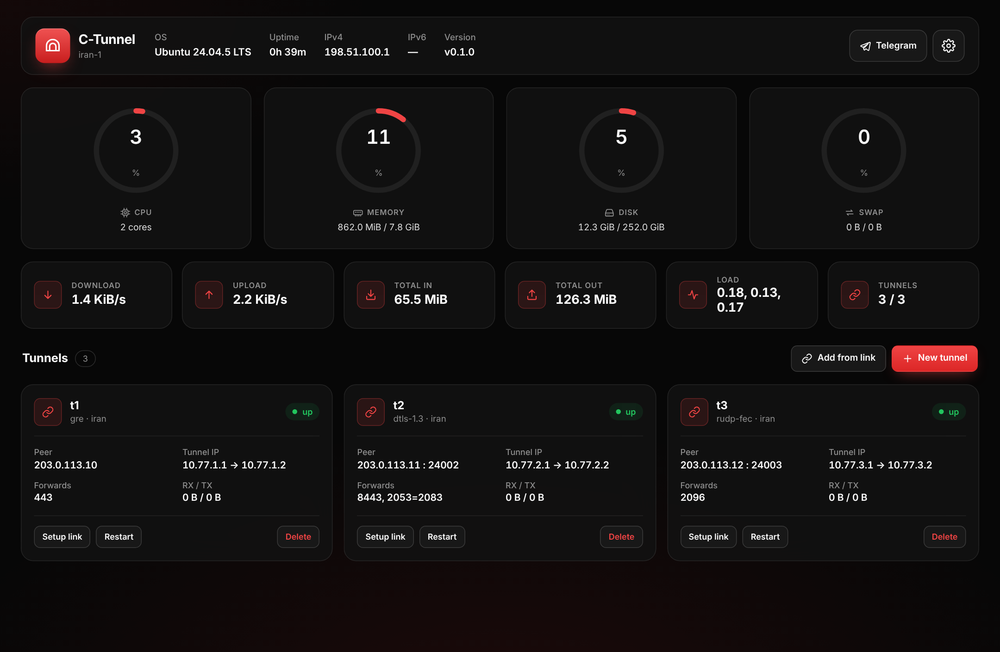
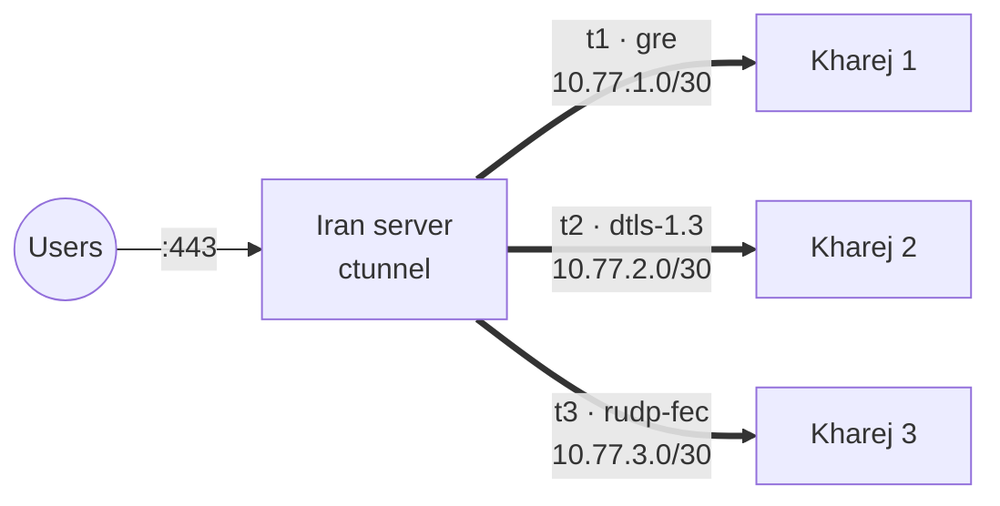

<p align="center">
  
</p>

<p align="center">
  <a href="https://github.com/CIAUB/C-Tunnel/releases/latest"></a>
  <a href="https://github.com/CIAUB/C-Tunnel/actions/workflows/ci.yml"></a>
  
  
  <a href="https://t.me/CiAUB_CH"></a>
</p>

<p align="center">
  <a href="README.md">English</a> · <b>فارسی</b> · <a href="README_RU.md">Русский</a>
</p>

<p align="center">
  <a href="https://nowpayments.io/embeds/donation-widget?api_key=8373139c-0aec-4e38-b34c-88dd005cfc1c" target="_blank" rel="noreferrer noopener">
    
  </a>
</p>

<div dir="rtl">

<p align="center">
  تانل‌های کرنلی و تانل‌های UDP رمزنگاری‌شده بین یک سرور ایران و هر تعداد سرور خارج،<br>
  همراه با فوروارد پورت، لینک راه‌اندازی یک‌خطی، منوی ترمینال و پنل وب.
</p>

<p align="center">
  
</p>

---

## فهرست

- [چطور کار می‌کند](#چطور-کار-میکند)
- [امکانات](#امکانات)
- [پیش‌نیازها](#پیشنیازها)
- [نصب](#نصب)
- [شروع سریع](#شروع-سریع)
- [انتخاب روش](#انتخاب-روش)
- [همه‌ی روش‌ها](#همهی-روشها)
- [پنل وب](#پنل-وب)
- [دستورها](#دستورها)
- [فایل‌ها و سرویس‌ها](#فایلها-و-سرویسها)
- [عیب‌یابی](#عیبیابی)
- [ساخت از سورس](#ساخت-از-سورس)
- [ارتباط](#ارتباط)

## چطور کار می‌کند



۱. روی سرور ایران تانل می‌سازید و یک لینک یک‌خطی `ctunnel://` می‌گیرید.

۲. لینک را روی سرور خارج می‌چسبانید. آدرس، پورت، کلید و MTU دو طرف با هم یکی می‌شود.

۳. کاربرها به یک پورت روی سرور ایران وصل می‌شوند و C-Tunnel ترافیک را از داخل تانل به سرور خارج می‌رساند.

هر تانل subnet خودش (`10.77.N.0/30`)، اینترفیس خودش و پورت UDP خودش را می‌گیرد؛ پس هر چند سرور خارج که بخواهید را بدون تداخل اضافه می‌کنید.

## امکانات

| | |
|---|---|
| **۲۸ روش** | تانل‌های کرنلی L3 و L2، به‌علاوه‌ی هشت روش UDP رمزنگاری‌شده |
| **یک ایران، چند خارج** | subnet، پورت و شناسه‌ها خودکار تخصیص داده می‌شوند و تداخل رد می‌شود |
| **فوروارد پورت** | `443`، یا `2053=8443` برای فرستادن به پورت دیگر. قانون‌های هر تانل جدا هستند و تمیز پاک می‌شوند. |
| **رمزنگاری** | AES-256-GCM با کلید جدا برای هر جهت، پنجره‌ی ضد replay به اندازه‌ی ۲۰۰۰ بسته و padding تصادفی |
| **شبیه‌سازی پروتکل** | هر روش UDP-Crypt بسته‌ها را با هدر پروتکل هم‌نامش می‌فرستد |
| **بازیابی packet loss** | `rudp-fec` به ازای هر دو بسته یک بسته‌ی parity می‌فرستد و بسته‌ی گم‌شده را بدون ارسال دوباره می‌سازد |
| **میکروتیک** | دستورهای آماده‌ی RouterOS 7 برای `gre`، `ipip`، `6to4`، `eoip`، `vxlan` و `wireguard` |
| **پنل وب** | HTTPS، گیج‌های سرور، ترافیک زنده، ساخت، وارد کردن، ری‌استارت و حذف تانل، تست لینک |
| **تست اتصال** | بسته‌های واقعی GRE، IPIP، SIT، ESP، WireGuard، VXLAN، QUIC، DTLS و… را بین دو سرور می‌فرستد، نشان می‌دهد کدام روش رد می‌شود و کدام بسته است، سرعت را اندازه می‌گیرد و بهترین روش را پیشنهاد می‌دهد |
| **ماندگار** | هر تانل یک سرویس systemd است؛ بعد از ریبوت برمی‌گردد و با ری‌استارت از نو و تمیز ساخته می‌شود |

## پیش‌نیازها

- لینوکس با systemd: Ubuntu 20.04 به بالا، Debian 11 به بالا یا مشابه
- معماری `amd64` یا `arm64`
- دسترسی root
- IP عمومی روی هر سرور، و باز بودن پروتکل یا پورت UDP تانل در دیتاسنتر

اگر `iproute2`، `iptables` و `curl` نصب نباشند، `install.sh` خودش نصبشان می‌کند. برای WireGuard بسته‌ی `wireguard-tools` هم لازم است.

## نصب

یک دستور، روی **هر دو** سرور:

```bash
sudo bash -c "$(curl -sL https://raw.githubusercontent.com/CIAUB/C-Tunnel/main/install.sh)"
```

نصب‌کننده همیشه آخرین [Release](https://github.com/CIAUB/C-Tunnel/releases/latest) را نصب می‌کند.
باینری‌های مخصوص معماری سرور، اسکریپت کرنل و سرویس‌های systemd را دانلود می‌کند، هر فایل را با
`SHA256SUMS` همان Release مقایسه می‌کند و فقط اگر همه یکی باشند نصب می‌کند. اگر فایلی خراب یا
دستکاری‌شده باشد، نصب متوقف می‌شود و هیچ چیزی تغییر نمی‌کند.

```bash
sudo ctunnel
```

برای آپدیت، گزینه‌ی **Update** در منو را بزنید یا دستور نصب را دوباره اجرا کنید. تانل‌های فعلی حفظ
می‌شوند. برای نصب یک نسخه‌ی مشخص، بعد از `sudo` بنویسید `CTUNNEL_VERSION=v0.1.0`.

## شروع سریع

**۱. سرور ایران** (برای هر سرور خارج یک بار):

```text
sudo ctunnel  →  1) Setup Iran
  Method              gre        (اگر GRE فیلتر است: dtls-1.3)
  Remote server IP    203.0.113.10
  Forward ports       443
```

منو یک لینک راه‌اندازی چاپ می‌کند:

```text
ctunnel://eyJuYW1lIjoidDEiLCJyb2xlIjoia2hhcmVqIiwibWV0aG9kIjoiZ3JlIi...
```

**۲. سرور خارج:**

```text
sudo ctunnel  →  2) Setup Kharej  →  لینک را بچسبانید
```

یا با یک دستور:

```bash
sudo ctunnel apply-link 'ctunnel://...'
```

**۳. بررسی:**

```bash
sudo ctunnel status
```

برای سرور خارج بعدی، مرحله‌ی ۱ را با IP آن تکرار کنید. تانل جدید `10.77.2.0/30`، پورت آزاد بعدی و پورت‌های فوروارد خودش را می‌گیرد.

## انتخاب روش

| وضعیت | پیشنهاد |
|---|---|
| GRE و IPIP فیلتر نیستند | `gre`، `6to4`، `ipip`: سرعت کرنل، کمترین مصرف CPU |
| پروتکل‌های خام IP فیلترند | `dtls-1.3`، `quic-v1`، `wireguard`، یا `gre` با پورت FOU |
| مسیر packet loss دارد یا ناپایدار است | `rudp-fec` |
| رمزنگاری با سرعت کرنل | `xfrm-ipsec`، `wireguard` |
| طرف مقابل میکروتیک است | `gre`، `ipip`، `eoip`، `vxlan`، `wireguard` |

مطمئن نیستید؟ اول روی سرور ایران **0) Connection Test** را بزنید (یک لینک `ctunnel-test://` می‌دهد)، بعد روی سرور خارج همان گزینه را بزنید و لینک را بچسبانید. یک جدول زنده پیشرفت تست هر روش را نشان می‌دهد. کنار هر روش `ok`، `unstable` یا `blocked` نوشته می‌شود، سرعت هر روشِ سالم، MTU مسیر و سرعت TCP اندازه گرفته می‌شود و بهترین روش با MTU مناسبش پیشنهاد می‌شود:

```text
RESULT  FAMILY     METHOD        STATUS    ECHOES  PROGRESS

🟢      L3-Direct  6to4          OK        10/10   ▰▰▰▰▰▰▰▰ 100%
🟢      UDP-Crypt  dtls-1.3      OK        10/10   ▰▰▰▰▰▰▰▰ 100%
🟡      UDP-Crypt  quic-v1       UNSTABLE  7/10    ▰▰▰▰▰▰▱▱  70%
🔴      L3-Direct  gre           BLOCKED   0/10    ▱▱▱▱▱▱▱▱   0%

Works steadily:

   METHOD        FAMILY     LATENCY          DOWNLOAD     UPLOAD       TOTAL
🟢 6to4          L3-Direct  42.1 ms ±0.8     1.12 Gbps    418.6 Mbps   1.54 Gbps
🟢 dtls-1.3      UDP-Crypt  42.3 ms ±0.9     1.05 Gbps    402.3 Mbps   1.45 Gbps

BEST SETTINGS
Method           6to4           42.1 ms ±0.8, 0% loss
Download         1.12 Gbps      6to4 packets at full rate for 1 s
Upload           418.6 Mbps     6to4 packets at full rate for 1 s
Path MTU         1500           full-size packets pass
Tunnel MTU       1440           path MTU minus 6to4 overhead
TCP download     1.18 Gbps      4 TCP streams, bytes confirmed by the receiver
TCP upload       431.0 Mbps     4 TCP streams, bytes confirmed by the receiver
```

در زمان تست، روی سرور ایران پورت UDP 7712، پورت TCP 7711 و پروتکل‌های 4، 41، 47، 50، 97 و 115 باید باز باشند.

### حالت ریورس

در حالت REVERSE سرور خارج به ایران وصل می‌شود و سرور ایران فقط گوش می‌دهد؛ یعنی ایران هیچ‌وقت به آی‌پی خارجی کانکشن نمی‌زند.

| لایه | مسیر | مناسب برای |
|---|---|---|
| UDP-Crypt (`rev+dtls-1.3`، `rev+quic-v1`…) | خارج UDP به ایران می‌فرستد، همان بسته‌های DIRECT | لینک‌های پرلاس یا پینگ بالا |
| WireGuard (`rev+wireguard`) | خارج کلاینت وایرگارد است | میکروتیک و کلاینت‌های معمولی |
| کرنل L3/L2 (`frp+gre`، `frp+vxlan`…) | داخل ۸ استریم TCP موازی شبیه رکورد TLS | لینک تمیز که فقط TCP رد می‌شود |

هر کانکشن داخلی روی یک استریم می‌ماند تا جابه‌جا نرسد و هر استریم صف خودش را دارد. در تست ما سرعت کریر TCP نسبت به 0.1.5 حدوداً دو برابر شد (از حدود ۳۹۰ به ۶۹۰ مگابیت روی لینک ۸۰۰ مگابیتی). تست اتصال سرعت TCP را جدا نشان می‌دهد؛ همان چیزی است که روش‌های `frp+` می‌برند.

## همه‌ی روش‌ها

<details>
<summary><b>L3 کرنلی</b>: ۱۳ روش</summary>

| روش | توضیح |
|---|---|
| `gre` | GRE (پروتکل 47)، با FOU و lane موازی اختیاری |
| `ipip` | IPv4 داخل IPv4 (پروتکل 4)، با FOU اختیاری |
| `6to4` | حامل SIT با IPIP6 داخلش |
| `6to4-gre` | حامل SIT با IP6GRE داخلش |
| `sit` | IPv6 داخل IPv4؛ فقط IPv6 حمل می‌کند |
| `ip6gre` | GRE روی بستر IPv6 |
| `ipip6` | IPv4 روی بستر IPv6 |
| `ip6ip6` | IPv6 روی IPv6؛ فقط IPv6 حمل می‌کند |
| `wireguard` | WireGuard کرنلی؛ کلیدها از لینک راه‌اندازی ساخته می‌شوند |
| `xfrm-ipsec` | GRE رمزشده با IPsec ESP کرنل (AES-GCM-256) |
| `fou-gre` | GRE داخل UDP |
| `gue-ipip` | IPIP داخل GUE/UDP |
| `ecmp-lanes` | ۲ تا ۸ تانل GRE موازی با ECMP |

</details>

<details>
<summary><b>L2</b>: ۷ روش</summary>

| روش | توضیح |
|---|---|
| `eoip` | EoIP میکروتیک روی GRE خام، سازگار با RouterOS |
| `gretap` | اترنت روی GRE |
| `ip6gretap` | اترنت روی GRE با IPv6 |
| `vxlan` | اترنت روی UDP (4789) |
| `geneve` | اترنت روی UDP (6081) |
| `l2tpv3` | pseudowire ثابت L2TPv3 روی IP یا UDP |
| `etherip` | EtherIP طبق RFC 3378 (پروتکل 97) |

</details>

<details>
<summary><b>UDP-Crypt</b>: ۸ روش با AES-256-GCM</summary>

| روش | بسته‌ها شبیه به |
|---|---|
| `dtls-1.3` | رکوردهای داده‌ی DTLS |
| `quic-v1` | بسته‌های short-header پروتکل QUIC |
| `srtp-direct` | استریم مدیای RTP / SRTP |
| `wg-stealth` | هدر تصادفی وابسته به کلید، با چند بسته‌ی بی‌معنی در شروع |
| `rudp-fec` | دیتاگرام‌های گروهی با parity از نوع XOR (۲+۱) |
| `dnscrypt-udp` | پاسخ‌های DNS |
| `ntp-direct` | بسته‌های سرور NTPv4 |
| `openvpn-dco` | بسته‌های `P_DATA_V2` در OpenVPN |

</details>

## پنل وب

`sudo ctunnel` ← **4) Web Panel** ← **Start**، بعد این آدرس را باز کنید:

```text
https://<server-ip>:8443
```

با کدی که در همان منو نمایش داده می‌شود وارد شوید. گواهی self-signed است، پس هشدار مرورگر را یک بار قبول کنید. بعد از ۵ کد اشتباه، آن IP پنج دقیقه قفل می‌شود. پورت و کد ورود را از همان منو می‌توانید عوض کنید. با عوض کردن کد، همه‌ی مرورگرها از پنل خارج می‌شوند.

## دستورها

| دستور | کار |
|---|---|
| `ctunnel` | منوی تعاملی |
| `ctunnel status` | لیست تانل‌ها با وضعیت و ترافیک |
| `ctunnel up\|restart\|down NAME` | روشن، ری‌استارت یا خاموش کردن یک تانل |
| `ctunnel link NAME` | لینک راه‌اندازی و دستورهای میکروتیک برای طرف مقابل |
| `ctunnel apply-link 'ctunnel://…'` | ساختن و روشن کردن تانل از روی لینک |
| `ctunnel conntest-server` | سمت ایران تست اتصال؛ لینک تست را می‌دهد |
| `ctunnel conntest 'ctunnel-test://…'` | سمت خارج: کدام روش‌ها رد می‌شوند، سرعت و پیشنهاد |
| `ctunnel linktest HOST` | پینگ، loss و سرعت تا HOST، مثلاً IP تانل |
| `ctunnel speedtest-server` | پاسخ‌دهنده برای `linktest` (پورت TCP 7711) |
| `ctunnel optimize` | BBR + fq، بافر ۶۴ مگابایتی و IP forwarding |
| `ctunnel panel` | اجرای پنل وب در پیش‌زمینه |
| `ctunnel catalog` | لیست همه‌ی روش‌ها |
| `ctunnel version` | نمایش نسخه |

## فایل‌ها و سرویس‌ها

| مسیر | کاربرد |
|---|---|
| `/etc/ctunnel/state.json` | تانل‌ها، پورت پنل و کد ورود |
| `/etc/ctunnel/tunnels/NAME.env` | تنظیمات یک تانل |
| `/usr/local/lib/ctunnel/ctunnel-kernel` | ساخت اینترفیس‌ها، فوروارد پورت و IPsec |
| `ctunnel@NAME.service` | تانل‌های کرنلی |
| `ctunnel-engine@NAME.service` | UDP-Crypt، EoIP و EtherIP |
| `ctunnel-panel.service` | پنل وب |

لاگ:

```bash
journalctl -u ctunnel@t1 -u ctunnel-engine@t1 -n 50
```

## عیب‌یابی

| مشکل | علت و راه‌حل |
|---|---|
| وضعیت `failed` | لاگ بالا را ببینید. معمولاً یک ماژول کرنل نیست (`modprobe ip_gre`) یا دیتاسنتر پروتکل را بسته است. |
| وضعیت `up` است ولی ترافیک رد نمی‌شود | طرف مقابل تنظیم نشده یا فایروال جلوی تانل را گرفته. برای UDP-Crypt و WireGuard پورت UDP و برای GRE پروتکل 47 را باز کنید. |
| UDP-Crypt بعد از ری‌استارت بسته‌ها را دور می‌ریزد | ساعت دو سرور باید تقریباً درست باشد (NTP)، چون شماره‌ی بسته‌ها از ساعت شروع می‌شود. |
| پورت فورواردشده جواب نمی‌دهد | سرویس روی سرور خارج باید روی `0.0.0.0` یا IP تانل گوش بدهد. |
| با `sit` و `ip6ip6` نمی‌شود پورت فوروارد کرد | این دو فقط IPv6 حمل می‌کنند؛ به‌جایشان از `6to4` استفاده کنید. |

## ساخت از سورس

```bash
git clone https://github.com/CIAUB/C-Tunnel.git
cd C-Tunnel
go test ./...
sudo bash install.sh                  # build + install from this folder
bash scripts/build-release.sh 0.1.0   # release files + SHA256SUMS in dist/
```

**انتشار نسخه‌ی جدید:** نسخه را در `pkg/version/version.go` عوض کنید، commit کنید و یک tag بفرستید
(`git tag v0.1.1 && git push origin v0.1.1`). GitHub Actions تست‌ها را اجرا می‌کند، همه‌ی فایل‌ها را
همراه با `SHA256SUMS` می‌سازد و Release را منتشر می‌کند؛ دستور نصب از همان لحظه نسخه‌ی جدید را
می‌گیرد. ساختار کد در [docs/ARCHITECTURE.md](docs/ARCHITECTURE.md) توضیح داده شده است.

> روش‌های UDP-Crypt بسته‌ها را برای فیلترهای ساده شبیه DTLS، QUIC، RTP و بقیه نشان می‌دهند، ولی پیاده‌سازی کامل آن پروتکل‌ها نیستند.

## ارتباط

- اخبار، نسخه‌های جدید و پشتیبانی: کانال تلگرام [@CiAUB_CH](https://t.me/CiAUB_CH)
- گزارش باگ و درخواست امکانات: [GitHub Issues](https://github.com/CIAUB/C-Tunnel/issues)

</div>

<p align="center">
  
</p>
