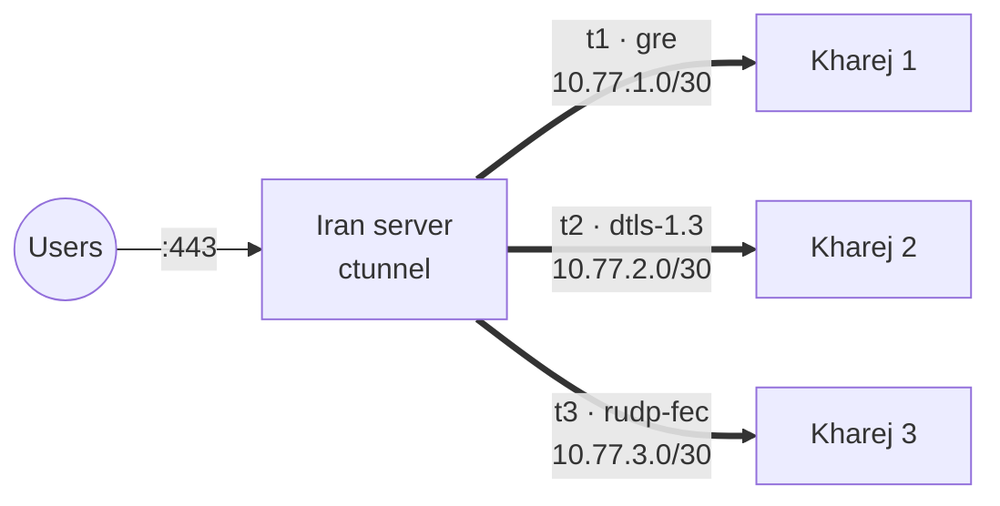

<p align="center">
  
</p>

<p align="center">
  <a href="https://github.com/CIAUB/C-Tunnel/releases/latest"></a>
  <a href="https://github.com/CIAUB/C-Tunnel/actions/workflows/ci.yml"></a>
  
  
  <a href="https://t.me/CiAUB"></a>
</p>

<p align="center">
  <a href="README.md">English</a> · <a href="README_FA.md">فارسی</a> · <b>Русский</b>
</p>

<p align="center">
  <a href="https://nowpayments.io/embeds/donation-widget?api_key=8373139c-0aec-4e38-b34c-88dd005cfc1c" target="_blank" rel="noreferrer noopener">
    
  </a>
</p>

<p align="center">
  Туннели ядра Linux и зашифрованные UDP-транспорты между иранским сервером и любым числом зарубежных серверов,<br>
  с пробросом портов, однострочными ссылками настройки, меню в терминале и веб-панелью.
</p>

<p align="center">
  
</p>

---

## Содержание

- [Как это работает](#как-это-работает)
- [Возможности](#возможности)
- [Требования](#требования)
- [Установка](#установка)
- [Быстрый старт](#быстрый-старт)
- [Выбор метода](#выбор-метода)
- [Все методы](#все-методы)
- [Веб-панель](#веб-панель)
- [Команды](#команды)
- [Файлы и службы](#файлы-и-службы)
- [Решение проблем](#решение-проблем)
- [Сборка из исходников](#сборка-из-исходников)
- [Сообщество](#сообщество)

## Как это работает



1. На иранском сервере вы создаёте туннель и получаете однострочную ссылку `ctunnel://`.
2. Вставляете ссылку на зарубежном (kharej) сервере. Адреса, порты, ключи и MTU на обеих сторонах совпадают автоматически.
3. Пользователи подключаются к порту иранского сервера, а C-Tunnel передаёт трафик через туннель на зарубежный сервер.

Каждый туннель получает свою подсеть `10.77.N.0/30`, свой сетевой интерфейс и свой UDP-порт, поэтому можно подключить сколько угодно зарубежных серверов без конфликтов.

## Возможности

| | |
|---|---|
| **28 методов** | Туннели ядра L3 и L2, а также восемь зашифрованных UDP-транспортов |
| **Один Иран, много зарубежных серверов** | Подсети, порты и идентификаторы туннелей выделяются автоматически, конфликты отклоняются |
| **Проброс портов** | `443`, или `2053=8443` для проброса на другой порт. Правила помечены по туннелям и удаляются аккуратно. |
| **Шифрование** | AES-256-GCM с отдельным ключом для каждого направления, окно защиты от повторов на 2000 пакетов и случайное дополнение (padding) |
| **Маскировка под протокол** | Каждый метод UDP-Crypt оборачивает пакеты в заголовок одноимённого протокола |
| **Восстановление потерь** | `rudp-fec` добавляет один XOR-пакет чётности на каждые два пакета данных и восстанавливает потерянный пакет без повторной передачи |
| **MikroTik** | Готовые команды RouterOS 7 для `gre`, `ipip`, `6to4`, `eoip`, `vxlan` и `wireguard` |
| **Веб-панель** | HTTPS, загрузка сервера, трафик в реальном времени, создание, импорт, перезапуск и удаление туннелей, тест канала |
| **Тест соединения** | Отправляет настоящие пакеты GRE, IPIP, SIT, ESP, WireGuard, VXLAN, QUIC, DTLS… между серверами, показывает, какие методы проходят, а какие заблокированы, измеряет скорость и рекомендует лучший |
| **Устойчивость** | Каждый туннель — служба systemd: восстанавливается после перезагрузки и чисто пересоздаётся при перезапуске |

## Требования

- Linux с systemd: Ubuntu 20.04+, Debian 11+ или аналогичный
- `amd64` или `arm64`
- Права root
- Публичный IP на каждом сервере и разрешённый у провайдера протокол или UDP-порт туннеля

`install.sh` сам установит `iproute2`, `iptables` и `curl`, если их нет. Для WireGuard дополнительно нужен `wireguard-tools`.

## Установка

Одна команда на **обоих** серверах:

```bash
sudo bash -c "$(curl -sL https://raw.githubusercontent.com/CIAUB/C-Tunnel/main/install.sh)"
```

Установщик всегда ставит последний [релиз](https://github.com/CIAUB/C-Tunnel/releases/latest).
Он скачивает бинарники для архитектуры сервера, скрипт ядра и юниты systemd, сверяет каждый файл
с `SHA256SUMS` релиза и устанавливает только при совпадении всех хэшей. Повреждённый или изменённый
файл прерывает установку, и в системе ничего не меняется.

```bash
sudo ctunnel
```

Для обновления выберите **Update** в меню или выполните команду установки ещё раз. Работающие
туннели сохраняются. Чтобы установить конкретную версию, добавьте `CTUNNEL_VERSION=v0.1.0` после `sudo`.

## Быстрый старт

**1. Иранский сервер**, по одному разу для каждого зарубежного сервера:

```text
sudo ctunnel  →  1) Setup Iran
  Method              gre        (dtls-1.3, если GRE блокируется)
  Remote server IP    203.0.113.10
  Forward ports       443
```

Меню выведет ссылку настройки:

```text
ctunnel://eyJuYW1lIjoidDEiLCJyb2xlIjoia2hhcmVqIiwibWV0aG9kIjoiZ3JlIi...
```

**2. Зарубежный сервер:**

```text
sudo ctunnel  →  2) Setup Kharej  →  вставьте ссылку
```

или одной командой:

```bash
sudo ctunnel apply-link 'ctunnel://...'
```

**3. Проверка:**

```bash
sudo ctunnel status
```

```text
 NAME      METHOD       ROLE   REMOTE           TUNNEL IP      PORT   STATE    RX / TX
 t1        gre          iran   203.0.113.10     10.77.1.1      0      up       1.2 GiB / 310.4 MiB
 t2        dtls-1.3     iran   203.0.113.11     10.77.2.1      24002  up       842.7 MiB / 95.1 MiB
```

Чтобы добавить ещё один зарубежный сервер, повторите шаг 1 с его IP. Новый туннель получит `10.77.2.0/30`, следующий свободный порт и собственные пробрасываемые порты.

## Выбор метода

| Ситуация | Рекомендуется |
|---|---|
| GRE / IPIP не блокируются | `gre`, `6to4`, `ipip`: скорость ядра, минимальная нагрузка на CPU |
| «Сырые» IP-протоколы блокируются | `dtls-1.3`, `quic-v1`, `wireguard` или `gre` с портом FOU |
| Канал с потерями или нестабильный | `rudp-fec` |
| Шифрование на скорости ядра | `xfrm-ipsec`, `wireguard` |
| С другой стороны MikroTik | `gre`, `ipip`, `eoip`, `vxlan`, `wireguard` |

Не уверены? Сначала запустите **0) Connection Test** на иранском сервере (он выдаст ссылку `ctunnel-test://`), затем на зарубежном сервере вставьте эту ссылку. Живая таблица показывает ход проверки каждого метода. Каждый метод будет помечен как `ok`, `unstable` или `blocked`; измеряются скорость каждого рабочего метода, MTU пути и скорость TCP, и предлагается лучший метод с подходящим MTU:

```text
RESULT  FAMILY     METHOD        STATUS    ECHOES  PROGRESS

🟢      L3-Direct  6to4          OK        10/10   ▰▰▰▰▰▰▰▰ 100%
🟢      UDP-Crypt  dtls-1.3      OK        10/10   ▰▰▰▰▰▰▰▰ 100%
🟡      UDP-Crypt  quic-v1       UNSTABLE  7/10    ▰▰▰▰▰▰▱▱  70%
🔴      L3-Direct  gre           BLOCKED   0/10    ▱▱▱▱▱▱▱▱   0%

Works steadily:

   METHOD        FAMILY     LATENCY          IRAN→KHAREJ   KHAREJ→IRAN
🟢 6to4          L3-Direct  42.1 ms ±0.8     1.12 Gbps     418.6 Mbps
🟢 dtls-1.3      UDP-Crypt  42.3 ms ±0.9     1.05 Gbps     402.3 Mbps

BEST SETTINGS
Method           6to4           42.1 ms ±0.8, 0% loss
Iran → Kharej    1.12 Gbps      6to4 packets at full rate for 1 s
Kharej → Iran    418.6 Mbps     6to4 packets at full rate for 1 s
Path MTU         1500           full-size packets pass
Tunnel MTU       1440           path MTU minus 6to4 overhead
TCP Iran→Kharej  1.18 Gbps      4 TCP streams, bytes confirmed by the receiver
TCP Kharej→Iran  431.0 Mbps     4 TCP streams, bytes confirmed by the receiver
```

На время теста на иранском сервере должны быть открыты UDP 7712, TCP 7711 и IP-протоколы 4, 41, 47, 50, 97 и 115.

## Все методы

<details>
<summary><b>L3 ядра</b>: 13 методов</summary>

| Метод | Описание |
|---|---|
| `gre` | GRE (IP-протокол 47), опционально FOU и параллельные линии |
| `ipip` | IPv4-in-IPv4 (протокол 4), опционально FOU |
| `6to4` | Несущий SIT с IPIP6 внутри |
| `6to4-gre` | Несущий SIT с IP6GRE внутри |
| `sit` | IPv6-in-IPv4; передаёт только IPv6 |
| `ip6gre` | GRE поверх IPv6 |
| `ipip6` | IPv4 поверх IPv6 |
| `ip6ip6` | IPv6 поверх IPv6; передаёт только IPv6 |
| `wireguard` | WireGuard в ядре; ключи выводятся из ссылки настройки |
| `xfrm-ipsec` | GRE, зашифрованный IPsec ESP ядра (AES-GCM-256) |
| `fou-gre` | GRE внутри UDP |
| `gue-ipip` | IPIP внутри GUE/UDP |
| `ecmp-lanes` | От 2 до 8 параллельных GRE-туннелей с ключами и ECMP |

</details>

<details>
<summary><b>L2</b>: 7 методов</summary>

| Метод | Описание |
|---|---|
| `eoip` | MikroTik EoIP поверх «сырого» GRE, совместим с RouterOS |
| `gretap` | Ethernet поверх GRE |
| `ip6gretap` | Ethernet поверх IPv6 GRE |
| `vxlan` | Ethernet поверх UDP (4789) |
| `geneve` | Ethernet поверх UDP (6081) |
| `l2tpv3` | Статический псевдопровод L2TPv3 поверх IP или UDP |
| `etherip` | EtherIP, RFC 3378 (протокол 97) |

</details>

<details>
<summary><b>UDP-Crypt</b>: 8 методов, AES-256-GCM</summary>

| Метод | Пакеты похожи на |
|---|---|
| `dtls-1.3` | Записи прикладных данных DTLS |
| `quic-v1` | Пакеты QUIC с коротким заголовком |
| `srtp-direct` | Медиапоток RTP / SRTP |
| `wg-stealth` | Случайный заголовок, зависящий от ключа, с «мусорными» пакетами в начале |
| `rudp-fec` | Сгруппированные датаграммы с XOR-чётностью 2+1 |
| `dnscrypt-udp` | Ответы DNS |
| `ntp-direct` | Серверные пакеты NTPv4 |
| `openvpn-dco` | OpenVPN `P_DATA_V2` |

</details>

## Веб-панель

`sudo ctunnel` → **4) Web Panel** → **Start**, затем откройте:

```text
https://<server-ip>:8443
```

Войдите с кодом, который показан в том же меню. Сертификат самоподписанный, поэтому один раз подтвердите предупреждение браузера. После пяти неверных кодов IP блокируется на пять минут. Порт и код входа можно изменить в меню. При смене кода все браузеры выходят из панели.

## Команды

| Команда | Описание |
|---|---|
| `ctunnel` | Интерактивное меню |
| `ctunnel status` | Туннели с состоянием и трафиком |
| `ctunnel up\|restart\|down NAME` | Управление одним туннелем |
| `ctunnel link NAME` | Ссылка настройки и команды MikroTik для другой стороны |
| `ctunnel apply-link 'ctunnel://…'` | Создать и запустить туннель по ссылке |
| `ctunnel conntest-server` | Иранская сторона теста соединения, выводит ссылку |
| `ctunnel conntest 'ctunnel-test://…'` | Зарубежная сторона: какие методы проходят, скорость, рекомендация |
| `ctunnel linktest HOST` | Задержка, потери и скорость до HOST, например IP туннеля |
| `ctunnel speedtest-server` | Ответчик для `linktest` (TCP 7711) |
| `ctunnel optimize` | BBR + fq, буферы сокетов 64 МБ, IP forwarding |
| `ctunnel panel` | Запустить веб-панель в текущем терминале |
| `ctunnel catalog` | Список всех методов |
| `ctunnel version` | Показать версию |

## Файлы и службы

| Путь | Назначение |
|---|---|
| `/etc/ctunnel/state.json` | Туннели, порт панели и код входа |
| `/etc/ctunnel/tunnels/NAME.env` | Настройки одного туннеля |
| `/usr/local/lib/ctunnel/ctunnel-kernel` | Создаёт интерфейсы, проброс портов и IPsec |
| `ctunnel@NAME.service` | Туннели ядра |
| `ctunnel-engine@NAME.service` | UDP-Crypt, EoIP и EtherIP |
| `ctunnel-panel.service` | Веб-панель |

Журналы:

```bash
journalctl -u ctunnel@t1 -u ctunnel-engine@t1 -n 50
```

## Решение проблем

| Симптом | Причина и решение |
|---|---|
| Состояние `failed` | Посмотрите журнал выше. Обычно не хватает модуля ядра (`modprobe ip_gre`) или протокол заблокирован провайдером. |
| Состояние `up`, но трафика нет | Другая сторона не настроена или файрвол отбрасывает туннель. Откройте UDP-порт для UDP-Crypt и WireGuard или протокол 47 для GRE. |
| UDP-Crypt отбрасывает пакеты после перезапуска | Часы обоих серверов должны быть примерно верными (NTP), так как номера пакетов начинаются от текущего времени. |
| Проброшенный порт не отвечает | Служба на зарубежном сервере должна слушать `0.0.0.0` или IP туннеля. |
| `sit` / `ip6ip6` не пробрасывают порты | Они передают только IPv6. Используйте `6to4`. |

## Сборка из исходников

```bash
git clone https://github.com/CIAUB/C-Tunnel.git
cd C-Tunnel
go test ./...
sudo bash install.sh                  # сборка и установка из этой папки
bash scripts/build-release.sh 0.1.0   # файлы релиза и SHA256SUMS в dist/
```

**Публикация релиза:** укажите версию в `pkg/version/version.go`, сделайте коммит и отправьте тег
(`git tag v0.1.1 && git push origin v0.1.1`). GitHub Actions запустит тесты, соберёт все файлы вместе с
`SHA256SUMS` и опубликует релиз; команда установки сразу начнёт его использовать.
Устройство проекта описано в [docs/ARCHITECTURE.md](docs/ARCHITECTURE.md).

> Методы UDP-Crypt делают пакеты похожими на DTLS, QUIC, RTP и другие протоколы для простых фильтров, но не являются полными реализациями этих протоколов.

## Сообщество

- Новости, релизы и поддержка: Telegram-канал [@CiAUB](https://t.me/CiAUB)
- Ошибки и предложения: [GitHub Issues](https://github.com/CIAUB/C-Tunnel/issues)

<p align="center">
  
</p>
