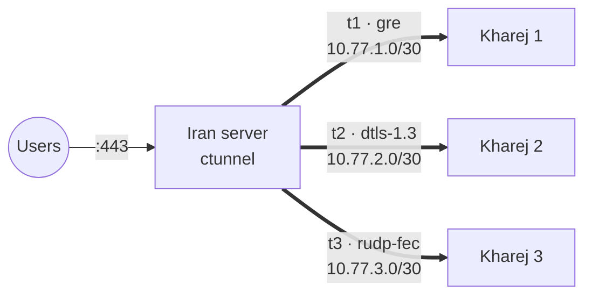

<p align="center">
  
</p>

<p align="center">
  <a href="https://github.com/CIAUB/C-Tunnel/releases/latest"></a>
  <a href="https://github.com/CIAUB/C-Tunnel/actions/workflows/ci.yml"></a>
  
  
  <a href="https://t.me/CiAUB_CH"></a>
</p>

<p align="center">
  <a href="README.md">English</a> · <a href="README_FA.md">فارسی</a> · <b>Русский</b>
</p>

<p align="center">
  <a href="https://nowpayments.io/embeds/donation-widget?api_key=8373139c-0aec-4e38-b34c-88dd005cfc1c" target="_blank" rel="noreferrer noopener">
    
  </a>
</p>

<p align="center">
  Туннели ядра Linux и зашифрованные UDP-транспорты между иранским сервером и любым числом зарубежных серверов,<br>
  с пробросом портов, однострочными ссылками настройки, меню в терминале и веб-панелью.
</p>

<p align="center">
  
</p>

---

## Содержание

- [Список изменений v2.0.0 (Changelog)](#список-изменений-v200-changelog)
- [Как это работает](#как-это-работает)
- [Возможности](#возможности)
- [Требования](#требования)
- [Установка](#установка)
- [Быстрый старт](#быстрый-старт)
- [Выбор метода](#выбор-метода)
- [Все методы](#все-методы)
- [Веб-панель](#веб-панель)
- [Команды](#команды)
- [Файлы и службы](#файлы-и-службы)
- [Решение проблем](#решение-проблем)
- [Сборка из исходников](#сборка-из-исходников)
- [Лицензия](#лицензия)
- [Сообщество](#сообщество)

## Список изменений v2.0.0 (Changelog)

Полный перечень всех новых протоколов, подсистем, оптимизаций ядра, улучшений безопасности и исправлений в **C-Tunnel v2.0.0** по сравнению с `v1.1.1` (подробный журнал в [CHANGELOG.md](CHANGELOG.md)):

- **21 новый транспорт (рост с 28 до 49 методов в 6 семействах) и 3 режима работы:**
  - **3 режима туннелей:** **Reverse** (зарубежный сервер подключается к Ирану; 0 исходящих подключений из Ирана), **Direct** (прямое подключение с минимальной задержкой) и **8× BBR Turbo Direct** (8 параллельных TCP-потоков с BBR).
  - **9 туннелей уровня L4 Direct и Reverse (`pkg/l4`):** `tcp` (пул из 16 соединений + ядерный `splice`), `tcpmux` (`smux` v2 поверх 4 TCP-соединений), `pck` (KCP внутри формируемых вручную TCP-сегментов через raw-сокет с BPF-фильтром и AES без TCP-состояния ядра), `ws` (WebSocket с поддержкой `Host`/SNI), `wsmux`, `wss` (WebSocket в TLS), `wssmux`, `udp` (пул KCP-сессий поверх UDP с явным сигналом FIN) и `udpmux`. Проброс TCP и UDP без туннельного IP и без TCP-in-TCP, настройка по ссылке `ctunnel://` или вручную, автоматический L4 Failover.
  - **4 выделенных игровых протокола (Direct и Reverse):** `game-udp` (минимальный пинг, `DSCP EF` / `SO_PRIORITY 6`, `IP_MTU_DISCOVER=DO`, без блокировки очереди), `game-fec` (**0-RTT XOR-FEC** восстановление потерь без ожидания повтора), `game-dup` (двойная отправка малых пакетов `<= 320 Б`) и `game-kcp` (проброс портов L4 на KCP с тиком `5 мс`).
  - **2 Stealth-транспорта уровня L3 (Direct и Reverse):** `faketcp` (TLS-записи внутри TCP-сегментов на носителе `pck` со скоростью UDP) и `icmp` (AES-256-GCM внутри ICMP Echo ping с подавлением собственных ответов ядра через iptables).
  - **3 новых метода маскировки UDP-Crypt (Direct и Reverse):** `stun-turn` (WebRTC TURN ChannelData, порт `3478`), `gtp-u` (3GPP GTP-U G-PDU мобильного ядра, порт `2152`) и `esp-udp` (IPsec NAT-T ESP-in-UDP, порт `4500`).
  - **3 новых высокоскоростных ядерных транспорта L3:** `bareudp` (IPv4 напрямую в UDP для Linux 5.7+ без лишнего заголовка, порт `6635`), `xgre` (многопоточный GRE с ключом, `ignore-df`, FOU, ECMP и поддержкой MikroTik) и `xgre-ip` (IPIP поверх многопоточного `xGRE`).
- **Оптимизации движка, ядра и сети (ускорение до 2.5×):**
  - **Переход на Go 1.26.10:** обновление с Go 1.22 до Go 1.26.10 и `golang.org/x/net v0.62.0` устранило все 37 уязвимостей стандартной библиотеки по `govulncheck` (0 достижимых CVE).
  - **Zero-Copy `splice` в ядре Linux для L4 TCP:** передача данных между сокетами напрямую в ядре без копирования в userspace.
  - **Пакетные ACK KCP раз в 10 мс и окно 4096 сегментов:** ускорение `udp`, `udpmux` и `pck` в **1.6–2.5 раза** между неймспейсами, на **~25%** при RTT `50 мс` и на **10–20%** при RTT `150 мс`.
  - **Окно `smux` 16 МиБ и фреймы 64 КиБ:** 4-кратное увеличение потокового окна (`4 МиБ → 16 МиБ`) для дальних каналов.
  - **Векторный пакетный ввод-вывод и ядерные оффлоады:** `sendmmsg`/`recvmmsg`, UDP GSO/GRO, TUN GSO/GRO, распределение декапсуляции по ядрам CPU (RPS), адаптивный контроллер пути (`pkg/pathctl`), userspace-клэмпинг TCP SYN MSS (`pkg/tcpmss`) и замер скорости по `TCP_INFO` (`Bytes_acked`) в скользящем окне 1 с.
- **Telegram-бот v2, мульти-админ, ретрансляция через туннель на Иране и вход в панель без пароля:**
  - **Работает на зарубежных и иранских серверах (`pkg/tgrelay`):** иранские серверы автоматически проксируют запросы к Bot API и загрузку медиа через активные туннели.
  - **Нативные таблицы Bot API 10.1+ и живой тест сети в `/start`:** параллельный замер пинга и потерь по всем туннелям с выводом в нативную таблицу Telegram `<table>` (и автоматическим откатом на `<pre>`).
  - **Цветные кнопки Bot API 9.4+ и подменю `⚙️ Manage`:** семантические цвета кнопок (`primary` синий, `success` зелёный, `danger` красный) и отдельное меню управления (`Backup & Restore`, `Admins`, `Alerts`, `Server`, `Premium Emojis`, `Language`, `Restart All`).
  - **Анимированные премиум-эмодзи Telegram (`pkg/notify/emoji.go`):** автоопределение `User.is_premium` у владельца бота, загрузка анимированных `.tgs` эмодзи через `getStickerSet` (`RestrictedEmoji` или любой пользовательский пак) и прозрачный откат на стандартный Unicode.
  - **Мульти-админ и вход в веб-панель в 1 клик:** до 32 числовых Telegram User ID; кнопка прямого входа по HTTP (`#tgToken` с 30-минутной подписью HMAC-SHA256) по умолчанию и автоматический переход на HTTPS Telegram Mini App (`web_app` `initData` HMAC-SHA256).
  - **Расширенный отчёт о трафике:** трафик каждого туннеля, дельта `Δ`, квоты, архивный трафик, **общий накопленный объём сервера (`Σ`)** и **список админов**.
- **Резервное копирование, восстановление и автобэкап с сохранением накопленного трафика:**
  - Архивы `ctunnel-backup/2` сохраняют накопленные байты RX/TX каждого туннеля (`TrafficSeedRx`/`TrafficSeedTx`) и `ArchivedRx`/`ArchivedTx`, поэтому при восстановлении или переносе на другой сервер общий счётчик трафика не сбрасывается.
  - Ручной бэкап, безопасное восстановление или восстановление с перезаписью через загрузку файла в бота, веб-панель и CLI, а также автобэкап каждые `N` часов (`6ч`, `12ч`, `24ч`, `48ч`, `7д` или `1–720ч`).
- **Квоты трафика и ограничение скорости для каждого туннеля:**
  - Настройка лимита трафика (`ГБ`), скорости (`Мбит/с`), обоих параметров или безлимита при создании и редактировании (через `tc` ядра для L3/L2 и token-bucket для L4).
  - Автоматическая остановка при исчерпании квоты + уведомление в Telegram с 3 действиями: **ручной запуск (игнорировать квоту)**, **сброс счётчика** и **интерактивное добавление ГБ**.
- **Веб-панель v2, тест соединения v2, безопасность и мультиформатный блок спонсора:**
  - **Смена IP удалённого сервера на месте (`pkg/tunnel/peer.go`):** обновление Remote IP в CLI или веб-панели без удаления и пересоздания туннеля.
  - **Active Data Probe (`pkg/tunnel/probe.go`) и реальный ICMP-пинг:** активная проверка простаивающих туннелей перед объявлением обрыва или failover, отображение реального ICMP RTT, джиттера и потерь на карточках.
  - **Тест соединения v2 (`pkg/conntest`):** тестирование реальных L4-туннелей, `icmp`, `faketcp`, `rev+` и `frp+`, флаги `-new` и `-only`, бинарный поиск Path MTU (`DF=1`), автовыбор свободных портов и спидометр в стиле Ookla.
  - **Безопасность и UX:** TOTP 2FA, белый список IP/CIDR, защита L4 от флуда рукопожатий (64/IP, 1024 всего, таймаут WS 60 с), лимит попыток входа по `/64` IPv6, живая SSE-консоль, светлая/тёмная/авто темы, CSS-скелетоны загрузки, минификация ассетов, обновление в один клик через transient systemd unit, умный выбор IP и 4-шаговое меню CLI.
  - **Мультиформатный блок спонсора (`pkg/sponsor`):** поддержка `.png`, `.jpg`, `.jpeg`, `.webp`, `.gif`, `.mp4`, `.webm`, `.mov` с проверкой сигнатур, автопоиск `sponser*`/`sponsor*`, случайная ротация без повторов, встроенное промо-видео (`136 КиБ`), кэш `ETag`/`304`, ретрансляция через туннель и пятничная рассылка в Telegram (`12:00 Asia/Tehran`) с `spontext.txt` и `sponlink.txt`.

## Как это работает



1. На иранском сервере вы создаёте туннель и получаете однострочную ссылку `ctunnel://`.
2. Вставляете ссылку на зарубежном (kharej) сервере. Адреса, порты, ключи и MTU на обеих сторонах совпадают автоматически.
3. Пользователи подключаются к порту иранского сервера, а C-Tunnel передаёт трафик через туннель на зарубежный сервер.

Каждый туннель получает свою подсеть `10.77.N.0/30`, свой сетевой интерфейс и свой UDP-порт, поэтому можно подключить сколько угодно зарубежных серверов без конфликтов.

## Возможности

| | |
|---|---|
| **49+ методов** | Туннели ядра L3 и L2, зашифрованные UDP-транспорты, Stealth-носители, L4 Direct/Reverse и **4 игровых протокола** (`game-udp`, `game-fec`, `game-dup`, `game-kcp`) |
| **Один Иран, много зарубежных серверов** | Подсети, порты и идентификаторы туннелей выделяются автоматически, конфликты отклоняются, а IP удалённого сервера можно менять на месте |
| **Проброс портов** | `443`, или `2053=8443` для проброса на другой порт. Правила помечены по туннелям и удаляются аккуратно. |
| **Квоты и лимит скорости** | Лимит трафика (ГБ) с автоостановкой и уведомлением в Telegram, а также ограничение полосы пропускания (Мбит/с) для каждого туннеля |
| **Бэкап и автобэкап** | Резервные копии `ctunnel-backup/2` с сохранением накопленного трафика туннелей и сервера + автобэкап в Telegram по расписанию |
| **Шифрование** | AES-256-GCM с отдельным ключом для каждого направления, окно защиты от повторов на 2000 пакетов и случайное дополнение (padding) |
| **Маскировка под протокол** | Каждый метод UDP-Crypt оборачивает пакеты в заголовок одноимённого протокола |
| **Восстановление потерь** | `rudp-fec` и `game-fec` восстанавливают потерянные пакеты с помощью 0-RTT XOR-чётности без повторной передачи |
| **MikroTik** | Готовые команды RouterOS 7 для `gre`, `ipip`, `6to4`, `eoip`, `vxlan` и `wireguard` |
| **Веб-панель** | Светлый и тёмный адаптивный интерфейс, HTTP по умолчанию, частный путь, TLS, TOTP 2FA, белый список IP, живая SSE-консоль и вход в один клик из Telegram |
| **Telegram-бот v2** | Работает на зарубежных и иранских серверах; нативные таблицы Bot API 10.1+, цветные кнопки, живой тест сети в `/start`, мульти-админ, премиум-эмодзи, бэкапы и прямой вход в веб-панель |
| **Тест соединения** | Отправляет настоящие пакеты GRE, IPIP, SIT, ESP, WireGuard, VXLAN, QUIC, DTLS… и запускает реальные L4-туннели, измеряет скорость и рекомендует лучший метод |
| **Устойчивость** | Каждый туннель — служба systemd: восстанавливается после перезагрузки и чисто пересоздаётся при перезапуске |

## Требования

- Linux с systemd: Ubuntu 20.04+, Debian 11+ или аналогичный
- `amd64`, `arm64` или `armv7` (32-битный ARM)
- Права root
- Публичный IP на каждом сервере и разрешённый у провайдера протокол или UDP-порт туннеля

`install.sh` сам установит `iproute2`, `iptables` и `curl`, если их нет. Для WireGuard дополнительно нужен `wireguard-tools`.

## Установка

Одна команда на **обоих** серверах:

```bash
sudo bash -c "$(curl -sL https://raw.githubusercontent.com/CIAUB/C-Tunnel/main/install.sh)"
```

Установщик всегда ставит последний [релиз](https://github.com/CIAUB/C-Tunnel/releases/latest).
Он скачивает бинарники для архитектуры сервера, скрипт ядра и юниты systemd, сверяет каждый файл
с `SHA256SUMS` релиза и устанавливает только при совпадении всех хэшей. Повреждённый или изменённый
файл прерывает установку, и в системе ничего не меняется.

```bash
sudo ctunnel
```

Для обновления выберите **Update** в меню или выполните команду установки ещё раз. Работающие
туннели сохраняются. Без версии устанавливается последний стабильный релиз GitHub; черновики и предварительные релизы исключаются. Для конкретной версии:

```bash
sudo bash -c "$(curl -sL https://raw.githubusercontent.com/CIAUB/C-Tunnel/main/install.sh)" v0.2.1
```

Также поддерживаются `bash install.sh v0.2.1` и `CTUNNEL_VERSION=v0.2.1`. Явный аргумент версии имеет приоритет над переменной окружения.

## Быстрый старт

**1. Иранский сервер**, по одному разу для каждого зарубежного сервера:

```text
sudo ctunnel  →  1) Setup Iran
  Method              gre        (dtls-1.3, если GRE блокируется)
  Remote server IP    203.0.113.10
  Forward ports       443
```

Меню выведет ссылку настройки:

```text
ctunnel://eyJuYW1lIjoidDEiLCJyb2xlIjoia2hhcmVqIiwibWV0aG9kIjoiZ3JlIi...
```

**2. Зарубежный сервер:**

```text
sudo ctunnel  →  2) Setup Kharej  →  вставьте ссылку
```

или одной командой:

```bash
sudo ctunnel apply-link 'ctunnel://...'
```

**3. Проверка:**

```bash
sudo ctunnel status
```

```text
 NAME      METHOD       ROLE   REMOTE           TUNNEL IP      PORT   STATE    RX / TX
 t1        gre          iran   203.0.113.10     10.77.1.1      0      up       1.2 GiB / 310.4 MiB
 t2        dtls-1.3     iran   203.0.113.11     10.77.2.1      24002  up       842.7 MiB / 95.1 MiB
```

Чтобы добавить ещё один зарубежный сервер, повторите шаг 1 с его IP. Новый туннель получит `10.77.2.0/30`, следующий свободный порт и собственные пробрасываемые порты.

## Выбор метода

| Ситуация | Рекомендуется |
|---|---|
| GRE / IPIP не блокируются | `gre`, `6to4`, `ipip`: скорость ядра, минимальная нагрузка на CPU |
| «Сырые» IP-протоколы блокируются | `dtls-1.3`, `quic-v1`, `wireguard` или `gre` с портом FOU |
| Канал с потерями или нестабильный | `rudp-fec` |
| Шифрование на скорости ядра | `xfrm-ipsec`, `wireguard` |
| С другой стороны MikroTik | `gre`, `ipip`, `eoip`, `vxlan`, `wireguard` |

Не уверены? Сначала запустите **0) Connection Test** на иранском сервере (он выдаст ссылку `ctunnel-test://`), затем на зарубежном сервере вставьте эту ссылку. Живая таблица показывает ход проверки каждого метода. Каждый метод будет помечен как `ok`, `unstable` или `blocked`; измеряются скорость каждого рабочего метода, MTU пути и скорость TCP, и предлагается лучший метод с подходящим MTU:

```text
RESULT  FAMILY     METHOD        STATUS    ECHOES  PROGRESS

🟢      L3-Direct  6to4          OK        10/10   ▰▰▰▰▰▰▰▰ 100%
🟢      UDP-Crypt  dtls-1.3      OK        10/10   ▰▰▰▰▰▰▰▰ 100%
🟡      UDP-Crypt  quic-v1       UNSTABLE  7/10    ▰▰▰▰▰▰▱▱  70%
🔴      L3-Direct  gre           BLOCKED   0/10    ▱▱▱▱▱▱▱▱   0%

Works steadily:

   METHOD        FAMILY     LATENCY          DOWNLOAD     UPLOAD       TOTAL
🟢 6to4          L3-Direct  42.1 ms ±0.8     1.12 Gbps    418.6 Mbps   1.54 Gbps
🟢 dtls-1.3      UDP-Crypt  42.3 ms ±0.9     1.05 Gbps    402.3 Mbps   1.45 Gbps

BEST SETTINGS
Method           6to4           42.1 ms ±0.8, 0% loss
Download         1.12 Gbps      6to4 packets at full rate for 1 s
Upload           418.6 Mbps     6to4 packets at full rate for 1 s
Path MTU         1500           full-size packets pass
Tunnel MTU       1440           path MTU minus 6to4 overhead
TCP download     1.18 Gbps      4 TCP streams, bytes confirmed by the receiver
TCP upload       431.0 Mbps     4 TCP streams, bytes confirmed by the receiver
```

На время теста на иранском сервере должны быть открыты UDP 7712, TCP 7711 и IP-протоколы 4, 41, 47, 50, 97 и 115.

### Режим REVERSE

В режиме REVERSE подключается зарубежный сервер, а иранский только слушает, поэтому Иран никогда не открывает соединение на зарубежный IP.

| Уровень | Как идёт трафик | Лучше всего для |
|---|---|---|
| UDP-Crypt (`rev+dtls-1.3`, `rev+quic-v1`…) | kharej шлёт UDP в Иран, те же пакеты, что в DIRECT | каналы с потерями или большой задержкой |
| WireGuard (`rev+wireguard`) | kharej — клиент WireGuard | MikroTik и обычные клиенты |
| Ядро L3/L2 (`frp+gre`, `frp+vxlan`…) | внутри 8 параллельных TCP-потоков в виде TLS-записей | чистые каналы, где проходит только TCP |

Каждое внутреннее соединение остаётся в одном потоке и не перемешивается, у каждого потока своя очередь. В нашем тесте скорость TCP-несущей выросла примерно вдвое по сравнению с 0.1.5 (около 390 → 690 Мбит/с на канале 800 Мбит/с). Тест соединения проверяет и все варианты REVERSE: строка `rev+` для каждого UDP-метода и отдельные строки `frp+METHOD` с новыми TCP-потоками, проверкой payload и независимым измерением скорости. Это проверка формы трафика несущей, а не интеграционный тест туннеля ядра. В Best Settings указан самый быстрый вариант REVERSE.

## Все методы

<details>
<summary><b>L3 ядра</b>: 16 методов</summary>

| Метод | Описание |
|---|---|
| `gre` | GRE (IP-протокол 47), опционально FOU и параллельные линии |
| `ipip` | IPv4-in-IPv4 (протокол 4), опционально FOU |
| `6to4` | Несущий SIT с IPIP6 внутри |
| `6to4-gre` | Несущий SIT с IP6GRE внутри |
| `sit` | IPv6-in-IPv4; передаёт только IPv6 |
| `ip6gre` | GRE поверх IPv6 |
| `ipip6` | IPv4 поверх IPv6 |
| `ip6ip6` | IPv6 поверх IPv6; передаёт только IPv6 |
| `wireguard` | WireGuard в ядре; ключи выводятся из ссылки настройки |
| `xfrm-ipsec` | GRE, зашифрованный IPsec ESP ядра (AES-GCM-256) |
| `fou-gre` | GRE внутри UDP |
| `gue-ipip` | IPIP внутри GUE/UDP |
| `ecmp-lanes` | От 2 до 8 параллельных GRE-туннелей с ключами и ECMP |
| `bareudp` | IPv4 напрямую в UDP (6635), без заголовка; Linux 5.7+ |
| `xgre` | Многопоточный GRE с ключом (`ignore-df`, FOU, MikroTik) |
| `xgre-ip` | IPIP внутри многопоточного носителя `xGRE` |

</details>

<details>
<summary><b>L2</b>: 7 методов</summary>

| Метод | Описание |
|---|---|
| `eoip` | MikroTik EoIP поверх «сырого» GRE, совместим с RouterOS |
| `gretap` | Ethernet поверх GRE |
| `ip6gretap` | Ethernet поверх IPv6 GRE |
| `vxlan` | Ethernet поверх UDP (4789) |
| `geneve` | Ethernet поверх UDP (6081) |
| `l2tpv3` | Статический псевдопровод L2TPv3 поверх IP или UDP |
| `etherip` | EtherIP, RFC 3378 (протокол 97) |

</details>

<details>
<summary><b>UDP-Crypt</b>: 11 методов, AES-256-GCM</summary>

| Метод | Пакеты похожи на |
|---|---|
| `dtls-1.3` | Записи прикладных данных DTLS |
| `quic-v1` | Пакеты QUIC с коротким заголовком |
| `srtp-direct` | Медиапоток RTP / SRTP |
| `wg-stealth` | Случайный заголовок, зависящий от ключа, с «мусорными» пакетами в начале |
| `rudp-fec` | Сгруппированные датаграммы с XOR-чётностью 2+1 |
| `dnscrypt-udp` | Ответы DNS |
| `ntp-direct` | Серверные пакеты NTPv4 |
| `openvpn-dco` | OpenVPN `P_DATA_V2` |
| `stun-turn` | TURN ChannelData (ретрансляторы WebRTC, порт 3478) |
| `gtp-u` | GTP-U G-PDU (пользовательский трафик мобильного ядра, порт 2152) |
| `esp-udp` | IPsec ESP в UDP (NAT-T, порт 4500) |

</details>

<details>
<summary><b>Stealth</b>: 2 метода, AES-256-GCM</summary>

| Метод | Как передаются пакеты |
|---|---|
| `faketcp` | TLS-записи в формируемых вручную TCP-сегментах (без TCP-состояния и ретрансмиссий) |
| `icmp` | ICMP echo-запросы и ответы (ping) |

</details>

<details>
<summary><b>Layer-4 (Direct и Reverse)</b>: 9 методов, проброс портов</summary>

| Метод | Описание |
|---|---|
| `tcp` | TCP, одно соединение из пула на подключение пользователя (ядерный `splice`) |
| `tcpmux` | TCP + MUX (потоки `smux` v2 поверх 4 TCP-соединений) |
| `pck` | TCP + PCK: KCP в формируемых вручную TCP-сегментах, raw socket, AES |
| `ws` | WebSocket |
| `wsmux` | WebSocket + MUX |
| `wss` | WebSocket в TLS |
| `wssmux` | WebSocket в TLS + MUX |
| `udp` | UDP: сессия KCP на каждое подключение пользователя, AES |
| `udpmux` | UDP + MUX: потоки поверх нескольких сессий KCP, AES |

</details>

<details>
<summary><b>Игровые протоколы (Direct и Reverse)</b>: 4 метода</summary>

| Метод | Лучше всего для |
|---|---|
| `game-udp` | Минимальный пинг и джиттер (`DSCP EF`, `SO_PRIORITY 6`, без блокировки очереди) |
| `game-fec` | Восстановление потерь 0-RTT XOR-FEC без ожидания повторной передачи |
| `game-dup` | Двойная отправка малых критичных игровых пакетов (`&lt;= 320 Б`) |
| `game-kcp` | Проброс портов L4 на низколатентном KCP с тиком `5 мс` |

</details>

## Веб-панель

Откройте `sudo ctunnel` → **4) Web Panel** → **Start** и используйте полный URL из меню. При первом запуске используется HTTP с сохранённым случайным путём:

```text
http://<server-ip>:6969/panel-<random-id>/
```

Код входа показан в том же меню. Пять неверных попыток блокируют IP на пять минут. Смена кода завершает существующие сеансы.

В **Settings → Panel settings** можно изменить путь и домен. Укажите пути к действительным `fullchain.pem` и соответствующему `privkey.pem`, либо загрузите их через HTTPS/loopback. Проверенная пара автоматически включает HTTPS с плавным перезапуском слушателя. DNS должен указывать на сервер; порт панели должен быть доступен. После изменения адреса или транспорта войдите снова.

**Link test** принимает ссылку `ctunnel-test://` второго сервера и измеряет методы отдельно. **Deploy Best Tunnel** создаёт локальную сторону по лучшему успешному результату и возвращает ссылку настройки другой стороны. Тесты формы пакетов не заменяют проверку реального туннеля ядра.

Скриншоты сделаны в Chromium из реального интерфейса с демонстрационными данными: [мобильный вид](docs/panel-mobile.png), [настройки](docs/panel-settings.png), [изменения и обновление](CHANGELOG.md).

## Команды

| Команда | Описание |
|---|---|
| `ctunnel` | Интерактивное меню |
| `ctunnel status` | Туннели с состоянием и трафиком |
| `ctunnel up\|restart\|down NAME` | Управление одним туннелем |
| `ctunnel link NAME` | Ссылка настройки и команды MikroTik для другой стороны |
| `ctunnel apply-link 'ctunnel://…'` | Создать и запустить туннель по ссылке |
| `ctunnel conntest-server` | Иранская сторона теста соединения, выводит ссылку |
| `ctunnel conntest 'ctunnel-test://…'` | Зарубежная сторона: какие методы проходят, скорость, рекомендация |
| `ctunnel linktest HOST` | Задержка, потери и скорость до HOST, например IP туннеля |
| `ctunnel speedtest-server` | Ответчик для `linktest` (TCP 7711) |
| `ctunnel optimize` | BBR + fq, буферы сокетов 64 МБ, IP forwarding |
| `ctunnel restart-all` | Перезапуск всех туннелей (Manage → Auto Refresh запускает это из cron) |
| `ctunnel proxy-serve` | Встроенный SOCKS5/HTTP-прокси (настраивается в Manage → Built-in Proxy) |
| `ctunnel panel` | Запустить веб-панель в текущем терминале |
| `ctunnel catalog` | Список всех методов |
| `ctunnel version` | Показать версию |

## Файлы и службы

| Путь | Назначение |
|---|---|
| `/etc/ctunnel/state.json` | Туннели, порт панели и код входа |
| `/etc/ctunnel/tunnels/NAME.env` | Настройки одного туннеля |
| `/usr/local/lib/ctunnel/ctunnel-kernel` | Создаёт интерфейсы, проброс портов и IPsec |
| `ctunnel@NAME.service` | Туннели ядра |
| `ctunnel-engine@NAME.service` | UDP-Crypt, EoIP и EtherIP |
| `ctunnel-panel.service` | Веб-панель |

Журналы:

```bash
journalctl -u ctunnel@t1 -u ctunnel-engine@t1 -n 50
```

## Решение проблем

| Симптом | Причина и решение |
|---|---|
| Состояние `failed` | Посмотрите журнал выше. Обычно не хватает модуля ядра (`modprobe ip_gre`) или протокол заблокирован провайдером. |
| Состояние `up`, но трафика нет | Другая сторона не настроена или файрвол отбрасывает туннель. Откройте UDP-порт для UDP-Crypt и WireGuard или протокол 47 для GRE. |
| UDP-Crypt отбрасывает пакеты после перезапуска | Часы обоих серверов должны быть примерно верными (NTP), так как номера пакетов начинаются от текущего времени. |
| Проброшенный порт не отвечает | Служба на зарубежном сервере должна слушать `0.0.0.0` или IP туннеля. |
| `sit` / `ip6ip6` не пробрасывают порты | Они передают только IPv6. Используйте `6to4`. |

## Сборка из исходников

```bash
git clone https://github.com/CIAUB/C-Tunnel.git
cd C-Tunnel
go test ./...
sudo bash install.sh                  # сборка и установка из этой папки
bash scripts/build-release.sh 0.1.0   # файлы релиза и SHA256SUMS в dist/
```

**Публикация релиза:** укажите версию в `pkg/version/version.go`, сделайте коммит и отправьте тег
(`git tag v0.1.1 && git push origin v0.1.1`). GitHub Actions запустит тесты, соберёт все файлы вместе с
`SHA256SUMS` и опубликует релиз; команда установки сразу начнёт его использовать.
Устройство проекта описано в [docs/ARCHITECTURE.md](docs/ARCHITECTURE.md).

> Методы UDP-Crypt делают пакеты похожими на DTLS, QUIC, RTP и другие протоколы для простых фильтров, но не являются полными реализациями этих протоколов.

## Лицензия

C-Tunnel — свободное ПО под лицензией [AGPL-3.0](LICENSE). Условия указания авторства и товарного знака — в [NOTICE](NOTICE).

Меню Manage (туннели, статус, проверка состояния, Exit Health, метрики, автоперезапуск, встроенный прокси, расположение файлов) взято из BackPack:
**Based on BackPack by Amin Mohammadi (AminMGMT)** — https://github.com/AminMGMT/BackPack

## Сообщество

- Новости, релизы и поддержка: Telegram-канал [@CiAUB_CH](https://t.me/CiAUB_CH)
- Ошибки и предложения: [GitHub Issues](https://github.com/CIAUB/C-Tunnel/issues)

<p align="center">
  
</p>
