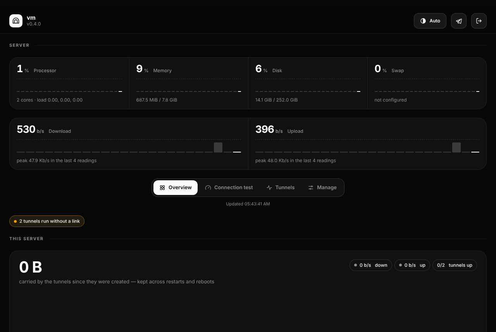
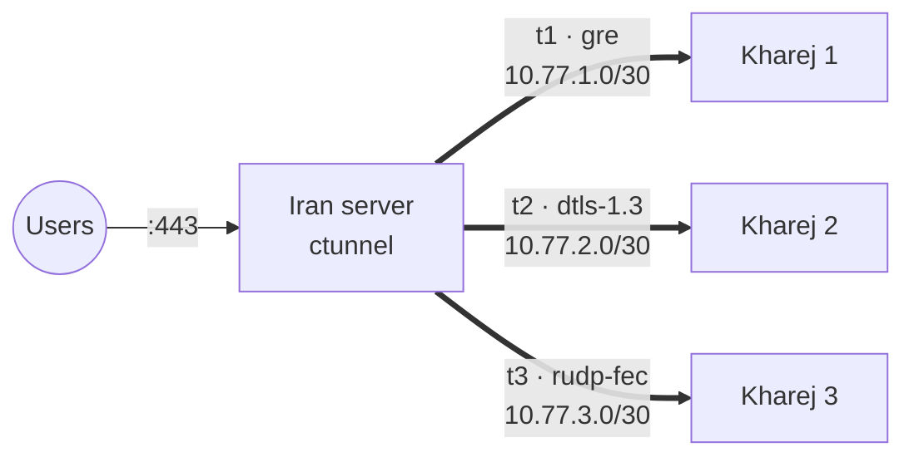

<p align="center">
  
</p>

<p align="center">
  <a href="https://github.com/CIAUB/C-Tunnel/releases/latest"></a>
  <a href="https://github.com/CIAUB/C-Tunnel/actions/workflows/ci.yml"></a>
  
  
  <a href="https://t.me/CiAUB_CH"></a>
</p>

<p align="center">
  <a href="README.md">English</a> · <a href="README_FA.md">فارسی</a> · <b>Русский</b>
</p>

<p align="center">
  <a href="#установка">⚡ Онлайн-установка</a> · <a href="#офлайн-установка">📦 Офлайн-установка (без GitHub)</a> · <a href="https://github.com/CIAUB/C-Tunnel/releases/latest/download/ctunnel-offline.zip">⬇️ Скачать офлайн ZIP</a>
</p>

<p align="center">
  <a href="https://nowpayments.io/embeds/donation-widget?api_key=8373139c-0aec-4e38-b34c-88dd005cfc1c" target="_blank" rel="noreferrer noopener">
    
  </a>
</p>

<p align="center">
  Туннели ядра Linux и зашифрованные UDP-транспорты между иранским сервером и любым числом зарубежных серверов,<br>
  с пробросом портов, однострочными ссылками настройки, меню в терминале и веб-панелью.
</p>

<p align="center">
  
</p>

---

## Содержание

- [Что нового в v2.1.0](#что-нового-в-v210)
- [Как это работает](#как-это-работает)
- [Возможности](#возможности)
- [Требования](#требования)
- [Установка](#установка)
- [Офлайн-установка (без доступа к GitHub)](#офлайн-установка)
- [Быстрый старт](#быстрый-старт)
- [Выбор метода](#выбор-метода)
- [Все методы](#все-методы)
- [Веб-панель](#веб-панель)
- [Командная строка](#командная-строка)
- [Файлы и службы](#файлы-и-службы)
- [Решение проблем](#решение-проблем)
- [Сборка из исходников](#сборка-из-исходников)
- [Лицензия](#лицензия)
- [Сообщество](#сообщество)

## Что нового в v2.1.0

Полные примечания ко всем версиям — в [CHANGELOG.md](CHANGELOG.md).

- **Адаптивные и трёхуровневые профили производительности (`AUTO` / `ECO` / `TURBO` / `HYPER`) для каждого туннеля:**
  - Вместо отдельных вариантов `turbo+` теперь единый профиль, который выбирается при создании (CLI и веб-панель) и меняется в любой момент через `ctunnel set-profile <name> <auto|eco|turbo|hyper>`, редактирование в CLI или в веб-панели.
  - **`AUTO` (адаптивный, первый в списке):** в простое (`< 5 Мбит/с`) держит `ECO`, а под нагрузкой автоматически переводит иранский и зарубежный серверы в `TURBO` (`>= 15 Мбит/с`) или `HYPER` (`>= 120 Мбит/с` на хостах с 4+ CPU и 3.5+ ГиБ RAM); текущий уровень (`AUTO → ECO/TURBO/HYPER`) виден в реальном времени в CLI, веб-панели и Telegram-боте.
  - Реальное масштабирование во время работы: пулы L4-соединений (`8/16/32`), буферы `smux` (`16M/64M/128M`), окна KCP (`2048/4096/8192`), BBR-потоки `revCarrier` (`4/8/16`), буферы UDP-сокетов (`4M/16M/32M`), `txqueuelen` ядра (`4000/10000/20000`) и Linux `SO_BUSY_POLL=50` на `HYPER`.
  - Туннели из прошлых версий автоматически получают `ECO` (старые Direct-туннели с `Carrier: true` — `TURBO`).
- **2 новых Stealth-транспорта уровня L3 (`stealth-tcp`, `stealth-ws`):**
  - `stealth-tcp`: многопоточный L3 TUN-туннель с AES-256-GCM, оформленный как записи application-data TLS 1.3, с привязкой потоков по 5-tuple и BBR-пейсингом.
  - `stealth-ws`: многопоточный L3 TUN-туннель с AES-256-GCM поверх WebSocket с секретным путём SHA-256 (проверка за постоянное время, `404` на неавторизованные пробы) и необязательными `Host` / SNI.
- **5 выделенных игровых протоколов и оптимизации движка:**
  - `dtls-1.3` перенесён в `FamilyGaming` как **`game-dtls`** с бесшовной миграцией состояния и ссылок, совместимостью на уровне протокола, полным игровым QoS (`DSCP EF`, `SO_PRIORITY=6`, `IP_PMTUDISC_DO`) и записью без аллокаций через `WriteToUDPAddrPort`.
  - Оптимизированы `game-udp`, `game-fec` (исправлена привязка воркеров групп XOR-FEC), `game-dup` и `game-kcp` (`IP_PMTUDISC_DO` + `SO_BUSY_POLL=50` на `HYPER`).
- **Отобранный набор активных протоколов и ограниченный `frp+`:**
  - `frp+` в режиме reverse/carrier оставлен только для основных IPv4 L3-методов (`xgre`, `xgre-ip`, `6to4`, `ipip`, `gre`).
  - Все основные L4-транспорты (`tcp`, `tcpmux`, `pck`, `ws`, `wsmux`, `wss`, `wssmux`, `udp`, `udpmux`) остались активными.
  - 23 слабых или избыточных устаревших протокола убраны из создания новых туннелей и теста соединения; существующие туннели на 100% управляются, редактируются и работают. (Чтобы создавать устаревшие протоколы, установите `v2.0.1` командой установки с версией ниже.)
- **Однострочная установка с GitHub и автоподключение (`--apply-link`):**
  - CLI (`showLink`, `ctunnel link <name>`) и веб-панель (`#dlg-link`) теперь выдают готовую команду `sudo bash -c "$(curl -sL ...)" -- --apply-link 'ctunnel://...'`, которая устанавливает C-Tunnel с GitHub, автоматически подключает удалённый сервер и показывает цветную карточку состояния.
- **100% премиум-эмодзи Telegram (`pkg/notify`):**
  - Поддержка нескольких паков и синонимов для всех 50 ключей иконок интерфейса: каждый экран бота, уведомление, отчёт о трафике, подпись бэкапа и inline-кнопка используют анимированные `<tg-emoji>` / `icon_custom_emoji_id`, когда Premium активен, с автоматическим откатом на обычный Unicode для аккаунтов без Premium.

<details>
<summary><b>Главное из v2.0.0 / v2.0.1</b> (надёжность TCP, Telegram-бот v2, квоты, бэкап и восстановление, TOTP 2FA)</summary>

- **v2.0.1:** исправлены «чёрные дыры» в пуле TCP-соединений (`TCP_USER_TIMEOUT=20s`, вытеснение мёртвых сокетов по `TCP_INFO`), голодание keepalive-пула, лавины TCP-соединений в Reverse/Direct, откат бэкенда IPv6/LocalIP на зарубежном сервере и ссылки настройки для NAT 1:1.
- **v2.0.0:** Go 1.26.10 (0 достижимых CVE), 9 L4-транспортов Direct/Reverse с ядерным `splice` без копирования, Telegram-бот v2 с ретрансляцией через туннель на иранском сервере (`pkg/tgrelay`), нативные таблицы Bot API 10.1+, мульти-админ, вход в веб-панель без пароля (`#tgToken` и HTTPS Mini App), квоты в ГБ и лимиты скорости в Мбит/с для каждого туннеля, `ctunnel-backup/2` с сохранением трафика, смена IP удалённого сервера на месте, TOTP 2FA, белый список IP/CIDR и тест соединения v2.

</details>

## Как это работает



1. На иранском сервере вы создаёте туннель и получаете однострочную ссылку `ctunnel://`.
2. Вставляете ссылку на зарубежном (kharej) сервере. Адреса, порты, ключи и MTU на обеих сторонах совпадают.
3. Пользователи подключаются к порту иранского сервера, а C-Tunnel передаёт трафик через туннель на зарубежный сервер.

Каждый туннель получает свою подсеть `10.77.N.0/30`, свой сетевой интерфейс и свой UDP-порт, поэтому можно подключить сколько угодно зарубежных серверов без конфликтов.

## Возможности

| | |
|---|---|
| **28 активных методов (+23 устаревших, управляемых)** | Отобранные туннели ядра L3/L2, зашифрованный UDP-Crypt, **4 Stealth-носителя** (`faketcp`, `icmp`, `stealth-tcp`, `stealth-ws`), **9 L4-транспортов Direct/Reverse** и **5 выделенных игровых протоколов** (`game-udp`, `game-fec`, `game-dup`, `game-kcp`, `game-dtls`) |
| **Трёхуровневые профили производительности** | `ECO` (минимальное потребление), `TURBO` (высокая скорость) и `HYPER` (максимальная скорость + `SO_BUSY_POLL`) для каждого туннеля, переключаются на лету из CLI и веб-панели |
| **Один Иран, много зарубежных серверов** | Подсети, порты и ID туннелей выделяются автоматически, конфликты отклоняются, а IP удалённого сервера можно менять на месте без пересоздания туннелей |
| **Проброс портов** | `443`, или `2053=8443` для проброса на другой порт. Правила помечены по туннелям и удаляются аккуратно. |
| **Квоты трафика и лимит скорости** | Необязательная квота в ГБ для каждого туннеля (автоостановка + уведомление в Telegram с действиями Override / Reset / Add GB) и ограничение полосы в Мбит/с |
| **Бэкап и автобэкап** | Полные JSON-бэкапы (`ctunnel-backup/2`), сохраняющие накопленный трафик туннелей и сервера при восстановлении и переносе, плюс автобэкап в Telegram по расписанию |
| **Шифрование** | AES-256-GCM с отдельным ключом для каждого направления, окно защиты от повторов на 2000 пакетов и случайное дополнение (padding) |
| **Маскировка под протокол** | Каждый метод UDP-Crypt оборачивает пакеты в заголовок одноимённого протокола |
| **Восстановление потерь** | `rudp-fec` и `game-fec` восстанавливают потерянные пакеты с помощью 0-RTT XOR-чётности без повторной передачи |
| **MikroTik** | Готовые команды RouterOS 7 для `gre`, `ipip`, `6to4`, `eoip`, `vxlan` и `wireguard` |
| **Веб-панель** | Тёмный и светлый адаптивный интерфейс, HTTP по умолчанию, частный путь, свой домен и TLS, TOTP 2FA и белый список IP, живая SSE-телеметрия, мультиформатный блок спонсора и вход в один клик без пароля из Telegram |
| **Тест соединения** | Отправляет настоящие пакеты GRE, IPIP, SIT, ESP, WireGuard, VXLAN, QUIC, DTLS… между двумя серверами и запускает реальный туннель для каждого L4-метода, показывает, какие методы проходят или заблокированы, измеряет скорость и рекомендует лучший |
| **Telegram-бот v2** | Работает на зарубежных и иранских серверах (через ретрансляцию по туннелю); нативные таблицы Bot API 10.1+, цветные кнопки, живая таблица состояния сети в `/start`, мульти-админ, анимированные премиум-эмодзи с автоматическим откатом, интерактивное добавление квоты, бэкап и восстановление, прямой вход в веб-панель по HTTP в один клик или через HTTPS Mini App |
| **Обновление в один клик** | Manage → Update now устанавливает последний релиз прямо из панели и показывает журнал |
| **Устойчивость** | Каждый туннель — служба systemd: восстанавливается после перезагрузки и чисто пересоздаётся при перезапуске |

## Требования

- Linux с systemd: Ubuntu 20.04+, Debian 11+ или аналогичный
- `amd64`, `arm64` или `armv7` (32-битный ARM)
- Права root
- Публичный IP на каждом сервере и разрешённый у провайдера протокол или UDP-порт туннеля

`install.sh` сам установит `iproute2`, `iptables` и `curl`, если их нет. Для WireGuard дополнительно нужен `wireguard-tools`.

## Установка

Одна команда на **обоих** серверах:

```bash
sudo bash -c "$(curl -sL https://raw.githubusercontent.com/CIAUB/C-Tunnel/main/install.sh)"
```

Установщик всегда ставит последний [релиз](https://github.com/CIAUB/C-Tunnel/releases/latest).
Он скачивает бинарники под архитектуру сервера, вспомогательный скрипт ядра и юниты systemd,
сверяет каждый файл с `SHA256SUMS` релиза и устанавливает только при совпадении всех хешей.
Повреждённая или изменённая загрузка останавливает установку, и ничего не меняется.

```bash
sudo ctunnel
```

Для обновления выберите **Update** в меню или снова запустите команду установки. Работающие туннели сохраняются.
Без указания версии устанавливается последний стабильный релиз с GitHub; черновики и pre-release не выбираются. Чтобы установить конкретную версию (например, `v2.0.1`, если нужно создавать устаревшие протоколы):

```bash
sudo bash -c "$(curl -sL https://raw.githubusercontent.com/CIAUB/C-Tunnel/main/install.sh)" v2.0.1
```

Чтобы установить C-Tunnel на удалённый (зарубежный) сервер **и** сразу подключить туннель по ссылке настройки одной командой:

```bash
sudo bash -c "$(curl -sL https://raw.githubusercontent.com/CIAUB/C-Tunnel/main/install.sh)" -- --apply-link 'ctunnel://...'
```

Также поддерживаются `bash install.sh v2.0.1` и `CTUNNEL_VERSION=v2.0.1`. Явный аргумент версии важнее переменной окружения.

## Офлайн-установка

Если у сервера нет доступа к GitHub (или ограничен интернет / `apt`), вы можете установить или обновить C-Tunnel **полностью офлайн** с помощью одного универсального архива, подходящего для **любых Linux-серверов** (`amd64`, `arm64`, `armv7` — Ubuntu, Debian, CentOS, AlmaLinux, Rocky, Fedora, Arch).

**1. Скачайте универсальный офлайн-архив** на ПК, телефон или любой сервер с доступом к GitHub:

- **Рекомендуемый (`.zip`):** [Скачать `ctunnel-offline.zip`](https://github.com/CIAUB/C-Tunnel/releases/latest/download/ctunnel-offline.zip)
- **Для минимальных серверов без `unzip` / `python3` (`.tar.gz`):** [Скачать `ctunnel-offline.tar.gz`](https://github.com/CIAUB/C-Tunnel/releases/latest/download/ctunnel-offline.tar.gz)

**2. Загрузите архив на сервер** (через `scp`, Termius, WinSCP, MobaXterm или любой SFTP-клиент):

```bash
scp ctunnel-offline.zip root@SERVER_IP:/root/
```

**3. Выполните одну команду на сервере** (в папке, куда загрузили файл):

```bash
(unzip -qo ctunnel-offline.zip -d /tmp 2>/dev/null || python3 -m zipfile -e ctunnel-offline.zip /tmp) && sudo bash /tmp/ctunnel-offline/install.sh && rm -rf /tmp/ctunnel-offline
```

<details>
<summary><b>Дополнительные офлайн-варианты</b> (<code>.tar.gz</code>, автоподключение <code>--apply-link</code>, распакованная папка)</summary>

- **Установка из `ctunnel-offline.tar.gz`** (использует встроенный `tar`, работает даже без `unzip` и `python3`):
  ```bash
  tar -xzf ctunnel-offline.tar.gz -C /tmp && sudo bash /tmp/ctunnel-offline/install.sh && rm -rf /tmp/ctunnel-offline
  ```
- **Офлайн-установка + мгновенное подключение туннеля (`--apply-link`):**
  ```bash
  (unzip -qo ctunnel-offline.zip -d /tmp 2>/dev/null || python3 -m zipfile -e ctunnel-offline.zip /tmp) && sudo bash /tmp/ctunnel-offline/install.sh --apply-link 'ctunnel://...' && rm -rf /tmp/ctunnel-offline
  ```
- **Если архив уже распакован вручную:**
  ```bash
  sudo bash ctunnel-offline/install.sh
  ```
- **Прямой флаг `--offline`** (принимает `.zip`, `.tar.gz` или папку):
  ```bash
  sudo bash install.sh --offline /root/ctunnel-offline.zip
  ```

</details>

> **Ноль обращений к сети и полная проверка целостности:** `install.sh` автоматически определяет офлайн-архив, выбирает статический бинарник под архитектуру CPU (`amd64` / `arm64` / `armv7`), сверяет каждый файл по `SHA256SUMS`, не вызывает `apt-get` и GitHub, а при офлайн-обновлении сохраняет все работающие туннели и настройки.

## Быстрый старт

**1. Иранский сервер**, один раз для каждого зарубежного сервера:

```text
sudo ctunnel  →  1) Setup Iran
  Method              gre        (dtls-1.3 if GRE is filtered)
  Remote server IP    203.0.113.10
  Forward ports       443
```

Меню выведет ссылку настройки:

```text
ctunnel://eyJuYW1lIjoidDEiLCJyb2xlIjoia2hhcmVqIiwibWV0aG9kIjoiZ3JlIi...
```

**2. Зарубежный сервер:**

```text
sudo ctunnel  →  2) Setup Kharej  →  paste the link
```

или одной командой:

```bash
sudo ctunnel apply-link 'ctunnel://...'
```

**3. Проверка:**

```bash
sudo ctunnel status
```

```text
 NAME      METHOD       ROLE   REMOTE           TUNNEL IP      PORT   STATE    RX / TX
 t1        gre          iran   203.0.113.10     10.77.1.1      0      up       1.2 GiB / 310.4 MiB
 t2        dtls-1.3     iran   203.0.113.11     10.77.2.1      24002  up       842.7 MiB / 95.1 MiB
```

Чтобы добавить ещё один зарубежный сервер, повторите шаг 1 с его IP. Он получит `10.77.2.0/30`, следующий свободный порт и свои пробрасываемые порты.

## Выбор метода

| Ситуация | Рекомендация |
|---|---|
| GRE / IPIP не фильтруются | `gre`, `6to4`, `ipip`: скорость ядра, минимальная нагрузка на CPU |
| Чистые IP-протоколы фильтруются | `dtls-1.3`, `quic-v1`, `wireguard` или `gre` с портом FOU |
| Канал с потерями или нестабильный | `rudp-fec`, или `udpmux` для проброса портов |
| GRE / IPIP фильтруются, обычный UDP проходит, шифрование не нужно | `bareudp` |
| Видеозвонки проходят, а остальной UDP режется | `stun-turn` |
| Трафик IPsec VPN проходит | `esp-udp` |
| UDP 2152 (мобильное ядро) не трогают | `gtp-u` |
| UDP заблокирован, TCP открыт | `faketcp` |
| Проходит только ping | `icmp` |
| Шифрование на скорости ядра | `xfrm-ipsec`, `wireguard` |
| На другой стороне MikroTik | `gre`, `ipip`, `eoip`, `vxlan`, `wireguard` |

Не уверены? Сначала запустите **0) Connection Test** на иранском сервере (он выведет ссылку `ctunnel-test://`), затем вставьте ссылку на зарубежном сервере. Живая таблица показывает, какой метод сейчас проверяется. Каждый метод получает отметку `ok`, `unstable` или `blocked`; измеряются скорость каждого рабочего метода, MTU пути и скорость TCP, и рекомендуется метод с подходящим MTU:

```text
RESULT  FAMILY     METHOD        STATUS    ECHOES  PROGRESS

🟢      L3-Direct  6to4          OK        10/10   ▰▰▰▰▰▰▰▰ 100%
🟢      UDP-Crypt  dtls-1.3      OK        10/10   ▰▰▰▰▰▰▰▰ 100%
🟡      UDP-Crypt  quic-v1       UNSTABLE  7/10    ▰▰▰▰▰▰▱▱  70%
🔴      L3-Direct  gre           BLOCKED   0/10    ▱▱▱▱▱▱▱▱   0%

Works steadily:

   METHOD        FAMILY     LATENCY          DOWNLOAD     UPLOAD       TOTAL
🟢 6to4          L3-Direct  42.1 ms ±0.8     1.12 Gbps    418.6 Mbps   1.54 Gbps
🟢 dtls-1.3      UDP-Crypt  42.3 ms ±0.9     1.05 Gbps    402.3 Mbps   1.45 Gbps

BEST SETTINGS
Method           6to4           42.1 ms ±0.8, 0% loss
Download         1.12 Gbps      6to4 packets at full rate for 1 s
Upload           418.6 Mbps     6to4 packets at full rate for 1 s
Path MTU         1500           full-size packets pass
Tunnel MTU       1440           path MTU minus 6to4 overhead
TCP download     1.18 Gbps      4 TCP streams, bytes confirmed by the receiver
TCP upload       431.0 Mbps     4 TCP streams, bytes confirmed by the receiver
```

Во время теста на иранском сервере должны быть открыты UDP 7712, TCP 7711 и IP-протоколы 4, 41, 47, 50, 97 и 115.

### Режим REVERSE

В режиме REVERSE зарубежный сервер подключается сам, а иранский только слушает, поэтому Иран никогда не открывает соединение с иностранным IP.

| Уровень | Как передаётся | Лучше всего для |
|---|---|---|
| UDP-Crypt (`rev+dtls-1.3`, `rev+quic-v1`…) | зарубежный сервер шлёт UDP в Иран, те же пакеты, что и в DIRECT | каналов с потерями или высокой задержкой |
| WireGuard (`rev+wireguard`) | зарубежный сервер — клиент WireGuard | MikroTik и стандартных клиентов |
| Ядро L3/L2 (`frp+gre`, `frp+vxlan`…) | внутри 8 параллельных TCP-потоков, похожих на записи TLS | чистых каналов, где проходит только TCP |
| Уровень 4 (`tcp`, `tcpmux`, `pck`, `ws`, `wsmux`, `wss`, `wssmux`, `udp`, `udpmux`) | нативный L4-проброс портов: у каждого пользовательского соединения или UDP-потока свой поток, без туннельного IP | TCP-сервисов (VLESS, Trojan…) без TCP-in-TCP, каналов, где проходит только WebSocket или TLS, и каналов с потерями (`udp`, `udpmux`) |
| Выделенные игровые (`game-udp`, `game-fec`, `game-dup`, `game-kcp`) | сверхлёгкий UDP с DSCP EF, 0-RTT XOR-FEC, двойная отправка малых пакетов или L4 KCP с тиком 5 мс | соревновательных онлайн-игр (минимальный пинг против устойчивости к потерям, Direct и Reverse) |

Каждое внутреннее соединение остаётся на одном TCP-потоке, поэтому пакеты не переупорядочиваются, а у каждого потока своя очередь. В нашем тесте это примерно удвоило скорость TCP-носителя по сравнению с 0.1.5 (около 390 → 690 Мбит/с на канале 800 Мбит/с). Тест соединения проверяет и все варианты reverse: строку `rev+` для каждого UDP-метода и независимые строки `frp+METHOD` со свежими TCP-потоками, нагрузкой под конкретный метод, подтверждёнными эхо-ответами и отдельной скоростью для каждого поддерживаемого варианта в стиле FRP. Это тесты формы носителя и инкапсуляции, а не проверки интеграции туннеля ядра. Best Settings называет самый быстрый вариант reverse.

### Stealth-методы

Четыре L3-туннеля с шифрованием AES-256-GCM (ключ на каждое направление, случайное дополнение), пакеты которых идут не как обычный UDP. Работают в режиме DIRECT (первым подключается Иран) и REVERSE (первым подключается зарубежный сервер).

| Метод | Между серверами | Когда использовать |
|---|---|---|
| `faketcp` | Записи TLS внутри TCP-сегментов, собранных вручную и читаемых через packet socket (носитель `pck`). Промежуточное оборудование видит одно TCP-соединение с согласованными номерами последовательности; внутри ничего не переотправляется, поэтому нет TCP-in-TCP, и туннель работает на скорости UDP | UDP заблокирован или режется, а TCP нет |
| `icmp` | ICMP echo: запросы в одну сторону, ответы в другую, с идентификатором из секрета. Ядро отвечающего сервера само ответило бы на каждый запрос; правило iptables отбрасывает эти ответы и оставляет ответы туннеля | проходит только ping |
| `stealth-tcp` | Многопоточный TCP-носитель с AES-256-GCM, оформленный как записи application-data TLS 1.3 (`0x17 0x03 0x03`), с привязкой потоков по 5-tuple и BBR-пейсингом | TCP проходит, и нужен чистый многопоточный зашифрованный L3 TUN |
| `stealth-ws` | Многопоточный WebSocket-носитель с AES-256-GCM, секретным путём URL SHA-256 (`404` на неавторизованные пробы) и необязательными `Host` / SNI | лучше всего через DPI проходит трафик HTTP/WebSocket |

`faketcp` и `icmp`, как и `pck`, требуют root и iptables. У `icmp` нет порта. Для `icmp` тест соединения пингует иранский сервер echo-запросами размером с пакеты туннеля, а для `faketcp` показывает результат носителя `pck`, на котором он работает.

### Новая маскировка и BareUDP

`stun-turn`, `gtp-u` и `esp-udp` — методы UDP-Crypt: то же шифрование и дополнение, но с заголовком TURN ChannelData (ретрансляция звонков WebRTC), GTP-U G-PDU (пользовательская плоскость мобильного ядра) или ESP в UDP (IPsec VPN за NAT). Первый туннель каждого метода занимает настоящий порт протокола — 3478, 2152 или 4500, — если он свободен; следующие берут порт из обычного диапазона. Как и у других методов UDP-Crypt, на протокол похож только заголовок; фильтр, следящий за всем обменом, может их различить.

`bareudp` — туннель ядра, который кладёт IPv4-пакеты прямо в UDP, без заголовка и шифрования, для каналов, где GRE и IPIP фильтруются, а обычный UDP проходит. Нужен Linux 5.7 или новее с модулем `bareudp`; занимает порт 6635, если он свободен. Устройство bareudp принимает UDP с любого адреса, поэтому правило iptables разрешает доступ к его порту только другому серверу.

### Обратные L4-туннели

Движок Reverse-L4 на иранском сервере слушает порт туннеля и все пробрасываемые порты (TCP и UDP). Зарубежный сервер подключается к порту туннеля и передаёт каждое пользовательское соединение на целевой порт своего `127.0.0.1`. Туннельного интерфейса и туннельного IP нет, поэтому бенчмарк туннеля к ним не применяется. Failover применяется — на другой L4-метод: туннель считается поднятым, пока зарубежный сервер держит соединение с иранским. Тест соединения запускает реальный туннель каждого метода на тестовом L4-порту иранского сервера (TCP и UDP 7714 из меню терминала или следующий свободный, если занят; меню выводит порты, которые нужно открыть) и измеряет скорость через него.

| Метод | Между серверами |
|---|---|
| `tcp` | одно TCP-соединение на каждое пользовательское, из пула в 16 соединений, который держит зарубежный сервер |
| `tcpmux` | потоки smux поверх 4 TCP-соединений |
| `pck` | потоки smux поверх KCP внутри TCP-сегментов, собранных вручную через packet socket (ни на одной стороне нет TCP-состояния ядра); шифрование AES |
| `ws` | как `tcp`, каждое соединение — WebSocket |
| `wsmux` | как `tcpmux`, поверх WebSocket |
| `wss` | как `ws`, внутри TLS |
| `wssmux` | как `wsmux`, внутри TLS |
| `udp` | одна KCP-сессия поверх UDP на каждое пользовательское соединение, из пула в 16; шифрование AES. KCP сам переотправляет потерянные пакеты, поэтому потери обходятся дешевле, чем в TCP |
| `udpmux` | потоки smux поверх 2 KCP-сессий через UDP; шифрование AES |

При открытии каждого соединения оба сервера доказывают, что знают секрет туннеля. Дальше `tcp` и `ws` передают байты пользователей без изменений; если канал между серверами нужно шифровать, используйте `wss`, `wssmux`, `pck`, `udp` или `udpmux`. Для `udp` и `udpmux` на иранском сервере порт туннеля должен быть открыт для UDP. Методы WebSocket принимают необязательные Host / SNI. На зарубежном сервере туннель можно добавить по ссылке настройки или вручную: IP иранского сервера, метод, порт туннеля и секрет.

Между двумя сетевыми неймспейсами на 2 CPU (iperf3, один TCP-поток через пробрасываемый порт): `tcp` около 12.7 Гбит/с, `ws` 10.8, `tcpmux` 7.6, `wsmux` 6.9, `wss` 6.6, `wssmux` 4.4 и `pck` 0.8 Гбит/с.

На смоделированном длинном пути (500 Мбит/с, RTT 100 мс, 0.3% потерь в каждую сторону; iperf3, один поток): `tcp`, `ws` и `wss` около 425 Мбит/с, `tcpmux` 373, `wsmux` 397, `wssmux` 359, `pck` 185, `udp` 188 и `udpmux` 188 (около 300 с четырьмя потоками). Поскольку KCP отправляет ACK раз в 10 мс, `udp`, `udpmux` и `pck` между неймспейсами работают в 1.6–2.5 раза быстрее, примерно на 25% быстрее при 50 мс и на 10–20% при 150 мс. L3-методы на том же пути, отдача: `faketcp` 370, `icmp` 377, `stun-turn` 323, `gtp-u` 311 и `esp-udp` 307 Мбит/с, против 317 у `quic-v1`.

## Все методы

<details>
<summary><b>L3 ядра</b>: 16 методов</summary>

| Метод | Описание |
|---|---|
| `gre` | GRE (IP-протокол 47), необязательные FOU и параллельные линии |
| `ipip` | IPv4-in-IPv4 (протокол 4), необязательный FOU |
| `6to4` | Носитель SIT с IPIP6 внутри |
| `6to4-gre` | Носитель SIT с IP6GRE внутри |
| `sit` | IPv6-in-IPv4; передаёт только IPv6 |
| `ip6gre` | GRE поверх IPv6 |
| `ipip6` | IPv4 поверх IPv6 |
| `ip6ip6` | IPv6 поверх IPv6; передаёт только IPv6 |
| `wireguard` | WireGuard в ядре; ключи выводятся из ссылки настройки |
| `xfrm-ipsec` | GRE, зашифрованный IPsec ESP ядра (AES-GCM-256) |
| `fou-gre` | GRE внутри UDP |
| `gue-ipip` | IPIP внутри GUE/UDP |
| `ecmp-lanes` | от 2 до 8 параллельных GRE-туннелей с ключами и ECMP |
| `bareudp` | IPv4 прямо внутри UDP (6635), без заголовка; Linux 5.7+ |
| `xgre` | Расширенный многолинейный GRE с ключами (`ignore-df`, готов к FOU, MikroTik) |
| `xgre-ip` | IPIP внутри многолинейного носителя `xGRE` с ключами |

</details>

<details>
<summary><b>L2</b>: 7 методов</summary>

| Метод | Описание |
|---|---|
| `eoip` | MikroTik EoIP поверх чистого GRE, совместим с RouterOS |
| `gretap` | Ethernet поверх GRE |
| `ip6gretap` | Ethernet поверх IPv6 GRE |
| `vxlan` | Ethernet поверх UDP (4789) |
| `geneve` | Ethernet поверх UDP (6081) |
| `l2tpv3` | Статический псевдопровод L2TPv3 поверх IP или UDP |
| `etherip` | EtherIP, RFC 3378 (протокол 97) |

</details>

<details>
<summary><b>UDP-Crypt</b>: 11 методов, AES-256-GCM</summary>

| Метод | Пакеты похожи на |
|---|---|
| `dtls-1.3` | Записи application data DTLS |
| `quic-v1` | Пакеты QUIC с коротким заголовком |
| `srtp-direct` | Медиа RTP / SRTP |
| `wg-stealth` | Случайный заголовок на основе ключа, с пачкой мусорных пакетов в начале |
| `rudp-fec` | Сгруппированные датаграммы с XOR-чётностью 2+1 |
| `dnscrypt-udp` | Ответы DNS |
| `ntp-direct` | Серверные пакеты NTPv4 |
| `openvpn-dco` | OpenVPN `P_DATA_V2` |
| `stun-turn` | TURN ChannelData, как у ретрансляторов звонков WebRTC (3478) |
| `gtp-u` | GTP-U G-PDU, пользовательская плоскость мобильного ядра (2152) |
| `esp-udp` | IPsec ESP в UDP, как при NAT-T (4500) |

</details>

<details>
<summary><b>Stealth</b>: 4 метода, AES-256-GCM</summary>

| Метод | Пакеты передаются как |
|---|---|
| `faketcp` | Записи TLS в TCP-сегментах, собранных вручную (без TCP-состояния и переотправки) |
| `icmp` | Запросы и ответы ICMP echo |
| `stealth-tcp` | Многопоточный зашифрованный TCP в форме TLS 1.3 поверх TUN |
| `stealth-ws` | Многопоточный зашифрованный WebSocket с секретным путём и необязательными Host/SNI |

</details>

<details>
<summary><b>Уровень 4 (Direct и Reverse)</b>: 9 методов, проброс портов</summary>

| Метод | Описание |
|---|---|
| `tcp` | TCP, соединение из пула на каждое пользовательское (ядерный `splice`) |
| `tcpmux` | TCP + MUX (потоки `smux` v2 поверх параллельных TCP-соединений) |
| `pck` | TCP + PCK: KCP в TCP-сегментах, собранных вручную, raw-сокет, AES |
| `ws` | WebSocket |
| `wsmux` | WebSocket + MUX |
| `wss` | WebSocket в TLS |
| `wssmux` | WebSocket в TLS + MUX |
| `udp` | UDP: KCP-сессия на каждое пользовательское соединение, AES |
| `udpmux` | UDP + MUX: потоки поверх параллельных KCP-сессий, AES |

</details>

<details>
<summary><b>Выделенные игровые (Direct и Reverse)</b>: 5 методов</summary>

| Метод | Лучше всего для |
|---|---|
| `game-udp` | Минимальный пинг и джиттер (`DSCP EF`, `SO_PRIORITY 6`, без блокировки очереди) |
| `game-fec` | Восстановление потерь 0-RTT XOR-FEC без задержки на переотправку |
| `game-dup` | Двойная отправка малых, критичных к задержке игровых пакетов (`&lt;= 320 B`) |
| `game-kcp` | Настроенный L4-проброс портов на KCP с nodelay и тиком `5 ms` для нестабильных маршрутов |
| `game-dtls` | Анти-DPI UDP в форме DTLS 1.3 с AES-256-GCM и игровым QoS (туннели `dtls-1.3` переносятся автоматически) |

</details>

## Веб-панель

Откройте `sudo ctunnel` → **4) Web Panel** → **Start** и используйте ровно тот адрес, который выведет меню. Первый запуск идёт по HTTP с сохранённым случайным путём:

```text
http://<server-ip>:6969/panel-<random-id>/
```

Войдите с кодом из того же меню. После пяти неверных кодов этот IP блокируется на пять минут. В меню терминала можно сменить порт или сгенерировать новый код; смена кода завершает текущие сессии.

В нижней панели четыре раздела — **Overview**, **Connection test**, **Tunnels** и **Manage**, — и у каждого экрана свой адрес (`#/tunnels`, `#/t/<name>/logs`, `#/health`…), поэтому экран можно добавить в закладки или перезагрузить.

- **Tunnels**: каждая карточка показывает состояние, текущую скорость и историю, и в ней есть Start/Stop, Restart, Live log, Setup link, Edit и Delete.
- **Live log**: журнал туннеля с цветом по уровню, фильтром и автопрокруткой к новым строкам.
- **Manage**: проверка состояния (те же проверки, что и в CLI, с исправлением для каждой проблемы), бенчмарк туннелей, автоперезапуск, встроенный прокси, уведомления Telegram, настройка ядра, перезапуск всех туннелей, скачивание и восстановление бэкапа, настройки панели, проверка обновлений и Update now.
- **Update now**: запускает установщик последнего релиза в отдельном юните systemd (`ctunnel-update`), поэтому обновление завершается, даже когда перезапускает панель; окно следит за `/var/log/ctunnel-update.log`, пока не появится результат.
- **Бенчмарк туннелей**: скорость загрузки и отдачи, пинг, джиттер и потери каждого работающего туннеля, измеренные через туннель по очереди, с отметкой самого быстрого. Другой сервер отвечает через `ctunnel-agent` (C-Tunnel 1.0 или новее).
- **Автоперезапуск**: перезапуск всех туннелей каждые 1–48 часов, показан на 24-часовом циферблате с обратным отсчётом. Это то же расписание, что и **Manage → Auto Refresh** в меню терминала.
- **Встроенный прокси**: включите SOCKS5- или HTTP-прокси, с логином или без, и посмотрите, какой проброс сделать на иранском сервере.
- **Оформление**: Auto, Dark или Light, в Mono или одном из шести цветов (Ocean, Emerald, Violet, Amber, Rose, Red); сохраняется в браузере.
- **Бэкап**: один JSON-файл с настройками и секретным токеном каждого туннеля. Восстановление добавляет туннели, которых нет на сервере, и запускает их. Храните файл в тайне.

### Failover

У туннеля может быть **резервный метод** (в форме туннеля или в ссылке настройки с сервера, где он задан). `ctunnel-agent` на обоих серверах пингует другую сторону через туннель. Если 45 секунд нет ответа, оба сервера переключаются на метод, который часы выбирают для текущего двухминутного окна, поэтому они встречаются на одном методе, не связываясь друг с другом. В начале каждого часа туннель на резервном методе снова пробует основной и возвращается в течение минуты, если основной по-прежнему не отвечает. На обоих серверах нужно примерно точное время (NTP). Редактирование туннеля возвращает его на основной метод; остановленный туннель никогда не переключается. Карточка и проверка состояния показывают, какой метод работает. L4-туннель принимает только L4-резервный метод и считается упавшим, когда зарубежный сервер не держит ни одного соединения с иранским.

### Уведомления Telegram

Отправляют только зарубежные серверы, так как Telegram в Иране заблокирован. В **Manage → Telegram alerts** укажите токен бота от @BotFather и chat ID (отправьте боту `/start`, чтобы узнать его), затем нажмите **Send test**. Уведомления: туннель упал на 45 секунд и поднялся снова, переключение failover, перезапуск или обновление (с причиной) и ежедневный отчёт о состоянии и трафике каждого туннеля в выбранное время. `ctunnel-agent` отправляет их и отвечает боту только в настроенном чате: `/status`, `/report` и `/settings`, кнопки которого включают и выключают каждое уведомление, как в панели. Настройки хранятся в `/etc/ctunnel/telegram.json`; панель больше не показывает токен. Несколько зарубежных серверов могут слать уведомления через одного бота, но Telegram позволяет читать сообщения бота только одному из них, поэтому дайте каждому серверу своего бота, если каждый должен отвечать на кнопки.

### Встроенный прокси через туннель

Прокси слушает 127.0.0.1 и туннельный IP каждого туннеля на сервере, но никогда не публичный адрес. На иранском сервере пробросьте порт прокси через туннель, для SOCKS5 UDP — с одинаковым номером на обоих концах: для прокси на порту 10800 используйте `10800` или `10800=10800`. В `A=B` первый порт — иранский, второй — зарубежного сервера.

Суммарный трафик на карточках и в CLI считается с момента создания туннеля и сохраняется после перезапусков и перезагрузок. Новые туннели получают имена `ir-<port>` на Иране и `kh-<port>` на зарубежном сервере, если вы не задали имя.

Чтобы попробовать панель на компьютере, не трогая его сеть, запустите `go run ./cmd/ctunnel-local` (Windows, macOS или Linux) и откройте `http://127.0.0.1:6969/ctunnel-local/` с кодом входа `ctunnel-test`. Туннели в нём имитируются.

В **Manage → Panel settings** можно изменить базовый путь и домен. Укажите пути к действительному `fullchain.pem` и соответствующему `privkey.pem` или загрузите пару по HTTPS/loopback. Действительная пара автоматически включает HTTPS после мягкой перезагрузки слушателя. DNS домена уже должен указывать на сервер, а порт панели должен быть доступен. После смены адреса или протокола нужно войти заново.

**Connection test** принимает ссылку `ctunnel-test://` другого сервера, измеряет методы по отдельности и предлагает **Deploy Best Tunnel** для успешного измеренного результата. Развёртывание создаёт эту сторону и возвращает ссылку настройки для применения на другом сервере. Тесты формы носителя не заменяют реальную проверку туннеля ядра.

Скриншоты сделаны из настоящего интерфейса в Chromium на синтетических демонстрационных данных. См. [мобильную версию](docs/panel-mobile.png), [настройки](docs/panel-settings.png) и [изменения и заметки по обновлению](CHANGELOG.md).


## Командная строка

| Команда | Описание |
|---|---|
| `ctunnel` | Интерактивное меню |
| `ctunnel status` | Туннели с состоянием и трафиком |
| `ctunnel up\|restart\|down NAME` | Управление одним туннелем |
| `ctunnel set-peer NAME NEW_IP` | Сменить IP удалённого сервера на месте (`-all OLD NEW` обновляет все подходящие туннели) |
| `ctunnel set-profile NAME eco\|turbo\|hyper` | Сменить профиль производительности и перезапустить |
| `ctunnel link NAME` | Ссылка настройки, однострочная команда установки и команды MikroTik для другой стороны |
| `ctunnel apply-link 'ctunnel://…'` | Создать и запустить туннель по ссылке |
| `ctunnel conntest-server` | Иранская сторона теста соединения, выводит ссылку |
| `ctunnel conntest 'ctunnel-test://…'` | Зарубежная сторона: какие методы проходят, скорость, рекомендация |
| `ctunnel conntest -new 'ctunnel-test://…'` | Только методы, новые в 2.0; `-only udp,udpmux` — любой список |
| `ctunnel linktest HOST` | Задержка, потери и пропускная способность до HOST, например туннельного IP |
| `ctunnel speedtest-server` | Ответчик для `linktest` (TCP 7711) |
| `ctunnel optimize` | BBR + fq, буферы сокетов 64 МБ, IP forwarding |
| `ctunnel restart-all` | Перезапустить все туннели (Manage → Auto Refresh запускает это из cron) |
| `ctunnel proxy-serve` | Встроенный прокси SOCKS5/HTTP (настраивается в Manage → Built-in Proxy) |
| `ctunnel agent` | Failover и ответчик бенчмарка туннелей (запускается `ctunnel-agent.service`) |
| `ctunnel panel` | Запустить веб-панель в текущем терминале |
| `ctunnel catalog` | Список всех методов |
| `ctunnel version` | Показать версию |

## Файлы и службы

| Путь | Назначение |
|---|---|
| `/etc/ctunnel/state.json` | Туннели, порт панели и код входа |
| `/etc/ctunnel/panel.json` | Сохранённые базовый путь панели, домен и пути к сертификатам |
| `/etc/ctunnel/tunnels/NAME.env` | Настройки одного туннеля |
| `/usr/local/lib/ctunnel/ctunnel-kernel` | Создаёт интерфейсы, пробросы портов и IPsec |
| `ctunnel@NAME.service` | Туннели ядра |
| `ctunnel-engine@NAME.service` | UDP-Crypt, EoIP и EtherIP |
| `ctunnel-panel.service` | Веб-панель |
| `ctunnel-agent.service` | Failover и ответчик бенчмарка туннелей (TCP 7719 на туннельных IP) |
| `/etc/ctunnel/failover/NAME` | Существует, пока туннель работает на резервном методе |
| `/etc/ctunnel/telegram.json` | Настройки уведомлений Telegram (токен бота, chat ID, уведомления) |
| `/var/log/ctunnel-update.log` | Журнал последнего обновления, запущенного из панели |

Журналы:

```bash
journalctl -u ctunnel@t1 -u ctunnel-engine@t1 -n 50
```

## Решение проблем

| Симптом | Причина и решение |
|---|---|
| Состояние `failed` | Посмотрите журнал выше. Обычно не хватает модуля ядра (`modprobe ip_gre`) или провайдер блокирует протокол. |
| Состояние `up`, но трафика нет | Другая сторона не настроена или межсетевой экран отбрасывает туннель. Откройте UDP-порт для UDP-Crypt и WireGuard или протокол 47 для GRE. |
| UDP-Crypt теряет пакеты после перезапуска | На обоих серверах нужно примерно точное время (NTP), так как номера последовательности отсчитываются от часов. |
| Проброшенный порт не отвечает | Служба на зарубежном сервере должна слушать `0.0.0.0` или туннельный IP. |
| `sit` / `ip6ip6` не пробрасывают порты | Они передают только IPv6. Используйте `6to4`. |

## Сборка из исходников

```bash
git clone https://github.com/CIAUB/C-Tunnel.git
cd C-Tunnel
go test ./...
sudo bash install.sh                  # build and install from this checkout
bash scripts/build-release.sh 0.1.0   # release assets and SHA256SUMS in dist/
```

**Публикация релиза:** укажите версию в `pkg/version/version.go`, сделайте коммит и отправьте тег
(`git tag v0.1.1 && git push origin v0.1.1`). GitHub Actions запускает тесты, собирает все файлы с
`SHA256SUMS` и публикует релиз; команда установки сразу его подхватывает.
[docs/ARCHITECTURE.md](docs/ARCHITECTURE.md) объясняет, как устроены части проекта.

> Методы UDP-Crypt делают пакеты похожими на DTLS, QUIC, RTP и другие для простых фильтров. Это не полные реализации этих протоколов.

## Лицензия

C-Tunnel — свободное ПО под лицензией [AGPL-3.0](LICENSE). Условия указания авторства и товарного знака — в [NOTICE](NOTICE).

Меню Manage (туннели, состояние, проверка состояния, exit health, метрики, автообновление, встроенный прокси, расположение файлов) взято из BackPack:
**Based on BackPack by Amin Mohammadi (AminMGMT)** — https://github.com/AminMGMT/BackPack

## Сообщество

- Новости, релизы и поддержка: Telegram-канал [@CiAUB_CH](https://t.me/CiAUB_CH)
- Ошибки и предложения: [GitHub Issues](https://github.com/CIAUB/C-Tunnel/issues)

<p align="center">
  
</p>
